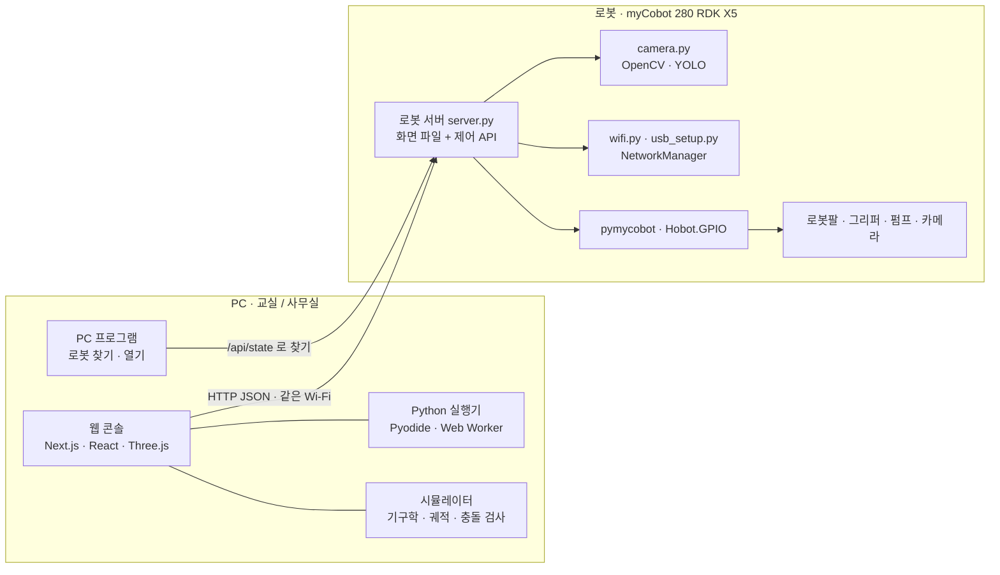
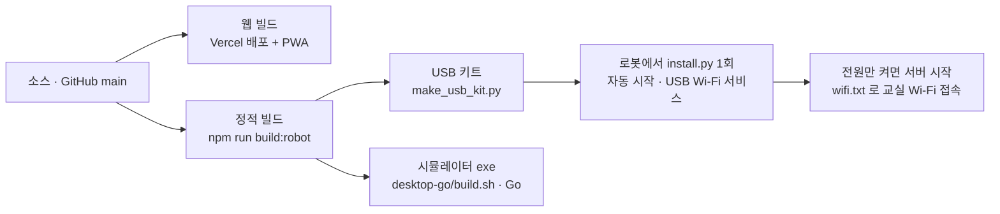
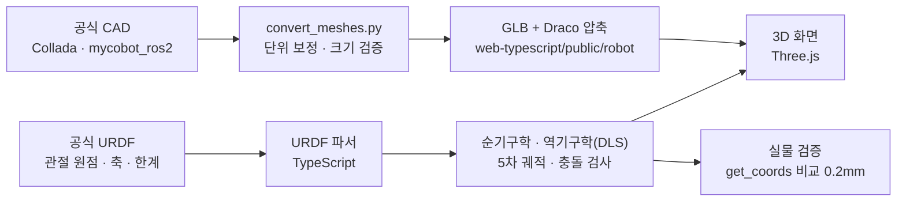
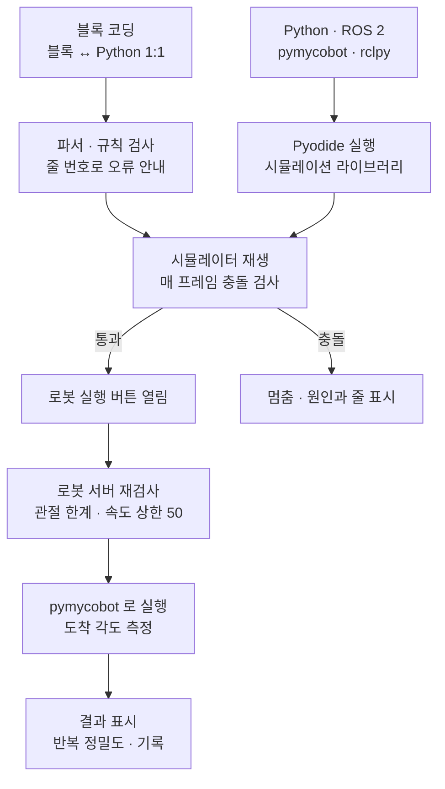
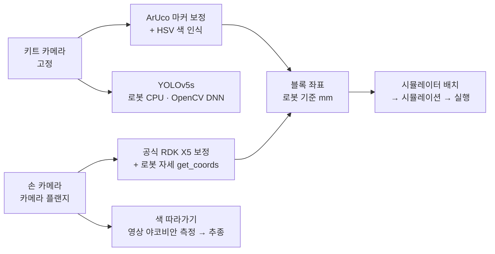
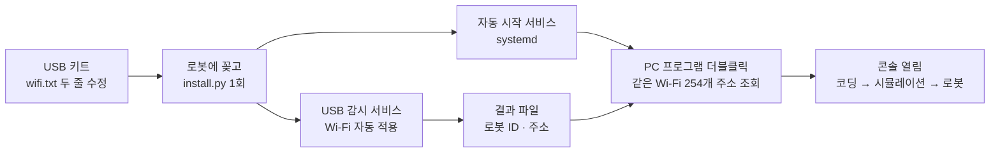
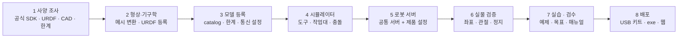

[보고 #14] 시스템 구성과 개발 파이프라인 — Physical AI 학습 프로그램 (myCobot 280 RDK X5)

■ 핵심 요약
 - 화면: 웹 콘솔 하나 (Next.js · React · Three.js). PC 브라우저·설치형 앱·exe 모두 같은 화면
 - 로봇: RDK X5 안에서 Python 서버가 화면 파일과 제어 API 제공 (표준 라이브러리 + pymycobot)
 - 모델링: 제조사 공식 CAD·URDF 를 그대로 변환. 실물 좌표와 0.2mm 일치 확인
 - 안전: 시뮬레이션(충돌 검사)을 통과한 동작만 로봇으로, 로봇 서버가 한 번 더 검사

■ 1. 전체 아키텍처
 PC 는 화면과 계산(3D·충돌 검사·Python 실행)을, 로봇은 실제 동작·카메라·네트워크를 맡음. 둘은 같은 Wi-Fi 에서 HTTP(JSON)로만 통신.
 로봇이 제공한 화면으로 열면 "로봇 모드", 웹·앱·exe 로 열면 "시뮬레이터 모드" (같은 코드)

 배포 경로 3가지: 웹(인터넷), USB 키트(로봇), exe(로봇·인터넷 없이 시연)

■ 2. 개발 과정 (2026-08-24 ~ 10-01, 단계마다 보고서)
 1) 통신 확인 — 공식 SDK(pymycobot 4.0.6) 프로토콜을 TypeScript 로 옮겨 브라우저에서 제어 (보고 #1)
 2) 디지털 트윈 — 공식 URDF 파서, 순·역기구학, 관절 한계 단일화, 3D 뷰어 (#2)
 3) 구조 결정 — 로봇 안 서버 + PC 브라우저 접속, 교육 흐름·커리큘럼 초안 (#3~5)
 4) 교육 콘솔 — 공식 3D 모델·엔드이펙터 8종, 블록 코딩, 시뮬레이터 + 충돌 검사, AI 키트 재현 (#6~7)
 5) 실물 검증·로봇 연결 — 좌표 0.2mm 일치·관절 정확도 확인 → 로봇 서버, 실제 실행, 검수 7종 (#8~9)
 6) 수준별 3단계·현장 세팅 — 블록 / Python(Pyodide) / ROS 2, PC 앱, 자동 시작, USB Wi-Fi, PC 프로그램 (#10~11)
 7) 확장 — myAGV 시뮬레이터·서버, 손 카메라 색 따라가기, 시뮬레이터 exe (#12)
 8) 검수 대응 — 카메라 2대, 손 카메라 공식 보정, 로봇 안 YOLO, 검수 준비 점검·결과표 (#13)

■ 3. 핵심 파이프라인
 3-1. 모델링 — 공식 자료에서 시뮬레이터까지

 3-2. 프로그램 실행 — 코드에서 실제 로봇까지
 안전 장치: 화면 연결 3초 끊기면 정지, 조그 신호 1초 끊기면 정지, Esc·스페이스 즉시 정지

 3-3. 비전 — 카메라에서 동작까지
 색 인식은 공식 AI 키트 코드와 같은 수치를 브라우저(TypeScript)와 로봇(OpenCV) 양쪽에 구현, 같은 영상에서 0.5mm 안 일치

 3-4. 현장 세팅 — USB 하나로 수업 준비

■ 4. 기능별 구현
 기능          구현 방식                                                              위치
 3D 화면       Three.js(React Three Fiber), 공식 GLB                                   web-typescript/src/ui/simulator/stage/Stage.tsx
 기구학        URDF 순기구학, 수치 역기구학(감쇠 최소자승), 받침대 높이 반영              web-typescript/src/engine/robot/
 시뮬레이터    5차 최소저크 궤적, 매 프레임 충돌 검사, 집기·흡착·낙하 규칙               web-typescript/src/engine/simulator/sim.ts
 블록 코딩     자체 블록 에디터, 블록 ↔ Python 부분집합 1:1 변환                        BlockEditor.tsx · program.ts
 Python·ROS 2  Pyodide(Web Worker), pymycobot·rclpy·Hobot.GPIO 시뮬레이션 모듈           web-typescript/src/engine/python/
 실시간 조그   시뮬: 매 프레임 / 로봇: 목표 스트리밍·펌웨어 연속 조그 + 유지 신호        Console.tsx · server.py
 로봇 서버     Python 표준 HTTP 서버 + pymycobot (실행·조그·영점·그리퍼·펌프·카메라)    robot-python/server/server.py
 비전          OpenCV(ArUco·HSV), 공식 손 카메라 보정, YOLOv5s(OpenCV DNN)              camera.py · engine/vision/
 네트워크      USB wifi.txt 감시 → NetworkManager(nmcli), 실패 시 이전 연결 복구        wifi.py · usb_setup.py
 로봇 찾기     단일 HTML PC 프로그램, 같은 대역 254개 주소 병렬 조회                      web-typescript/public/pc/
 오프라인      로봇 내장 웹 · 서비스 워커(PWA) · Go exe 에 정적 빌드 내장               tools/build/gen-sw.mjs · desktop-go/
 myAGV         메카넘 주행·2D 라이다·직진 보정 시뮬레이터 + 전용 서버                     engine/agv/ · agv_server.py

■ 5. 품질 검증
 - 자동 단위 시험(npm run check): 프로토콜·통신·기구학·콘솔(공식 키트 대조)·실습 예제 전부·Python·myAGV·색 따라가기
 - 브라우저 동작 시험(Playwright): 시뮬레이터 53, 로봇(데모 서버) 29, 화면 5개 크기 가림·잘림, 검수 기능 10
 - 실물 점검(robot-python/checks): 좌표·관절·정지·서보, 펌프·네트워크, 콘솔 [검수 준비 점검]

■ 6. 신규 제품 추가 파이프라인
 새 로봇은 같은 콘솔에 "모델"로 추가. 공통부(화면·시뮬레이터·서버)는 재사용, 제품별(형상·기구학·통신·도구·실습)만 채움. myAGV 가 이 순서로 추가됨

 1) 사양 조사 — 공식 SDK 명령·통신 속도·관절 한계, 공식 URDF·CAD, 교육 자료 (출처는 코드 주석에)
 2) 형상·기구학 — convert_meshes.py 에 제품 프로필 → GLB(Draco) → web-typescript/public/robot/<제품>/, URDF 등록
 3) 모델 등록 — engine/robot/catalog.ts (시작 화면), 관절 한계·통신 방식(로봇 내장 서버 / USB)
 4) 시뮬레이터 — 엔드이펙터·작업대·충돌 규칙. 팔은 기존 재사용, 이동 로봇은 전용(myAGV 예)
 5) 로봇 서버 — 같은 계열 팔은 server.py 제품 설정(포트·속도·한계·펌프 핀)만 교체, 다른 종류는 전용 서버(agv_server.py 예)
 6) 실물 검증 — 로봇 안 점검 스크립트로 화면 좌표 = 로봇 좌표, 관절 정확도·정지 거리 → 보고서
 7) 실습·검수 — 수준별 예제(블록·Python·ROS 2)와 목표, 검수 항목, 매뉴얼
 8) 배포 — npm run check·동작 시험 통과 → USB 키트·exe·웹
 다음 후보: myCobot 280 Pi(2·3·5 단계 대부분 재사용) → myCobot 280 Arduino(USB 직결, Web Serial 재사용) → 다른 팔

■ 7. 저장소 구조
 web-typescript/    웹 콘솔 (ui/simulator 화면 · engine/robot 기구학 · engine/simulator 시뮬레이터·실습 · engine/python Python · engine/vision · public/robot 모델 · tests)
 robot-python/      로봇 코드 (server 서버·카메라·Wi-Fi·자동 시작·myAGV · usb-kit 설치 · checks 점검 · tools 변환·빌드)
 desktop-go/        시뮬레이터 exe (Go)
 content-markdown/  교육 원고 (앱이 읽는 md)
 manuals/           사용 설명서
 docs/              보고서 #1~14
