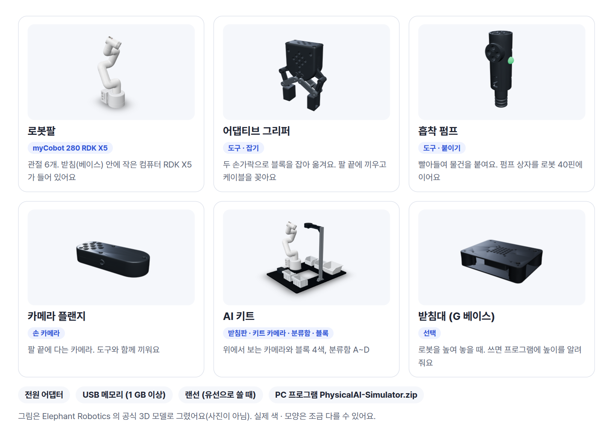
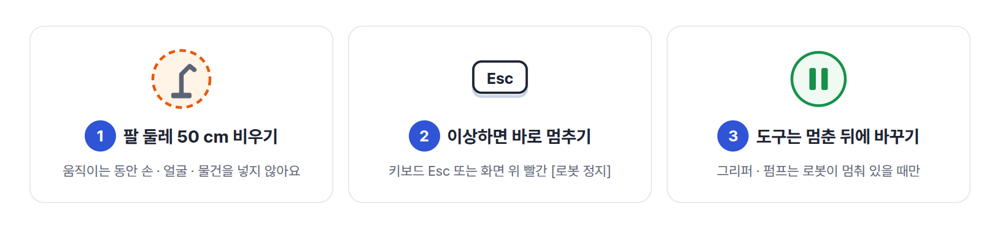
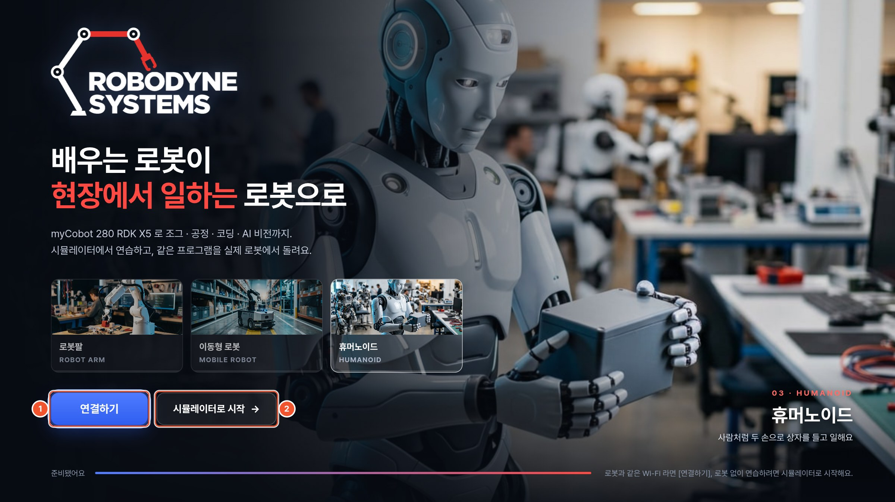
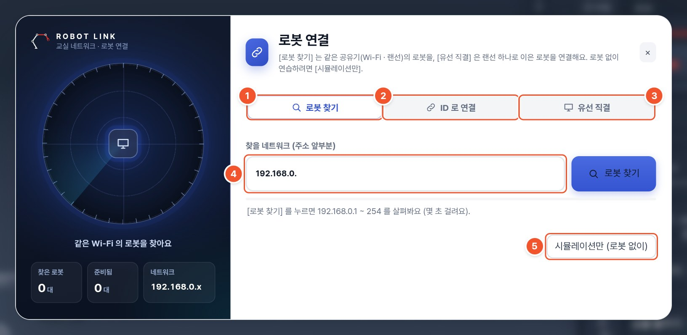
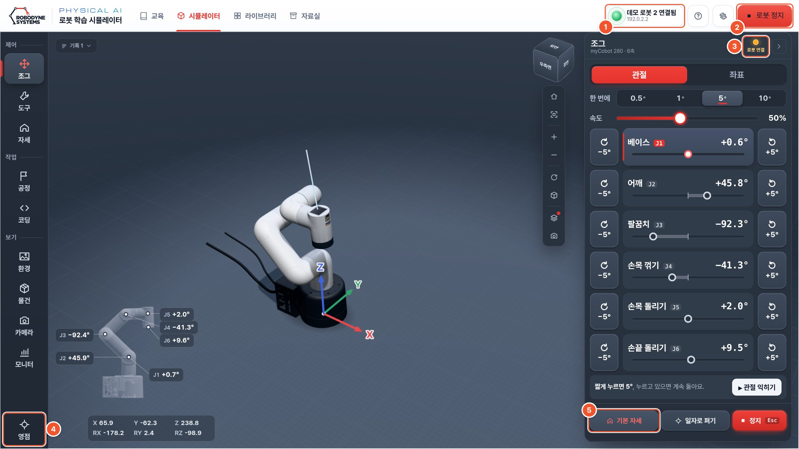
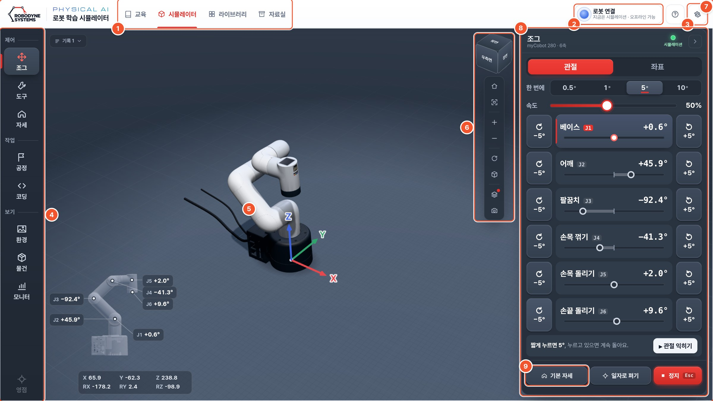

# 구성품과 안전

## 무엇이 있나요

| 이름 | 하는 일 |
| --- | --- |
| 로봇팔 | 관절 6개로 움직이는 팔. 받침 안에 작은 컴퓨터가 있어요 |
| 어댑티브 그리퍼 | 두 손가락으로 블록을 잡아요 |
| 흡착 펌프 | 빨아들여 블록을 붙여요 |
| 카메라 플랜지 | 팔 끝에 다는 손 카메라 |
| AI 키트 | 위에서 보는 카메라, 블록 4색, 분류함 |
| PC 프로그램 | 화면 속 3D 로봇으로 연습하고, 실제 로봇을 움직여요 |

## 안전 약속 세 가지

::: step 팔 둘레 50 cm 비우기
로봇이 움직이는 동안 손 · 얼굴 · 물건을 팔 가까이 두지 않아요.
:::

::: step 이상하면 바로 멈추기
키보드 **Esc** 나 화면 위 빨간 **[로봇 정지]** 를 눌러요. 누구든 눌러도 돼요.
:::

::: step 도구는 멈춘 뒤에 바꾸기
그리퍼 · 펌프는 로봇이 멈춰 있을 때만 바꿔 끼워요. 케이블은 선생님과 함께 꽂아요.
:::

# 로봇 켜기

로봇 설치는 선생님이 미리 해 둡니다. 학생은 켜고 기다리기만 하면 돼요.

::: step 자리 확인
로봇 둘레 50 cm 가 비었는지 봐요. 로봇 받침에 붙은 **로봇 ID 스티커**(예: 107)를 확인해요.
:::

::: step 전원 켜기
전원을 켜고 **1~2분** 기다려요. 로봇 안의 컴퓨터가 켜지는 시간이에요.
:::

::: step 도구 확인
선생님이 말한 도구(그리퍼 또는 흡착 펌프)가 끼워져 있는지 봐요.
:::

> 주의: 처음 보는 경고가 나오거나 로봇이 이상하게 움직이면 바로 **Esc** 를 누르고 선생님께 알려요.

# 프로그램 켜기 · 끄기

::: step 켜기
바탕화면의 **Physical AI 시뮬레이터** 를 더블클릭해요. 검은 창이 뜨고 잠시 뒤 프로그램 창이 열려요.
:::

::: step 시작 화면에서 고르기
로봇과 함께 하면 **① [CONNECT · 로봇 연결하기]**, 로봇 없이 연습하면 **② [SIMULATOR · 시뮬레이터로 시작]** 을 눌러요.
:::

{w=84}

::: step 끄기
프로그램 창을 닫고, 뒤의 **검은 창**도 닫아요. 쓰는 동안에는 검은 창을 닫지 않아요.
:::

# 로봇과 연결하기

선생님이 알려 준 방법으로 연결해요. 보통은 ① 입니다.

## ① 목록에서 내 로봇 고르기

{w=84}

::: step [로봇 찾기]
[CONNECT] (또는 3D 화면 왼쪽 위 [ROBOT LINK])를 누르고 **[로봇 찾기]** 를 눌러요. 몇 초 뒤 로봇 목록이 나와요.
:::

::: step [움직여 확인]
우리 조 이름이나 로봇 ID 가 보이면 **[움직여 확인]** 을 눌러요. 우리 로봇이 천천히 일자로 펴지면 맞아요.
:::

::: step [연결]
**[연결]** 을 누르면 윗줄에 "로봇 107 연결됨" 이 나와요.
:::

## ② 로봇 ID 로 연결

목록에 없으면 **[ID 로 연결]** 탭에서 로봇 ID 숫자만 넣고 [연결] 을 눌러요.

![[ID 로 연결]](img/c-id.jpg){w=72}

## ③ 랜선 하나로 연결 (유선 직결)

PC 와 로봇이 랜선 하나로 이어져 있으면 **[유선 직결]** 탭 → **[유선 직결로 연결]** 을 눌러요. 안 되면 30초 기다렸다 다시 눌러요.

![[유선 직결]](img/c-direct.jpg){w=72}

## 연결됐는지 확인

::: marks
1. **연결 표시** — 초록 불과 "로봇 107 연결됨". 우리 로봇 ID 인지 봐요.
2. **[로봇 정지]** — 실제 로봇을 바로 멈춰요. **Esc** 와 같아요.
3. **상태 불** — 누르고 [연결 확인] 을 누르면 로봇이 천천히 일자로 펴져요.
4. **[영점]** — 선생님만 써요.
5. **[기본 자세]** — 눌러서 실제 팔과 화면의 팔이 같은 모양인지 봐요. 다르면 선생님께.
:::

::: newpage

# 화면 둘러보기

::: marks
1. **화면 탭** — [교육] [시뮬레이터] [라이브러리] [자료실]. 오늘은 [시뮬레이터].
2. **[로봇 연결]** — 로봇과 연결해요(4장).
3. **? · ⚙** — 도움말과 설정.
4. **왼쪽 메뉴** — 오늘은 맨 위 묶음의 [제어] [도구] [자세] 를 써요.
5. **3D 화면** — 화면 속 로봇.
6. **보기 도구** — 처음 시점, 확대 · 축소.
7. **작은 로봇** — 관절 각도와 손끝 위치 숫자.
8. **작업 패널** — 왼쪽 메뉴에서 고른 화면.
9. **[기본 자세] [일자로 펴기] [정지]** — 늘 맨 아래에 있어요.
:::

## 3D 화면 돌려 보기

| 마우스 | 하는 일 |
| --- | --- |
| 왼쪽 버튼 끌기 | 돌려 보기 |
| 휠 굴리기 | 확대 · 축소 |
| 오른쪽 버튼 끌기 | 옮기기 |

> 팁: 로봇이 화면에서 사라지면 오른쪽 도구 막대의 **처음 시점**(집 모양)을 눌러요.

# 기초 조작 — 버튼으로 움직이기

먼저 로봇 없이 화면에서 해 보고, 선생님이 허락하면 같은 버튼으로 실제 로봇을 움직여요.
로봇에 연결되어 있으면 이 버튼들은 **실제 로봇도** 움직여요.

## 관절 하나씩 — [제어] → [관절]

::: cols
![[제어] → [관절]](img/s-jog.png)
+++
- [−5°] [+5°] 를 짧게 누르면 조금, **누르고 있으면 계속** 돌아요.
- 베이스 J1 은 몸통, 어깨 J2 · 팔꿈치 J3 는 팔, J4 · J5 · J6 은 손목과 손끝이에요.
- [속도] 막대로 빠르기를 정해요. 실제 로봇은 30% 쯤에서 시작해요.
- [▸ 관절 익히기] 를 누르면 여섯 관절을 하나씩 안내해 줘요.
:::

## 손끝 옮기기 — [제어] → [좌표]

::: cols
![[제어] → [좌표]](img/s-jog-xyz.png)
+++
- 십자 버튼: 로봇에서 본 앞 · 뒤 · 왼쪽 · 오른쪽.
- [위] · [아래]: 손끝 높이. Z 숫자가 바뀌어요.
- 손 방향이 헷갈리면 [손 아래로].
- 팔이 닿지 않는 곳이면 움직이지 않고 이유를 알려 줘요.
:::

## 자세 저장 — [자세]

![[자세]](img/s-poses.png){w=60}

- [지금 자세 저장하기] 로 저장하고, [이 자세로] 로 다시 가요.
- [기본 자세] 는 시작 자세예요. 헷갈리면 여기로 돌아와요.

## 도구 — [도구]

::: cols
![[도구]](img/s-tools.png)
+++
- 실제로 끼운 도구와 **같은 것**을 골라요.
- 그리퍼: [열기] · [닫기].
- 흡착 펌프: [흡착 켜기] · [흡착 끄기].
- 화면 도구와 실제 도구가 다르다는 안내가 나오면 선생님께 알려요.
:::

## 따라 하기 다섯 가지

하나 끝날 때마다 □ 에 표시해요.

| | 할 일 | 확인 |
| --- | --- | --- |
| □ | **멈추기** — [기본 자세] 를 누르고 팔이 움직이는 동안 **Esc** 로 멈추기 | 팔이 바로 멈췄나요? |
| □ | **관절 여섯 개** — J1 부터 J6 까지 하나씩 [+5°] 를 누르고 있기 | 어디가 도는지 말할 수 있나요? |
| □ | **손끝 옮기기** — [좌표] 에서 [아래] 로 손끝 내리기, 앞 · 왼쪽으로 옮기기 | Z 숫자가 줄었나요? |
| □ | **자세 저장** — 자세 저장 → [기본 자세] → [이 자세로] | 저장한 자세로 돌아왔나요? |
| □ | **블록 옮기기** — [환경] 에서 [책상에 매트와 블록 놓기], 그리퍼로 블록 하나를 집어 옆으로 옮기기 | 블록이 떨어지지 않았나요? |

::: step 블록 옮기기 순서
[도구] 에서 그리퍼 → [열기]. [좌표] 로 블록 바로 위까지 내리기 → [닫기].
[위] 로 들어 올리기 → 옆으로 옮기기 → 내려서 [열기] → [기본 자세].
:::

# 끄기 · 이럴 땐 선생님께

## 끄는 순서

::: step 기본 자세
[기본 자세] 를 눌러요.
:::

::: step 프로그램 닫기
프로그램 창과 검은 창을 닫아요.
:::

::: step 정리
선생님이 말하면 로봇 전원을 끄고, 블록과 도구를 제자리에 둬요.
:::

## 이럴 땐 선생님께

| 이럴 때 | 먼저 해 볼 것 |
| --- | --- |
| 목록에 우리 로봇이 없어요 | 1~2분 기다리고 [로봇 찾기]. 그래도 없으면 선생님께 |
| "다른 PC 가 이 로봇을 움직이는 중이에요" | 우리 조 로봇 담당이 누구인지 확인. 15초 뒤 다시 |
| 실제 팔과 화면의 팔 모양이 달라요 | 움직이지 말고 선생님께 (영점이 틀어졌을 수 있어요) |
| 팔이 움직이지 않고 "부딪혀요" · "책상에 닿아요" | 알림이 말한 쪽으로 돌리거나 [기본 자세] |
| 이상한 소리 · 냄새 · 처음 보는 경고 | 바로 **Esc**, 그리고 선생님께 |
