# 구성품과 안전

## 이 매뉴얼로 하는 것

로봇을 처음 받은 날부터 학생이 로봇을 움직이는 첫 시간까지를 다룹니다.
코딩(블록 · Python · ROS 2)과 수업 진행은 다루지 않습니다. 수업은 「교사용 교육 가이드라인」을 봅니다.

| 장 | 내용 | 언제 |
| --- | --- | --- |
| 1 구성품과 안전 | 상자에 든 것, 포트와 케이블, 안전 약속 | 처음 |
| 2 로봇 설치 | 놓기 · 전원 · 도구, USB 로 처음 설치, 영점 | 학기 전, 로봇마다 한 번 |
| 3 프로그램 설치 | PC 프로그램 풀기 · 켜기 · 나눠 주기 | 학기 전, PC 마다 한 번 |
| 4 로봇과 연결하기 | 무선(교실 Wi-Fi · 핫스팟) · 유선(공유기 · 직결) | 학기 전 + 교실을 옮길 때 |
| 5 프로그램 사용법 | 화면 둘러보기, 3D 화면, 메뉴, 설정 | 처음 |
| 6 기초 조작 | 멈추기, 관절, 손끝, 자세, 도구 (코딩 없이) | 첫 시간 |
| 7 끄기와 문제 해결 | 끄는 순서, 문제 해결 표, 수업 전 점검표 | 늘 |

- 그림 위의 **빨간 번호**는 그림 아래 설명의 번호와 같습니다.
- `[연결하기]` 처럼 네모 괄호로 쓴 말은 화면의 **버튼 이름**입니다.
- 파란 숫자 카드는 **순서대로 따라 하는 단계**입니다.
- 학생용 매뉴얼은 같은 장 번호에 학생이 할 일만 담았습니다. "학생용 6장 펴세요" 처럼 쓰면 됩니다.

## 구성품

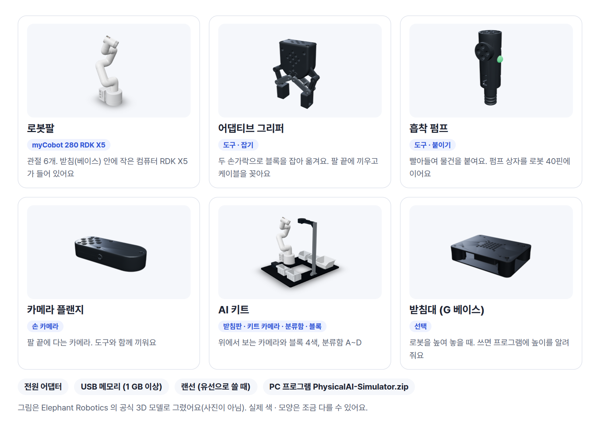

| 구성품 | 하는 일 | 이 매뉴얼 |
| --- | --- | --- |
| 로봇팔 myCobot 280 RDK X5 | 관절 6개(J1~J6)의 로봇팔. 받침 안의 작은 컴퓨터(RDK X5)가 로봇 프로그램을 돌립니다 | 2 · 6장 |
| 어댑티브 그리퍼 | 두 손가락으로 블록을 잡습니다. [열기] · [닫기] | 6장 |
| 흡착 펌프 | 빨아들여 붙입니다. [흡착 켜기] · [흡착 끄기]. 펌프 상자를 로봇에 배선합니다 | 아래 · 6장 |
| 카메라 플랜지 | 팔 끝의 손 카메라. 도구와 함께 끼웁니다 | 2장 |
| AI 키트 | 받침판, 키트 카메라와 거치대, 분류함 A~D, 25 mm 블록 4개 | 2장 |
| 받침대 (G 베이스) | 로봇을 높여 놓을 때 (선택) | 2장 |
| 전원 어댑터 | 로봇과 함께 온 것만 씁니다 | 2장 |
| USB 메모리 | 1 GB 이상. 프로그램이 로봇 설치 · 연결용으로 만들어 줍니다 | 2 · 4장 |
| 랜선 | 유선으로 연결할 때만 (공유기 랜선 · 유선 직결) | 4장 |
| PC 프로그램 | `PhysicalAI-Simulator.zip` — Windows 10/11, 설치 · 인터넷 필요 없음 | 3장 |

> 참고: 공유기는 구성품이 아닙니다. 교실 Wi-Fi 로 쓸 때는 교실 전용 공유기 한 대를 권장합니다(4장).

## 포트와 케이블

로봇 받침의 RDK X5 에 케이블을 꽂습니다. 무엇을 어디에 쓰는지만 기억하면 됩니다.

| 포트 | 꽂는 것 | 언제 |
| --- | --- | --- |
| 전원 | 전원 어댑터 | 늘 |
| USB | 키트 카메라 · 손 카메라, 로봇 USB 메모리 | 늘 · 설치와 Wi-Fi 바꿀 때 |
| USB · HDMI | 키보드 · 마우스 · 모니터 | 처음 설치할 때만 (2장) |
| LAN (랜 포트) | 랜선 — 공유기로, 또는 PC 로 바로 | 유선으로 쓸 때 (4장) |
| 40핀 | 흡착 펌프 상자 | 펌프를 쓸 때 (아래) |

## 흡착 펌프 배선

펌프를 쓸 때만 합니다. 로봇 전원을 끈 채로 꽂습니다.

::: step 40핀에 다섯 줄
펌프 상자의 선을 로봇의 40핀에 꽂습니다. 번호는 보드에 인쇄되어 있습니다.
**5V → 2 · 4번, GND → 6번, G5 → 37번, G2 → 31번.**
공식 RDK X5 비전 키트와 같은 핀 · 순서입니다.
:::

::: step 펌프 상자 전원
펌프 상자의 전원선을 꽂습니다.
설치가 끝나면 2장 「검수 준비 점검」에서 흡착 펌프가 ✓ 인지 봅니다.
:::

## 안전 약속

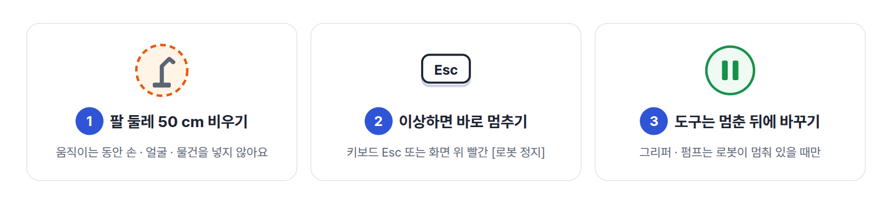

- 로봇이 움직이는 동안 팔이 닿는 반경(약 50 cm) 안에 손 · 얼굴 · 물건을 두지 않습니다.
- 이상하면 누구든 키보드 **Esc** 나 화면 위쪽 빨간 [로봇 정지] 를 누릅니다. 첫 시간 처음에 학생과 함께 연습합니다(6장).
- 그리퍼 · 펌프 같은 도구는 로봇이 멈춰 있을 때만 바꿔 끼웁니다.
- 보관할 때는 [기본 자세] 로 팔을 접고 전원을 끈 뒤, 도구는 따로 상자에 둡니다.

# 로봇 설치

로봇 한 대마다 학기 전에 한 번 합니다.
순서는 놓기 → 카메라 · 도구 → 전원 → USB 만들기 → 로봇에서 설치 → 로봇 ID → 영점입니다.

## 놓기 · 카메라 · 도구 · 전원

::: step 책상과 자리
흔들리지 않는 책상 위, 로봇 둘레 50 cm 가 비는 자리에 둡니다.
AI 키트를 쓰면 로봇을 받침판의 정해진 자리에 고정하고, 분류함이 로봇 앞에 오게 둡니다.
:::

::: step 카메라 먼저 꽂기
키트 카메라(위에서 내려다보는 카메라)의 USB 를 로봇에 꽂습니다. 손 카메라(카메라 플랜지)도 쓰면 함께 꽂습니다.
카메라는 전원을 켜기 **전에** 꽂아 두는 것이 가장 확실합니다.
:::

::: step 도구 끼우기
그리퍼나 흡착 펌프를 팔 끝에 끼웁니다. 그리퍼는 케이블을 팔 끝에 꽂습니다.
:::

::: step 전원 켜기
전원 어댑터를 꽂고 켭니다. 켠 직후 팔은 접힌 "쉬는 자세" 입니다.
처음 1~2분은 로봇 안의 컴퓨터가 켜지는 시간입니다.
:::

> 참고: 받침대(G 베이스) 위에 올렸다면 프로그램에도 알려 줍니다. 왼쪽 메뉴 [도구] 의 [받침대 (G 베이스)] 를 켜고 높이(mm)를 넣습니다. 켜지 않으면 책상 쪽으로 내려가는 동작을 "책상에 닿아요" 로 막습니다.

## 처음 한 번: 로봇 USB 만들기

USB 하나로 로봇 프로그램 설치, 전원을 켜면 저절로 켜지기, 연결 방법 정하기가 한 번에 끝납니다.
압축 풀기 · 메모장 · 터미널이 필요 없습니다. 먼저 3장대로 PC 프로그램을 켜 둡니다.

::: step USB 꽂고 [로봇 USB 만들기]
PC 에 USB 메모리를 꽂고 프로그램 윗줄 **⚙ → [로봇 USB 만들기]** 를 누릅니다. 꽂은 USB 가 저절로 골라집니다.
:::

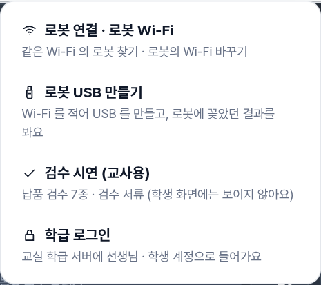{w=50}

::: step 연결 방법 고르기
**[교실 Wi-Fi]** · **[로봇 핫스팟]** · **[유선만 (Wi-Fi 끔)]** 중 하나를 고릅니다. 어느 것인지는 4장 첫 쪽의 표를 봅니다.
교실 Wi-Fi 면 **Wi-Fi 이름**(이 PC 의 Wi-Fi 가 미리 들어 있음)과 **비밀번호**를 적습니다.
**사용자**(선택)는 로봇 목록에 크게 보일 이름입니다(예: 3조).
:::

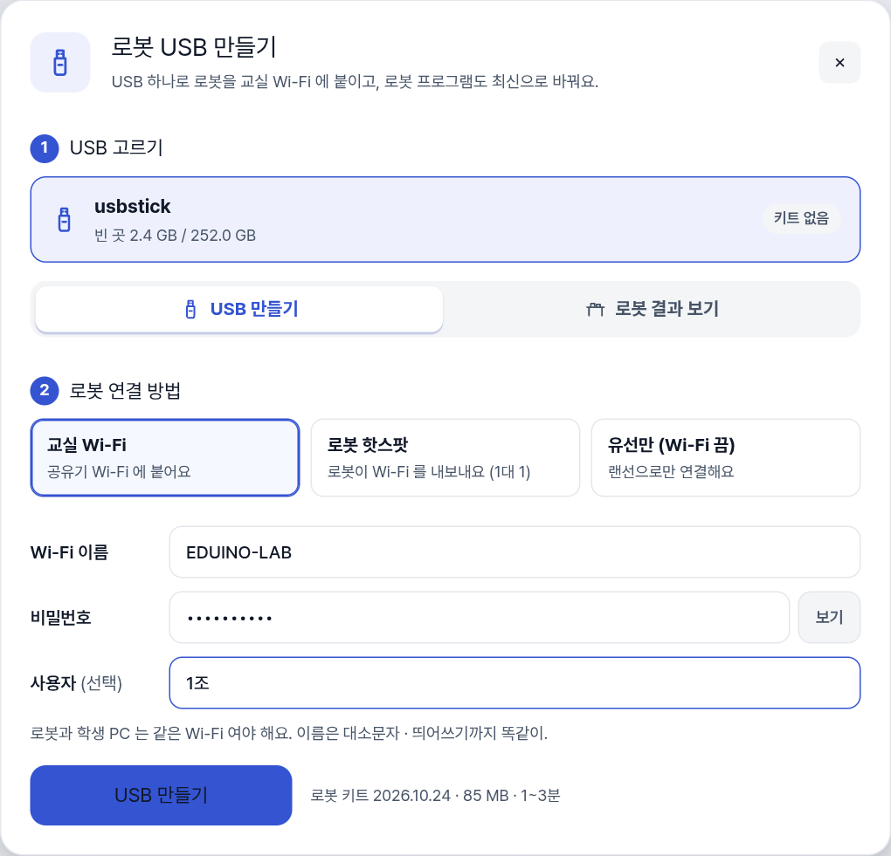{w=78}

::: step [USB 만들기] → [USB 꺼내기]
1~3분 뒤 "USB 를 만들었어요" 가 나오면 [USB 꺼내기] 를 누르고 USB 를 뺍니다.
:::

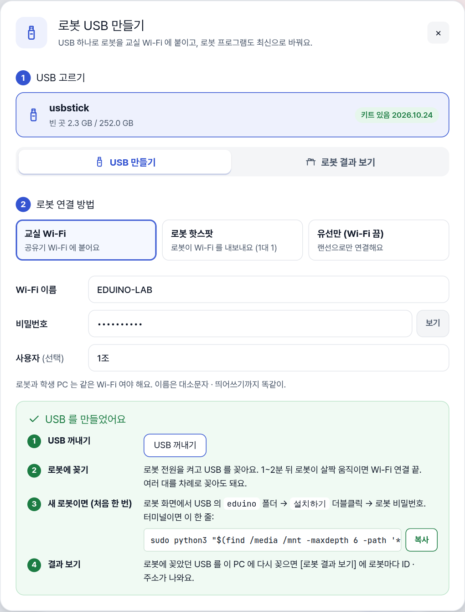{w=78}

## 로봇에서 [설치하기]

새 로봇에 처음 한 번만 합니다. 로봇에 모니터 · 키보드 · 마우스를 붙입니다.

::: step USB 꽂기
로봇 전원을 켜고 1분 뒤 USB 를 꽂습니다. 화면에 USB 창이 열립니다.
:::

::: step `eduino` 폴더의 `설치하기`
`eduino` 폴더에서 **`설치하기`** 를 더블클릭합니다.
"신뢰할 수 없는 실행 파일" 창이 뜨면 [그래도 실행] 을 누릅니다(USB 라서 매번 묻습니다. 정상입니다).
:::

::: step 비밀번호 넣고 기다리기
검은 창이 비밀번호를 물으면 **로봇 계정 비밀번호** + Enter (글자가 안 보이는 것이 정상).
4단계가 차례로 지나가고, 맨 아래에 **로봇 ID** 와 주소가 나오면 끝입니다(약 5분).
연결되면 로봇 밑동이 살짝 돌았다 돌아옵니다.
:::

> 참고: 모니터 없이 SSH 로만 접속할 때는 로봇 터미널에서 `sudo python3 /media/*/eduino/install.py` 한 줄로 설치합니다.

다음부터는 **전원만 켜면** 1~2분 뒤 로봇 프로그램이 저절로 켜지고, USB 에서 고른 방법으로 연결을 기다립니다.

## 로봇 ID 스티커와 결과 보기

로봇에 꽂았던 USB 를 PC 에 다시 꽂고 [로봇 USB 만들기] 를 열면 **[로봇 결과 보기]** 에 로봇마다 결과가 나옵니다.

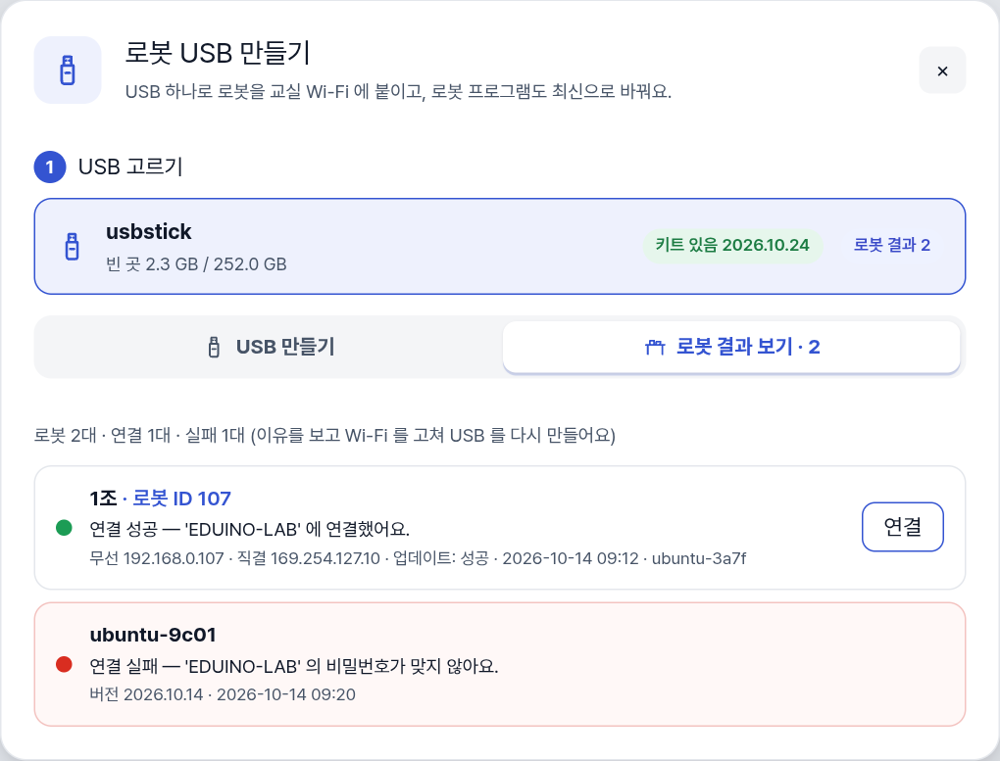{w=78}

- 성공한 로봇은 로봇 ID · 주소와 [연결] 버튼이, 실패한 로봇은 이유(예: 비밀번호가 맞지 않아요)가 보입니다.
- 주소는 종류를 붙여 보여 줍니다. **무선**(Wi-Fi), **유선**(공유기 랜선), **직결**(랜선 하나로 PC 와, 늘 `169.254.127.10`).
- **로봇 ID**(예: 107)는 무선 · 유선 주소의 마지막 숫자입니다. 스티커로 로봇에 붙여 둡니다.
- 한 USB 를 여러 로봇에 차례로 꽂아도 됩니다. 결과는 로봇마다 따로 남습니다.

## 영점 맞추기 — 화면과 실제 팔이 다를 때만

영점은 관절마다 "여기가 0°" 라는 기준입니다. 틀어지면 같은 명령에도 실제 팔이 화면과 다른 자세로 갑니다.
로봇과 연결한 뒤(4장) [기본 자세] 를 눌러 실제 팔과 화면의 3D 팔이 같은 모양인지 봅니다. 다를 때만 합니다.

::: cols
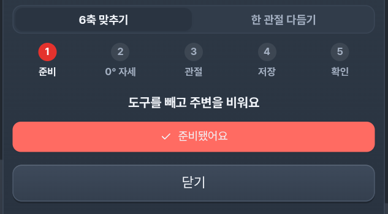
+++
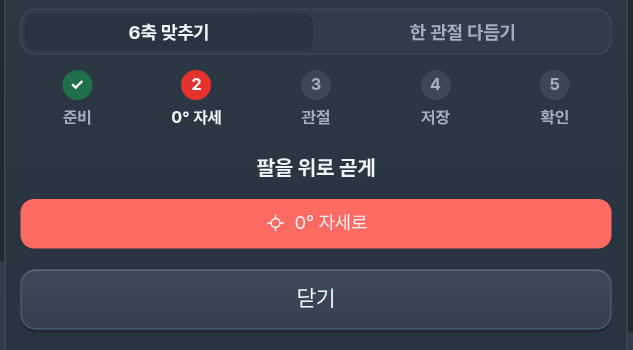
+++
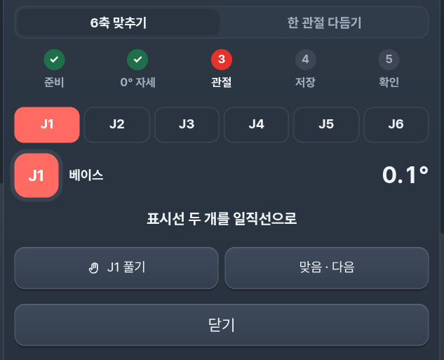
:::

::: step 도구 빼기 · 주변 비우기
왼쪽 메뉴 맨 아래 **[영점]** 을 누릅니다. 도구를 빼고 팔 주변(약 30 cm)을 비운 뒤 [준비됐어요].
:::

::: step [0° 자세로]
팔이 위로 곧게, 표시선이 거의 맞는 자리까지 알아서 갑니다.
:::

::: step J1 → J6 한 관절씩
표시선이 맞으면 [맞음 · 다음]. 어긋났으면 팔을 한 손으로 받치고 [J○ 풀기] → 그 관절만 손으로 돌려 **두 표시선을 일직선**으로 → [고정 · 다음].
나머지 관절은 고정돼 있어 팔이 쓰러지지 않습니다.
:::

::: step [6축 0° 저장] → 확인
저장한 뒤 [기본 자세] 에 갔다가 [0° 자세로] 돌아와, 표시선 여섯 쌍이 다시 맞으면 끝입니다.
:::

> 주의: 표시선을 맞추지 않고 저장하면 그 관절의 모든 동작이 틀어집니다. 한 관절만 조금 다르면 위쪽 [한 관절 다듬기] 에서 [−0.5°] [+0.5°] 로 맞춰 그 관절만 저장합니다.

## 검수 준비 점검 — 한 번에 확인

⚙ → [검수 시연 (교사용)] → [검수 준비 점검] 을 누르면 이 로봇이 갖춘 것이 ✓ · ✗ 로 나옵니다.
로봇팔 연결, 좌표 기준, 손 카메라 기준, 카메라 2대, OpenCV, AI 모델, 흡착 펌프, 그리퍼, ROS 2 입니다.

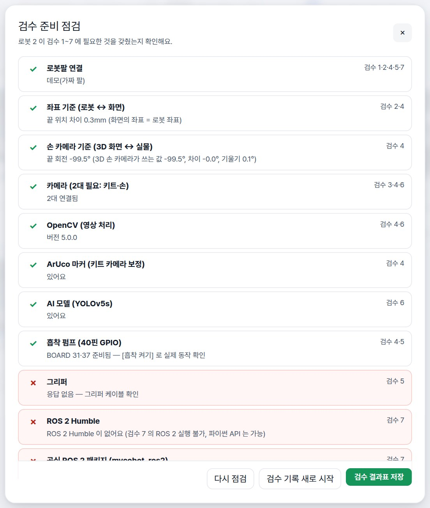{w=62}

- 카메라가 1대뿐이면 두 번째 카메라 USB 를 꽂고 로봇을 다시 켭니다.
- 흡착 펌프가 ✗ 면 위 「흡착 펌프 배선」을, 그리퍼가 ✗ 면 그리퍼 케이블을 봅니다.
- 다 보면 ⚙ → [검수 시연 끝내기] 로 학생 화면으로 돌아옵니다.

# 프로그램 설치

PC 프로그램 하나로 로봇 없이 연습하고(시뮬레이터), 로봇과 연결해 움직입니다. 설치 · 관리자 권한 · 인터넷이 필요 없습니다.

## 압축 풀고 실행하기

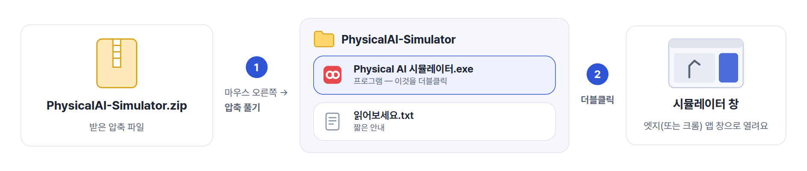

::: step 압축 풀기
`PhysicalAI-Simulator.zip` 을 마우스 오른쪽 버튼으로 누르고 [압축 풀기] 를 고릅니다.
바탕화면이나 문서 폴더처럼 찾기 쉬운 곳에 풉니다. 압축 파일 안에서 바로 실행하지 않습니다.
:::

::: step 프로그램 실행
풀린 폴더의 **Physical AI 시뮬레이터.exe** 를 더블클릭합니다. 검은 창이 하나 뜨고, 잠시 뒤 엣지(또는 크롬) 앱 창으로 프로그램이 열립니다.
:::

::: step 바탕화면에 바로 가기 (선택)
exe 를 마우스 오른쪽 버튼으로 끌어 바탕화면에 놓고 [여기에 바로 가기 만들기] 를 고릅니다.
:::

## 처음 한 번 나오는 Windows 안내

처음 실행할 때 파란 창 **"Windows의 PC 보호"** 가 나오면 [추가 정보] → [실행] 을 누릅니다. 같은 PC 에서는 다시 묻지 않습니다.

![처음 한 번만: [추가 정보] → [실행]](img/d-smartscreen.png)

## 시작 화면

시작 화면이 지나가면 마지막에 두 버튼이 나옵니다. 화면을 한 번 누르면 시작 화면을 건너뜁니다.

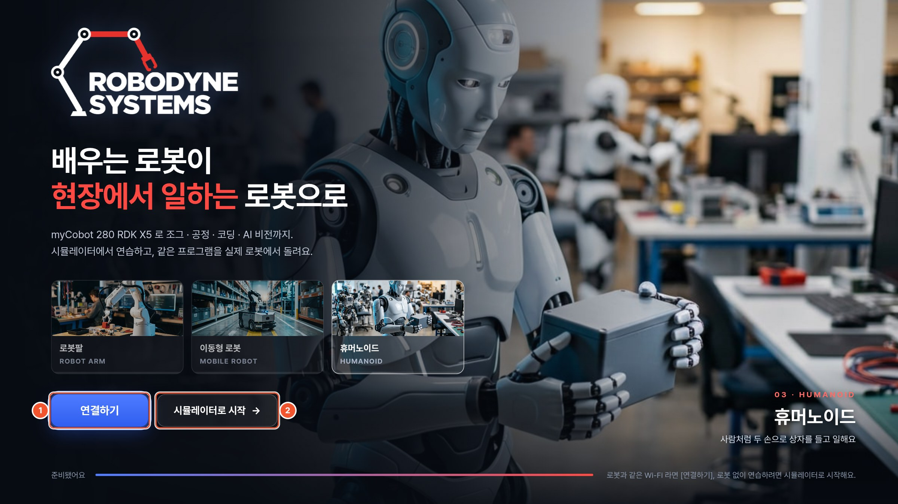{w=84}

::: marks
1. **[연결하기]** — 로봇을 찾아 연결하는 **로봇 연결** 창을 엽니다(4장).
2. **[시뮬레이터로 시작 →]** — 로봇 없이 PC 에서 바로 연습합니다.
:::

## 학생 PC 에 나눠 주기

- 풀린 폴더를 USB 나 공유 폴더로 학생 PC 마다 복사합니다. PC 마다 3장의 순서를 한 번 합니다.
- 프로그램은 같은 것 하나입니다. 학생 PC 에서는 ⚙ 메뉴의 교사용 항목(검수 시연)이 학급 학생 계정으로 들어오면 보이지 않습니다.
- 만든 자세 · 프로그램 · 진도는 그 PC 에 남습니다. 학급 계정을 쓰면 학생마다 따로 남고 선생님 화면에 모입니다(5장).

> 참고: 태블릿(갤럭시 탭 · 아이패드)은 프로그램을 설치하지 않고, 로봇과 같은 Wi-Fi 에서 브라우저 주소창에 `http://로봇주소:8080/console` 을 넣어 엽니다.

## 끄기

프로그램 창을 닫고, 뒤에 떠 있는 **검은 창**도 닫습니다. 검은 창이 프로그램 본체이므로 쓰는 동안에는 닫지 않습니다.

# 로봇과 연결하기

## 우리 교실에 맞는 방식

연결 방식은 네 가지입니다. 2장의 [로봇 USB 만들기] 에서 고른 것과 같습니다.

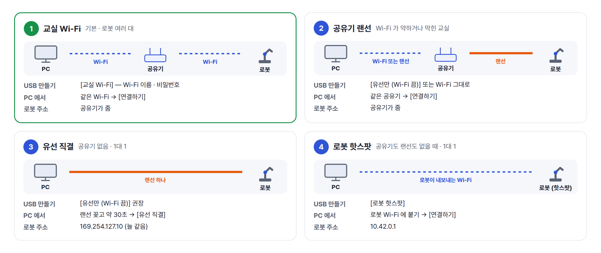

| 우리 교실은 | 방식 | USB 만들기에서 |
| --- | --- | --- |
| 공유기가 있고 로봇 · PC 가 여러 대 | **1 교실 Wi-Fi** (기본) | [교실 Wi-Fi] |
| Wi-Fi 가 약하거나 학교 Wi-Fi 가 기기끼리 막혀 있음 | **2 공유기 랜선** | [유선만 (Wi-Fi 끔)] 또는 Wi-Fi 그대로 |
| 공유기가 없고 PC 한 대와 로봇 한 대 (시연 · 점검) | **3 유선 직결** | [유선만 (Wi-Fi 끔)] 권장 |
| 공유기도 랜선도 없음 | **4 로봇 핫스팟** | [로봇 핫스팟] |

- 한 로봇에 랜선과 Wi-Fi 를 함께 써도 됩니다. 결과 보기와 연결 창에 주소가 무선 · 유선 · 직결로 따로 나옵니다.
- 직결 주소 `169.254.127.10` 은 로봇이 랜 포트에 늘 붙여 두는 주소라, 어느 방식을 골랐든 랜선 하나로 PC 와 이으면 들어갈 수 있습니다.

## 1 교실 Wi-Fi

::: step 공유기 준비
교실 전용 공유기 한 대를 권장합니다. 학교망 · 손님용 Wi-Fi 는 기기끼리 막혀 있는 경우가 많습니다.
2.4 GHz 를 켜 둡니다. 공유기 설정의 "AP 격리 · 게스트 격리" 는 끕니다. 접속할 때 웹 로그인 화면이 뜨는 Wi-Fi 는 쓸 수 없습니다.
:::

::: step USB 에 교실 Wi-Fi
[로봇 USB 만들기] 에서 [교실 Wi-Fi] 를 고르고 Wi-Fi 이름 · 비밀번호를 적어 만듭니다(2장).
켜진 로봇에 꽂으면 20~60초 뒤 로봇이 살짝 움직입니다. 연결된 것입니다.
:::

::: step PC 도 같은 Wi-Fi 로
PC 를 같은 Wi-Fi 에 연결하고 [연결하기] → 내 로봇 [연결] (아래 「연결 창 쓰기」).
:::

> 팁: 공유기에서 로봇마다 고정 IP 를 주면 로봇 ID 가 늘 같습니다. 켤 때 교실 Wi-Fi 를 찾지 못하면 로봇은 약 2분 뒤 스스로 핫스팟(4번 방식)을 켭니다.

## 2 공유기 랜선

::: step 랜선 꽂기
로봇의 랜 포트와 공유기(또는 공유기에 이어진 허브)를 랜선으로 잇습니다.
:::

::: step USB 에 [유선만 (Wi-Fi 끔)]
Wi-Fi 를 쓰지 않으면 [유선만 (Wi-Fi 끔)] 으로 USB 를 만들어 로봇에 꽂습니다. 로봇의 Wi-Fi 가 꺼져 다른 기기와 섞이지 않습니다.
Wi-Fi 도 함께 쓰려면 [교실 Wi-Fi] 그대로 두어도 됩니다.
:::

::: step PC 는 같은 공유기에
PC 를 같은 공유기에 (Wi-Fi 든 랜선이든) 연결하고 [연결하기] → 내 로봇 [연결].
:::

## 3 유선 직결 — 랜선 하나로

공유기 없이 PC 와 로봇을 랜선 하나로 바로 잇습니다. 시연이나 점검, 공유기가 없는 곳에서 씁니다.

![연결 창의 [유선 직결]](img/c-direct.jpg){w=78}

::: step 랜선 하나로 잇기
PC 의 랜 포트와 로봇의 랜 포트를 랜선으로 잇습니다. 노트북에 랜 포트가 없으면 USB 랜 어댑터를 씁니다.
:::

::: step 1분 기다리기
로봇을 켜고 1분쯤 기다립니다. Windows 가 이 연결의 주소를 스스로 잡는 데 약 30초 걸립니다(설정할 것 없음).
:::

::: step [유선 직결로 연결]
[연결하기] → [유선 직결] 탭 → [유선 직결로 연결]. 로봇은 늘 `169.254.127.10` 에 있습니다.
:::

- 안 되면 랜선이 로봇의 랜 포트에 꽂혔는지, PC 의 랜 포트가 학교망 대신 로봇에 이어졌는지 보고 30초 뒤 다시 누릅니다.
- 로봇의 Wi-Fi 는 꺼 두는 것을 권장합니다([유선만 (Wi-Fi 끔)]). 켜 두어도 직결은 됩니다.

## 4 로봇 핫스팟

로봇이 스스로 Wi-Fi 를 내보내고 PC 가 거기에 붙습니다. 로봇 한 대와 PC 한 대에 맞습니다.

::: step USB 에 [로봇 핫스팟]
[로봇 USB 만들기] 에서 [로봇 핫스팟] 을 골라 만들고 로봇에 꽂습니다.
:::

::: step PC 를 로봇 Wi-Fi 에
PC 의 Wi-Fi 목록에서 로봇이 내보내는 Wi-Fi 를 고릅니다. 이름과 비밀번호는 로봇과 함께 온 제조사 안내서에 있습니다.
:::

::: step [연결하기]
[연결하기] → 목록의 로봇 [연결]. 로봇 주소는 `10.42.0.1` 입니다.
:::

> 주의: PC 가 로봇 핫스팟에 붙어 있는 동안 PC 는 인터넷이 되지 않습니다. 프로그램은 인터넷 없이 모두 됩니다.

## 연결 창 쓰기

시작 화면의 [연결하기] 나 윗줄 [로봇 연결] 을 누르면 **로봇 연결** 창이 열립니다.

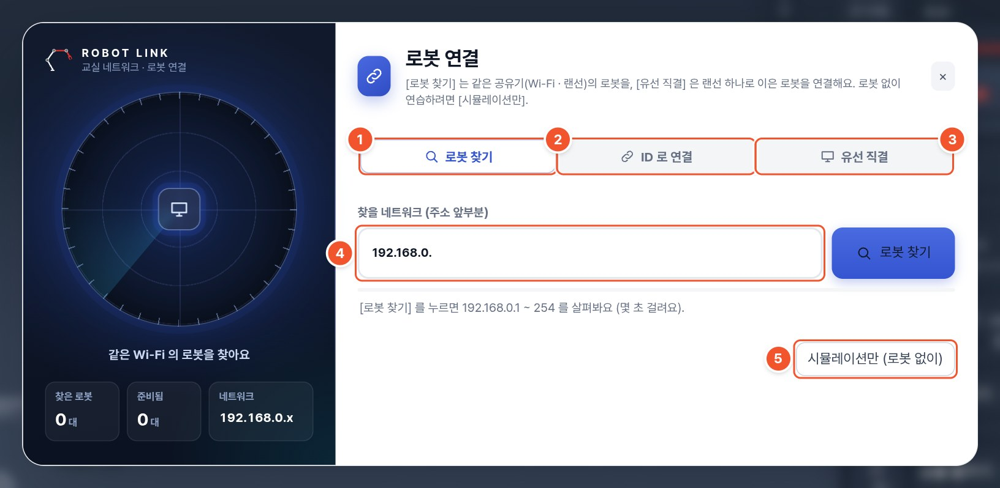{w=84}

::: marks
1. **[로봇 찾기]** — 같은 공유기(Wi-Fi · 랜선)의 로봇을 찾습니다. 몇 초 안에 사용자 이름 · 주소 · 로봇 ID 로 나옵니다.
2. **[ID 로 연결]** — 로봇 ID 숫자(예: 107)만 넣어 연결합니다.
3. **[유선 직결]** — 랜선 하나로 이은 로봇에 연결합니다.
4. **찾을 네트워크** — 교실 공유기 주소의 앞부분(예: 192.168.0.). 처음 한 번 고치면 기억합니다.
5. **[시뮬레이션만 (로봇 없이)]** — 로봇 없이 PC 에서만 연습합니다.
:::

- 목록에서 내 로봇인지 모르겠으면 **[움직여 확인]** — 그 로봇의 몸통이 살짝 돌았다 돌아옵니다. 맞으면 **[연결]**.
- 로봇은 전원을 켜고 1~2분 뒤에 목록에 나옵니다. 사람이 많으면 위 칸에 이름 · ID · 주소를 넣어 거릅니다.
- 로봇을 하나도 못 찾으면 [로봇이 아직 이 Wi-Fi 에 없나요?] 를 눌러 [로봇 USB 만들기] 로 갑니다.

![[ID 로 연결] — 주소 앞부분과 로봇 ID](img/c-id.jpg){w=72}

## 연결된 뒤 확인

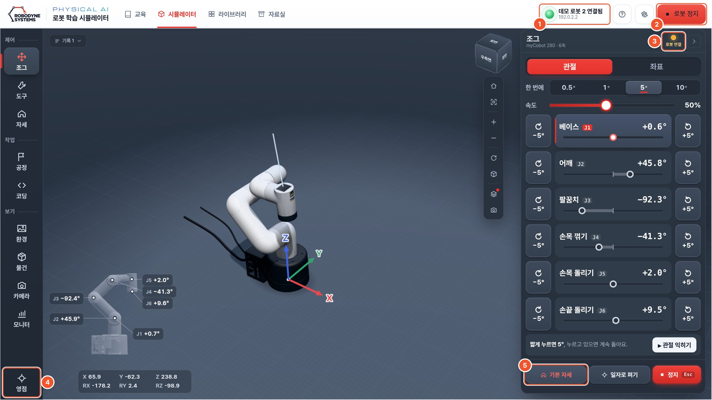

::: marks
1. **연결 표시** — 초록 불과 "로봇 107 연결됨", 그 아래 주소.
2. **[로봇 정지]** — 실제 로봇을 바로 멈춥니다(키보드 **Esc** 도 같음). 로봇에 연결됐을 때만 보입니다.
3. **상태 불** — 누르면 로봇 상태와 [연결 확인] [손으로 움직이기] [영점 맞추기].
4. **[영점]** — 2장 「영점 맞추기」.
5. **[기본 자세]** — 실제 팔과 화면의 팔이 같은 모양이 되는지 봅니다.
:::

::: cols
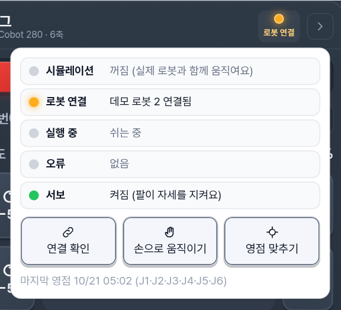
+++
::: step [연결 확인]
상태 불(3)을 누르고 [연결 확인] 을 누릅니다. 로봇 몸통이 살짝 돌았다 돌아오면 이 화면과 이 로봇이 이어진 것입니다.
:::
::: step [기본 자세]
[기본 자세] 를 누르고 실제 팔과 3D 팔이 같은 모양인지 봅니다. 다르면 영점을 맞춥니다.
:::
:::

## Wi-Fi 바꾸기 · 끄기

- **다른 교실로 옮길 때**: [로봇 USB 만들기] 에서 새 Wi-Fi 로 USB 를 다시 만들어 **켜진 로봇**에 꽂습니다. 20~60초 안에 로봇이 살짝 움직이면 됩니다. 터미널이 필요 없습니다.
- **Wi-Fi 를 끌 때**: [유선만 (Wi-Fi 끔)] 으로 만들어 꽂습니다. 다시 켜려면 [교실 Wi-Fi] 나 [로봇 핫스팟] 으로 만들어 꽂습니다.
- **연결된 상태에서**: 로봇 연결 창의 **[로봇 Wi-Fi]** 탭에서 로봇이 붙을 Wi-Fi 를 바꿀 수 있습니다. 바꾸면 화면이 잠깐 끊기고, PC 도 같은 Wi-Fi 로 옮긴 뒤 [로봇 찾기] 로 다시 찾습니다.

![연결 창의 [로봇 Wi-Fi] — 지금 Wi-Fi 와 붙을 수 있는 Wi-Fi](img/r-wifi.jpg){w=72}

> 참고: Windows 가 아닌 PC 에서는 USB 를 손으로 만듭니다. `eduino_usb.zip` 을 풀어 `eduino` 폴더를 USB 맨 위에 복사하고, `eduino/wifi.txt` 를 메모장으로 고칩니다.

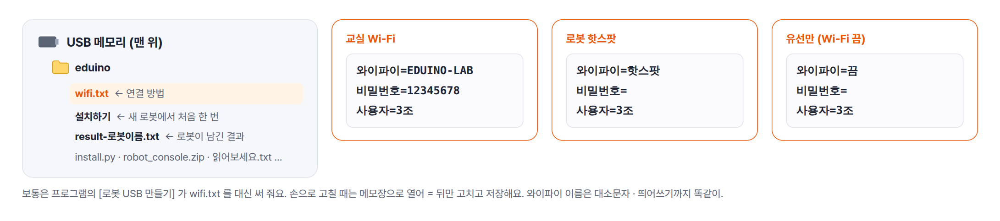

## 여러 대 · 여러 교실

- 한 USB 를 여러 로봇에 차례로 꽂아도 됩니다. 로봇마다 이름을 달리하려면 사용자 칸을 바꿔 다시 만들고 꽂습니다.
- 칠판에 조 · 로봇 ID 표를 적고, 로봇마다 ID 스티커를 붙입니다.
- 같은 로봇은 한 번에 한 PC 만 움직입니다. 다른 PC 가 움직이는 중이면 "다른 PC 가 이 로봇을 움직이는 중이에요" 가 나오고, 그 PC 가 끝내고 15초 뒤 다시 됩니다. 멈추기는 언제나 됩니다.

# 프로그램 사용법

## 한눈에 보기

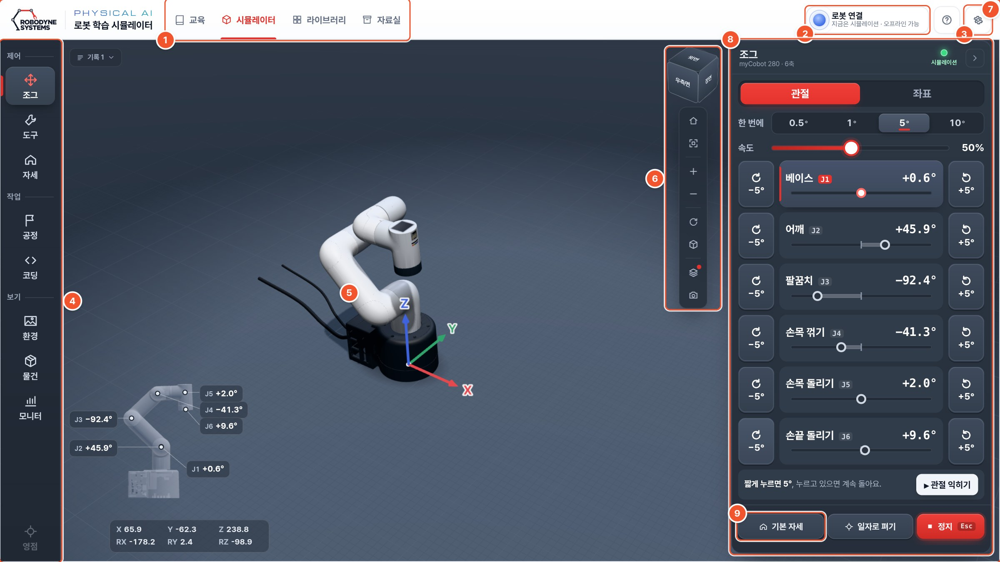

::: marks
1. **화면 탭** — [교육] [시뮬레이터] [라이브러리] [자료실].
2. **[로봇 연결]** — 로봇을 찾아 연결합니다. 연결되면 "로봇 107 연결됨" 으로 바뀝니다.
3. **? · ⚙** — 도움말(화면 · 순서 · 단축키)과 설정 메뉴.
4. **왼쪽 메뉴** — 제어 · 작업 · 보기 세 묶음과 맨 아래 [영점].
5. **3D 화면** — 로봇과 책상. 마우스로 돌리고 확대합니다.
6. **보기 큐브 · 도구 막대** — 보는 방향, 처음 시점, 확대 · 축소.
7. **작은 로봇** — 관절 J1~J6 각도와 손끝 위치 X · Y · Z.
8. **작업 패널** — 왼쪽 메뉴에서 고른 화면 하나.
9. **[기본 자세] [일자로 펴기] [정지]** — 제어 화면 어디서나 맨 아래에 늘 있습니다.
:::

## 위쪽 탭 네 개

| 탭 | 하는 일 |
| --- | --- |
| [교육] | 첫 화면은 산업단지 지도. 로봇 아카데미 28차시, 현장 실습, 로봇 실습 7 (「교사용 교육 가이드라인」) |
| [시뮬레이터] | 3D 로봇을 버튼으로 움직이고(6장), 공정 · 코딩으로 프로그램을 만들어 실제 로봇에서 실행 |
| [라이브러리] | 실습 과제 · 실습 환경 · 도구를 골라 시뮬레이터에 열기 |
| [자료실] | 교재 · 문항지 · 매뉴얼 PDF 내려받기 (이 매뉴얼도 있음) |

## 3D 화면 다루기

::: cols
| 마우스 | 하는 일 |
| --- | --- |
| 왼쪽 버튼 끌기 | 돌려 보기 |
| 휠 굴리기 | 확대 · 축소 |
| 오른쪽 버튼 끌기 | 옮기기 |
+++
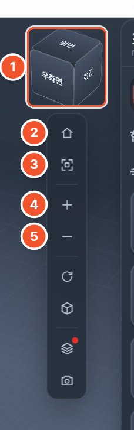{w=34}
:::

::: marks
1. **보기 큐브** — 면(윗면 · 정면 · 우측면)을 누르면 그 방향에서 봅니다.
2. **처음 시점** — 처음 보던 방향과 크기로. 로봇을 잃어버리면 누릅니다.
3. **전체 맞춤** — 로봇과 작업 공간이 꽉 차게.
4. **확대** 5. **축소** (+ − 키)
:::

## 왼쪽 메뉴

| 묶음 | 메뉴 | 하는 일 | 이 매뉴얼 |
| --- | --- | --- | --- |
| 제어 | [조그] [도구] [자세] | 버튼으로 움직이기, 도구 바꾸기, 자세 저장 | 6장 |
| 작업 | [공정] [코딩] | 점을 찍어 순서 만들기, 블록 · Python · ROS 2 | 다루지 않음 |
| 보기 | [환경] [물건] [카메라] [모니터] | 장면 고르기, 물건 놓기, 카메라 화면, 관절 · 손끝 자세히 | 6장 일부 |
| 맨 아래 | [영점] | 로봇에 연결됐을 때 영점 맞추기 | 2장 |

고른 메뉴는 오른쪽 작업 패널에 한 화면으로 열립니다. 같은 메뉴를 다시 누르면 패널이 접혀 3D 가 넓어집니다.
[카메라] 는 카메라가 있을 때(AI 키트 환경, 카메라 플랜지, 실제 로봇의 카메라)만 보입니다.

## 설정 메뉴 ⚙

::: cols
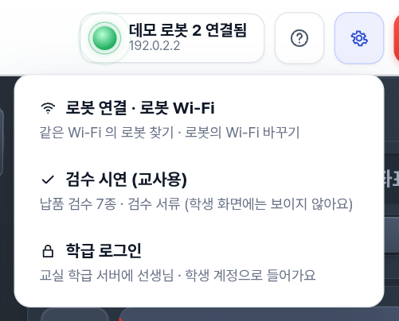
+++
| 항목 | 하는 일 |
| --- | --- |
| 로봇 연결 · 로봇 Wi-Fi | 로봇 연결 창 (4장) |
| 로봇 USB 만들기 | 2 · 4장. PC 프로그램에서만 |
| 검수 시연 (교사용) | 납품 검수 7종 · 검수 준비 점검. 학생 계정 화면에는 없음 |
| 학급 로그인 | 학급 서버에 선생님 · 학생 계정으로 |
:::

## 라이브러리와 자료실

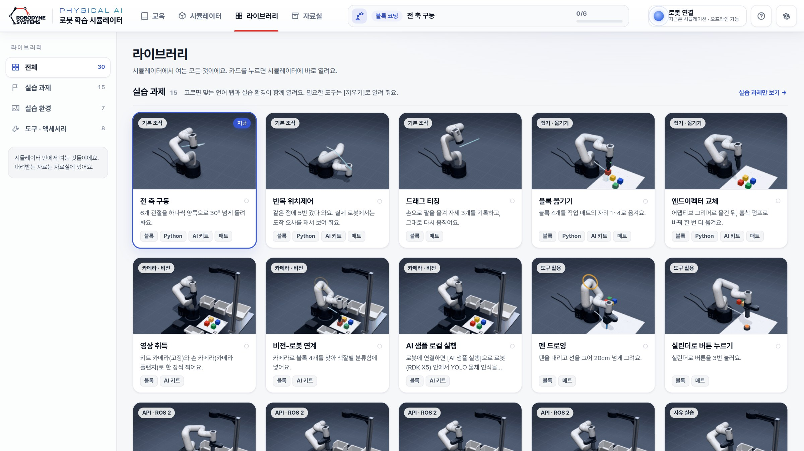

- **라이브러리**: 실습 과제 · 실습 환경(빈 화면 · AI 키트 · 실습 셀 A~E) · 도구 카드. 누르면 시뮬레이터로 돌아가 바로 열립니다.
- **자료실**: 프로그램 안에 든 PDF 를 폴더별로 봅니다. 인터넷 없이 [내려받기] [열기] 가 됩니다. 이 매뉴얼과 학생용 매뉴얼도 **매뉴얼 · 가이드** 폴더에 있습니다.

## 학급 계정 (선택)

- 선생님 PC 에서 `교사용 학급 서버.cmd` 를 더블클릭하면 학급 서버가 켜집니다. 처음 한 번 관리자 계정을 만듭니다.
- 학생은 ⚙ → [학급 로그인] 에서 학급 코드 · 번호 · PIN 으로 들어옵니다. 진도가 선생님의 학급 관리 화면에 모입니다.
- 학생 이름은 서버에 저장하지 않습니다. 번호 ↔ 이름 표는 선생님 PC 의 브라우저에만 둡니다.

# 기초 조작 — 코딩 없이

버튼만으로 로봇을 움직입니다. 먼저 로봇 없이 시뮬레이터에서 익히고, 같은 버튼으로 실제 로봇을 움직입니다.
로봇에 연결되어 있으면 이 장의 버튼은 **실제 로봇도** 움직입니다.

## 먼저 — 멈추는 법

- 키보드 **Esc**, 화면 위 빨간 **[로봇 정지]**, 작업 패널 맨 아래 **[■ 정지]** 는 모두 바로 멈춥니다.
- 첫 시간 처음에 학생과 함께 연습합니다. "멈춰!" 하면 아무나 Esc 를 누르는 놀이로 해도 좋습니다.
- 실제 로봇으로 처음 움직일 때는 [속도] 를 30% 쯤으로 낮춥니다.

::: newpage

## 관절 하나씩 움직이기 — [조그] → [관절]

::: cols
![[조그] → [관절]](img/s-jog.png)
+++
버튼 하나가 관절 하나를 돌립니다. 무엇이 움직일지 바로 알 수 있어 처음 익히기 좋습니다.

| 관절 | 하는 일 |
| --- | --- |
| 베이스 J1 | 몸통 전체를 좌우로 |
| 어깨 J2 | 팔을 앞뒤로 숙이기 |
| 팔꿈치 J3 | 팔 굽히기 |
| 손목 꺾기 J4 | 손목 위아래 |
| 손목 돌리기 J5 | 손목 좌우 |
| 손끝 돌리기 J6 | 도구 돌리기 |

- [−5°] [+5°] 를 짧게 누르면 한 칸, **누르고 있으면 계속** 돕니다. 한 칸은 [한 번에] 에서 고릅니다.
- 막대를 끌어도 됩니다. 키보드 ↑ ↓ 관절 고르기, ← → 돌리기.
- [▸ 관절 익히기] 는 여섯 관절을 하나씩 돌려 보는 짧은 안내입니다.
:::

## 손끝을 곧게 옮기기 — [조그] → [좌표]

::: cols
![[조그] → [좌표]](img/s-jog-xyz.png)
+++
손끝을 어디로 보낼지 정할 때 씁니다. 로봇이 관절 여섯 개를 알아서 함께 돌립니다.

- **십자 버튼**: 로봇에서 본 앞 · 뒤 · 왼쪽 · 오른쪽. 손 방향은 그대로.
- **위 · 아래**: 손끝 높이. 위쪽 X · Y · Z 숫자가 바뀝니다.
- **손 방향**: 손끝 자리는 그대로 두고 손만 기울이거나 돌립니다. 헷갈리면 [손 아래로].
- 키보드: 방향키 · Shift 위 · Space 아래.
- 팔이 닿지 않는 곳은 움직이지 않고 이유를 알려 줍니다.
:::

## 자세 저장 · 기본 자세 · 일자로 펴기 — [자세]

![[자세] — 지금 자세 저장하기와 저장한 자세](img/s-poses.png){w=60}

- **[지금 자세 저장하기]**: 지금 자세를 "내 자세 1" 처럼 저장합니다. **[이 자세로]** 를 누르면 그 자세로 다시 갑니다.
- **[기본 자세]**: 책상을 내려다보는 자세. 무엇을 하든 시작점으로 씁니다.
- **[일자로 펴기]**: 모든 관절을 0° 로. 팔이 위로 곧게 섭니다. 실제 로봇에서는 주변이 비었을 때만 누릅니다.

## 도구 쓰기 — [도구]

::: cols
![[도구] — 지금 달린 도구와 도구 바꾸기](img/s-tools.png)
+++
- 실제로 **끼운 도구와 같은 것**을 고릅니다. 고른 도구의 버튼이 맨 위에 나옵니다.
- 그리퍼: [열기] · [닫기]. 블록을 잡으면 그 자리에서 버팁니다.
- 흡착 펌프: [흡착 켜기] · [흡착 끄기].
- 카메라 플랜지: 손 카메라를 쓰면 켭니다.
- 받침대 (G 베이스): 로봇을 받침대에 올렸으면 켜고 높이를 넣습니다.
- 화면의 도구와 실제 도구가 다르면 "로봇에 그리퍼가 끼워져 있어요" 같은 안내가 나옵니다. 안내의 버튼으로 화면 도구를 맞춥니다.
:::

## 팔이 부딪히는 자세는 막습니다

- 팔이 제 몸이나 받침에 부딪히는 자세가 되면 팔은 그 자리에 멈추고, 어느 관절을 어느 쪽으로 돌리면 되는지 알려 줍니다.
- 팔이 책상에 닿으면 멈추고 "3번 관절 쪽 팔이 책상에 닿아요." 처럼 알려 줍니다.
- 알림대로 반대쪽으로 돌리거나 [기본 자세] 를 눌러 다시 시작합니다.

## 따라 하기 다섯 가지 (학생용 6장과 같음)

::: step 멈추기
[기본 자세] 를 누르고, 팔이 움직이는 동안 **Esc** 를 눌러 멈춰 봅니다.
:::

::: step 관절 여섯 개
[조그] → [관절] 에서 J1 부터 J6 까지 하나씩 [+5°] 를 누르고 있어 봅니다. 어디가 도는지 말로 설명합니다.
:::

::: step 손끝 옮기기
[좌표] 로 바꿔 [아래] 를 눌러 손끝을 내리고, Z 숫자가 줄어드는 것을 봅니다. 앞 · 왼쪽으로도 옮겨 봅니다.
:::

::: step 자세 저장하고 돌아오기
마음에 드는 자세에서 [지금 자세 저장하기] → [기본 자세] → 저장한 자세의 [이 자세로].
:::

::: step 블록 집어 옮기기
[환경] 에서 [책상에 매트와 블록 놓기] 를 켭니다. [도구] 에서 그리퍼를 고르고 [열기].
[좌표] 로 블록 바로 위까지 내려 [닫기] → [위] 로 들어 올리고 → 옆으로 옮겨 내려놓고 [열기].
:::

## 지도 요령

- 첫 시간은 **시뮬레이터에서 먼저**, 손에 익으면 같은 버튼으로 실제 로봇을 움직입니다.
- 선생님 화면을 스크린에 띄우고 다섯 가지를 먼저 보여 준 뒤 조별로 따라 합니다.
- 조마다 **로봇 담당 한 명**이 실제 로봇을 움직이고, 나머지는 같은 화면을 시뮬레이터로 따라 합니다. 담당은 활동마다 바꿉니다.
- 로봇 둘레 50 cm 는 늘 비웁니다. 실제 로봇은 속도 30% 쯤에서 시작합니다.

# 끄기와 문제 해결

## 끄는 순서

::: step 기본 자세
[기본 자세] 를 눌러 팔을 접힌 자세 가까이 둡니다.
:::

::: step 프로그램 닫기
프로그램 창과 뒤의 검은 창을 닫습니다.
:::

::: step 로봇 전원 끄기
로봇 전원을 끄고, 도구 · 블록 · 카메라를 정리합니다.
:::

## 문제가 생기면 — 연결

| 이럴 때 | 이렇게 |
| --- | --- |
| 로봇 목록에 내 로봇이 없다 | 전원을 켜고 1~2분 기다린 뒤 [로봇 찾기]. PC 와 로봇이 같은 공유기인지. [ID 로 연결] 에 로봇 ID |
| 교실 Wi-Fi 에 안 붙는다 | 결과 보기의 이유를 봅니다(비밀번호 등). 2.4 GHz · AP 격리 끄기 · 웹 로그인 없는 Wi-Fi 인지. 로봇은 약 2분 뒤 핫스팟으로 돌아갑니다 |
| [유선 직결] 이 안 된다 | 랜선이 로봇의 랜 포트에 꽂혔는지, PC 랜 포트가 로봇에 이어졌는지. 꽂고 30초 뒤 다시 |
| 공유기 랜선인데 못 찾는다 | PC 가 같은 공유기인지, 찾을 네트워크(주소 앞부분)가 맞는지. 결과 보기의 "유선" 주소로 [ID 로 연결] |
| "로봇 서버와 연결이 끊겼어요" | 로봇 전원 · 케이블 · Wi-Fi. 화면이 스스로 다시 시도합니다 |
| "다른 PC 가 이 로봇을 움직이는 중이에요" | 그 PC 가 끝내고 15초 뒤 다시 됩니다. 조마다 로봇 담당 한 명만 |
| Wi-Fi 를 다시 켜고 싶다 | [교실 Wi-Fi] 나 [로봇 핫스팟] 으로 USB 를 만들어 켜진 로봇에 꽂기 |

## 문제가 생기면 — 팔 · 도구 · 프로그램

| 이럴 때 | 이렇게 |
| --- | --- |
| "로봇 팔이 대답하지 않아요" | 팔 전원 · 케이블을 보고 [다시 연결] |
| 실제 팔이 화면과 다른 자세로 간다 | 2장 「영점 맞추기」 |
| "책상에 닿아요" 로 움직이지 않는다 | 받침대 위라면 [받침대 (G 베이스)] 를 켜고 높이. 아니면 더 높은 자세로 |
| 흡착 펌프가 안 된다 | 빨간 안내의 이유. 배선 5V → 2 · 4, GND → 6, G5 → 37, G2 → 31 |
| "로봇에 그리퍼가 끼워져 있어요" | 화면 도구와 실제 도구가 다릅니다. 안내의 버튼을 누르거나 실제 도구를 바꿔 끼우기 |
| 카메라가 1대만 보인다 | 두 번째 카메라를 꽂고 로봇을 다시 켜기 |
| exe 를 눌러도 안 열린다 | 압축을 푼 폴더에서 실행했는지. 엣지 또는 크롬이 있어야 합니다 |
| 3D 로봇이 안 보이거나 느리다 | F5 로 새로고침. 다른 프로그램을 닫기 |
| 화면에서 로봇을 잃어버렸다 | 도구 막대의 [처음 시점] |

## 수업 전 점검표

| 언제 | 확인할 것 |
| --- | --- |
| 학기 전 | 로봇마다 USB 설치 · 연결 방식 · 로봇 ID 스티커 · 영점 · 검수 준비 점검 |
| 학기 전 | 학생 PC 마다 프로그램이 열리고 [연결하기] 로 로봇이 찾아지는지 |
| 로봇 쓰는 날 | 전원 · 공유기(또는 랜선) · 로봇 둘레 50 cm 비우기 · 도구와 블록 |
| 수업 직전 | 선생님 화면을 스크린에 · 정지 약속 연습 · 속도 30% |
| 수업 끝 | [기본 자세] → 프로그램 닫기 → 로봇 전원 끄기 · 정리 |
