# 이 자료로 하는 것

## 네 부분으로 나뉩니다

| 부분 | 장 | 누가 · 언제 | 끝나면 |
| --- | --- | --- | --- |
| 로봇 기본 세팅 | 2장 | 선생님 · 학기 전 한 번 (로봇 한 대에 약 20분) | 로봇이 교실 Wi-Fi 에 붙고, PC 에서 로봇이 열립니다 |
| 간단 조작 | 3장 | 선생님 · 세팅 직후 30분 | 정지, 관절 움직이기, 도구, 첫 프로그램 실행을 할 수 있습니다 |
| 기초 수업 2차시 | 4 · 5장 | 학생과 함께 · 50분 × 2 | 학생이 로봇팔의 관절 · 정밀도 · 도구 · 카메라 · 코드를 직접 해 봅니다 |
| 학습 프로그램 사용 | 6장 | 선생님 · 필요할 때 | 교육 · 시뮬레이터 · 라이브러리 · 자료실을 어디서 무엇을 하는지 압니다 |

이 자료의 화면은 모두 실제 프로그램을 로봇에 연결해 찍은 것입니다.
버튼 이름은 `[로봇 정지]` 처럼 네모 괄호로 씁니다.
그림 위 빨간 번호는 그림 아래 설명의 번호와 같습니다.

## 준비물

| 준비물 | 내용 |
| --- | --- |
| 로봇팔 | myCobot 280 RDK X5 (로봇 안에 작은 컴퓨터 RDK X5 가 들어 있습니다) |
| 전원 | 로봇과 함께 온 전원 어댑터 |
| 도구 | 어댑티브 그리퍼, 흡착 펌프 (펌프 상자 포함), 카메라 플랜지 (손 카메라) |
| AI 키트 | 받침판, 키트 카메라와 거치대, 분류함 A~D, 25 mm 블록 4개 (빨강 · 초록 · 파랑 · 노랑) |
| USB 메모리 | 1 GB 이상. 시뮬레이터 프로그램의 [로봇 USB 만들기] 로 만듭니다 (2장) |
| PC | Windows 10/11. 받은 `PhysicalAI-Simulator.zip` 의 프로그램 (설치 · 인터넷 필요 없음) |
| 공유기 | 교실 전용 공유기 한 대를 권장합니다 (2장 「교실 Wi-Fi」) |

> 안전: 로봇이 움직이는 동안에는 팔이 닿는 반경(약 50 cm) 안에 손 · 얼굴 · 물건을 두지 않습니다. 이상하면 누구든 키보드 **Esc** 나 화면 맨 위 빨간 [로봇 정지] 를 누릅니다. 이 약속은 첫 수업 처음에 학생과 함께 연습합니다(4장).

# 로봇 기본 세팅

학기 전에 로봇 한 대마다 한 번 합니다.
순서는 놓기 → 전원 → 도구 · 카메라 → USB 설치 → PC 에서 열기 → 첫 확인입니다.

## 로봇 놓기

::: step 책상과 자리
흔들리지 않는 책상 위, 로봇 둘레 50 cm 가 비는 자리에 둡니다.
AI 키트를 쓰면 로봇을 받침판의 정해진 자리에 고정합니다. 받침판 위 보정판(흰 판)과 분류함이 로봇 앞에 오게 둡니다.
:::

::: step 받침대(G 베이스)를 쓰면
로봇을 받침대 위에 올렸다면 프로그램에도 알려 줍니다(3장). [도구 · 액세서리] 칸에서 [받침대 (G 베이스)] 를 켜고 높이(mm)를 넣습니다.
켜지 않으면 프로그램은 책상이 로봇 바닥 높이에 있다고 봅니다. 그래서 책상 쪽으로 내려가는 동작을 "책상에 닿아요" 로 막습니다.
:::

## 전원과 케이블

::: step 키트 카메라를 먼저 꽂기
키트 카메라(위에서 내려다보는 카메라)의 USB 를 로봇에 꽂습니다.
손 카메라(카메라 플랜지)도 쓰면 함께 꽂습니다. 카메라는 전원을 켜기 전에 꽂아 두는 것이 가장 확실합니다.
:::

::: step 흡착 펌프 배선 (펌프를 쓸 때)
펌프 상자의 선을 로봇 베이스의 40핀에 꽂습니다(보드에 인쇄된 번호).
**5V → 2 · 4번, GND → 6번, G5 → 37번, G2 → 31번**, 그리고 펌프 상자 전원선을 꽂습니다.
공식 RDK X5 비전 키트와 같은 핀 · 순서입니다.
:::

::: step 전원 켜기
전원 어댑터를 꽂고 로봇을 켭니다.
켠 직후 팔은 접힌 "쉬는 자세" 입니다. 처음 1~2분은 로봇 안의 컴퓨터가 켜지는 시간입니다.
:::

> 주의: 그리퍼 · 펌프 같은 도구는 **로봇이 멈춰 있을 때만** 바꿔 끼웁니다. 바꿔 끼우는 동안 전원은 그대로 둬도 됩니다.

## USB 로 처음 한 번 설치 (약 5분)

USB 하나로 로봇 프로그램 설치, 전원을 켜면 저절로 켜지기, 교실 Wi-Fi 연결이 한 번에 끝납니다.

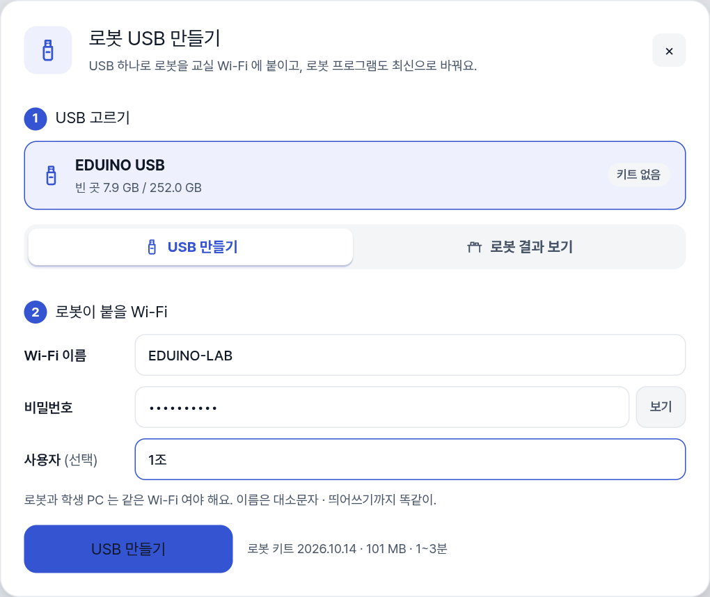{w=80}

::: step USB 만들기 (PC, 한 번)
PC 에 USB 를 꽂고 시뮬레이터 프로그램을 엽니다. 윗줄 **⚙ 설정 → [로봇 USB 만들기]** 를 누릅니다.
꽂은 USB 가 저절로 골라지고, **Wi-Fi 이름** 에는 이 PC 의 Wi-Fi 가 미리 들어 있습니다.
**비밀번호** 를 적습니다. **사용자** 는 로봇 목록에 크게 보일 이름입니다(예: 3조). **[USB 만들기]** → 1~3분 뒤 **[USB 꺼내기]**.
압축 풀기나 메모장은 필요 없습니다.
:::

::: step 로봇에 꽂고 [설치하기]
로봇에 모니터 · 마우스 · 키보드를 붙이고, 전원을 켜고 1분 뒤 USB 를 꽂습니다.
USB 창의 `eduino` 폴더에서 **`설치하기`** 를 더블클릭합니다.
"신뢰할 수 없는 실행 파일" 창이 뜨면 [그래도 실행] (USB 라서 매번 묻습니다. 정상입니다).
:::

::: step 비밀번호 넣고 기다리기
검은 창이 비밀번호를 물으면 **로봇 계정 비밀번호** + Enter (글자가 안 보이는 것이 정상).
4단계가 차례로 지나가고, 맨 아래에 `주소: http://…:8080/console` 와 **로봇 ID** 가 나오면 끝입니다.
연결되면 로봇 밑동이 5° 돌았다 돌아옵니다.
:::

::: step 로봇 ID 스티커
나온 **로봇 ID**(예: 107)를 스티커로 로봇에 붙여 둡니다.
USB 를 PC 에 다시 꽂고 [로봇 USB 만들기] → **[로봇 결과 보기]** 를 열면 로봇마다 ID · 주소가 나옵니다.
다음부터는 **전원만 켜면** 1~2분 뒤 프로그램이 저절로 켜지고 교실 Wi-Fi 에 붙습니다.
:::

> 팁: 다른 교실(다른 Wi-Fi)로 옮길 때는 [로봇 USB 만들기] 에서 Wi-Fi 만 바꿔 다시 만듭니다. 켜진 로봇에 USB 를 꽂습니다. 20~60초 안에 로봇이 살짝 움직이면 연결된 것입니다. 터미널이 필요 없습니다.

> 참고: 모니터 없이 SSH 로만 접속할 때는 로봇 터미널에서 한 줄로 설치합니다. `sudo python3 /media/*/eduino/install.py` (「USB 키트」 안내서).

## 교실 Wi-Fi (공유기)

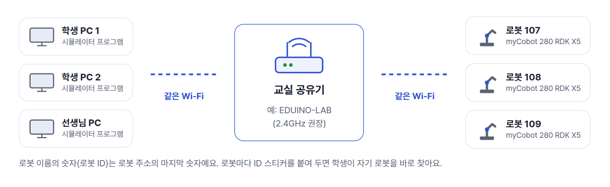{w=80}

- PC 와 로봇이 **같은 공유기(같은 Wi-Fi)** 에 있어야 합니다.
- 학교망 · 손님용 Wi-Fi 는 기기끼리 막혀 있는 경우가 많습니다. 교실 전용 공유기 한 대를 권장합니다.
- 2.4 GHz 를 켜 두면 가장 확실합니다. 접속할 때 웹 로그인 화면이 뜨는 Wi-Fi 는 쓸 수 없습니다.
- 공유기의 "AP 격리 / 게스트 격리" 는 끕니다. 로봇마다 고정 IP 를 주면 로봇 ID 가 늘 같습니다.

## PC 에서 로봇 열기

::: step 프로그램 켜기
PC 를 교실 Wi-Fi 에 연결합니다.
`PhysicalAI-Simulator.zip` 을 풀고 `Physical AI 시뮬레이터.exe` 를 더블클릭합니다.
처음에 "Windows의 PC 보호" 가 나오면 [추가 정보] → [실행].
:::

::: step [연결하기] → 내 로봇 [연결]
시작 화면이 끝나면 [연결하기] 를 누릅니다.
[로봇 연결] 창이 같은 Wi-Fi 의 로봇을 찾아 사용자 이름 · IP · 로봇 ID 로 보여 줍니다.
내 로봇의 [연결] 을 누르면 그 로봇의 화면이 열립니다. 헷갈리면 [움직여 확인] 으로 어느 로봇인지 봅니다.
:::

::: step 목록에 없으면 — [ID 로 연결]
[ID 로 연결] 탭에서 로봇 ID 숫자(예: 107)만 넣고 [연결].
앞부분(192.168.0.)은 교실 공유기에 맞게 한 번 고치면 기억합니다.
:::

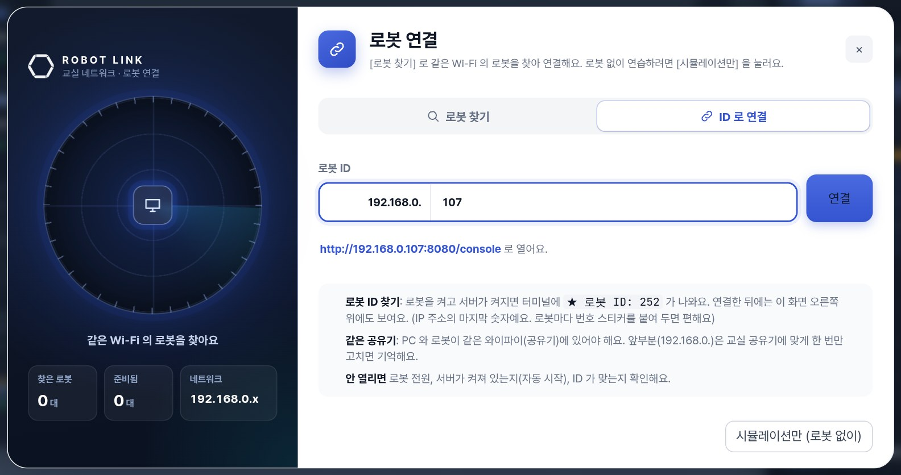{w=70}

## 첫 확인 — 연결 · 자세 · 준비 점검

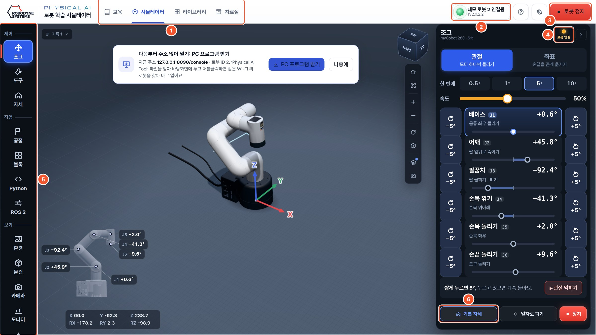

::: marks
① 위쪽 탭: [교육] [시뮬레이터] [라이브러리] [자료실]
② 연결 표시: 초록 불과 "로봇 ○ 연결됨". 로봇 ID 와 주소가 함께 보입니다
③ [로봇 정지]: 실제 로봇을 바로 멈춥니다 (키보드 **Esc** 도 같음)
④ 상태 표시등: 누르면 [연결 확인] [손으로 움직이기] [영점 맞추기] 가 나옵니다
⑤ 왼쪽 메뉴: [조그] [도구] [자세] [공정] · [블록] [Python] [ROS 2] · [환경] [물건] [모니터] · 맨 아래 [영점]
⑥ 늘 아래에 있는 [기본 자세] [일자로 펴기] [정지]
:::

::: step [연결 확인]
상태 표시등(④)을 누르고 [연결 확인] 을 누릅니다.
로봇 전체(1번 관절)가 10° 돌았다가 돌아오면, 이 화면과 이 로봇이 이어진 것입니다.
:::

::: step [기본 자세]
아래의 [기본 자세] 를 누릅니다. 실제 팔과 화면의 3D 팔이 같은 모양이 되는지 봅니다.
같으면 세팅이 끝났습니다. 다르면 다음 「영점 맞추기」를 합니다.
:::

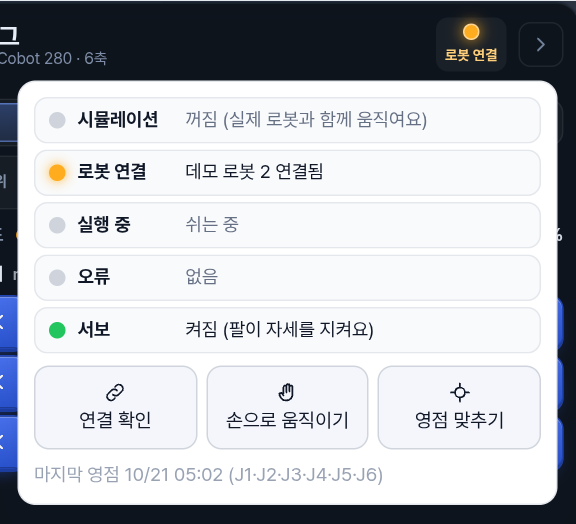{w=55}

## 영점 맞추기 — 화면과 실제 팔이 다를 때만

영점은 관절마다 "여기가 0°" 라는 기준입니다.
틀어지면 같은 명령에도 실제 팔이 화면과 다른 자세로 갑니다.
왼쪽 메뉴 맨 아래 [영점] (또는 상태 표시등 → [영점 맞추기])을 누르면 패널이 영점 화면이 됩니다.

::: step 도구 빼기 · 주변 비우기
그리퍼 같은 도구를 빼고 팔 주변(약 30 cm)을 비운 뒤 [준비됐어요] 를 누릅니다.
:::

::: step [0° 자세로]
로봇이 위로 곧게, 표시선이 거의 맞는 자리까지 알아서 갑니다.
:::

::: step J1 → J6 한 관절씩
표시선이 맞으면 [맞음 · 다음]. 어긋났으면 팔을 한 손으로 받치고 [J○ 풀기] → 그 관절만 손으로 돌려 **두 표시선을 일직선**으로 → [고정 · 다음].
나머지 관절은 고정돼 있어 팔이 쓰러지지 않습니다.
:::

::: step [6축 0° 저장] → 확인
저장한 뒤 [기본 자세] 갔다가 [0° 자세] 로 돌아와, 표시선 6쌍이 다시 맞으면 끝입니다.
:::

> 주의: 표시선을 맞추지 않고 저장하면 그 관절의 모든 동작이 틀어집니다. 나중에 한 관절만 조금 다르면 [한 관절 다듬기] 에서 [0° 자세로] 후 그 관절만 [−0.5°] [+0.5°] 로 맞춰 [J○ 0° 저장] 합니다.

## 검수 준비 점검 — 한 번에 확인

선생님은 ⚙ (설정) → [검수 시연 (교사용)] → [검수 준비 점검] 으로 이 로봇이 갖춘 것을 한 번에 봅니다.
로봇팔 연결, 좌표 기준, 손 카메라 기준, 카메라 2대, OpenCV, AI 모델, 흡착 펌프, 그리퍼, ROS 2 가 ✓ / ✗ 로 나옵니다.

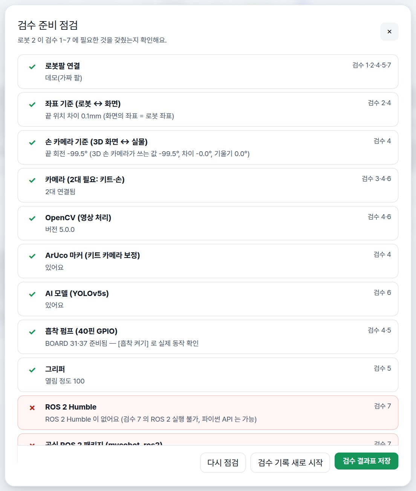{w=70}

> 참고: ✗ 가 나온 항목은 이유가 함께 나옵니다. 카메라가 1대뿐이면 두 번째 카메라 USB 를, 펌프가 ✗ 면 배선(위 「전원과 케이블」)을 봅니다.

# 간단 조작

세팅이 끝난 로봇으로 선생님이 먼저 30분 해 봅니다.
여기서 익힌 것이 4 · 5장 수업의 시범이 됩니다.

## 먼저 — 멈추는 법

> 안전: 이상하면 **Esc** 키, 또는 화면 맨 위 빨간 [로봇 정지]. 둘 다 실제 로봇을 바로 멈춥니다. 오른쪽 아래 [정지] 도 같습니다. 수업 중에는 정지 버튼이 늘 보이게 둡니다.

- 모든 동작은 먼저 시뮬레이터가 책상 · 키트 · 블록 · 로봇 몸에 닿는지 검사합니다. 닿으면 움직이지 않고 이유를 알려 줍니다.
- 실제 로봇의 속도는 최대 50 으로 제한됩니다.

## 관절 하나씩 움직이기

왼쪽 메뉴 [조그] → 위쪽 [관절] 을 누릅니다.

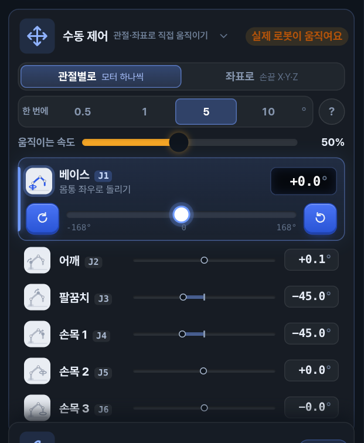{w=60}

::: step 관절 고르기
베이스(J1) · 어깨(J2) · 팔꿈치(J3) · 손목 1~3(J4~J6) 가운데 하나를 누릅니다.
작은 그림에서 그 관절이 움직이는 부분이 파란색으로 보입니다.
:::

::: step ↺ ↻ 로 돌리기
짧게 누르면 한 칸(이동 단위만큼), 누르고 있으면 계속 부드럽게 돌고, 손을 떼면 멈춥니다.
[단위](0.5 · 1 · 5 · 10°)와 [속도]로 빠르기를 정합니다.
:::

> 팁: 키보드로도 됩니다. [관절] 화면을 한 번 누른 뒤 **↑ ↓** 로 관절 고르기, **← →** 로 돌리기.

## 손끝을 X · Y · Z 로 움직이기

[조그] 위쪽 [좌표] 를 누르면(처음 열면 이쪽) 손끝(도구 끝)을 로봇 바닥 기준으로 옮깁니다.
**위치** X 는 앞뒤, Y 는 좌우, Z 는 위아래 — 도구 방향은 그대로 둔 채 곧게 움직입니다.
**회전** RX · RY · RZ 는 손끝 자리는 그대로 두고 도구 방향만 돌립니다.

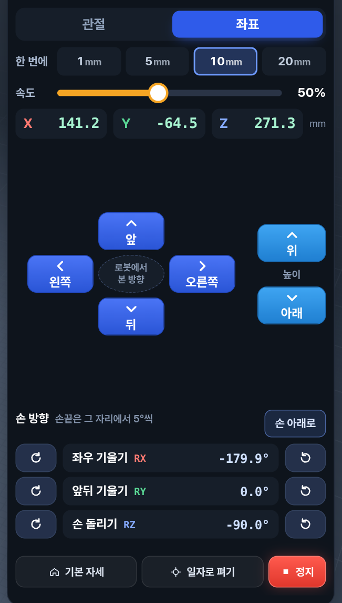{w=60}

## 자세 바로잡기와 저장

- [기본 자세]: 키트를 내려다보는 관찰 자세. 수업을 시작할 때와 끝낼 때 누릅니다.
- [일자로 펴기]: 모든 관절 0°, 팔이 위로 곧게 섭니다.
- 왼쪽 메뉴 [자세] 의 [지금 자세 저장하기]: 지금 자세가 "내 자세 1, 2 …" 로 남습니다. 누르면 그 자세로 다시 갑니다.

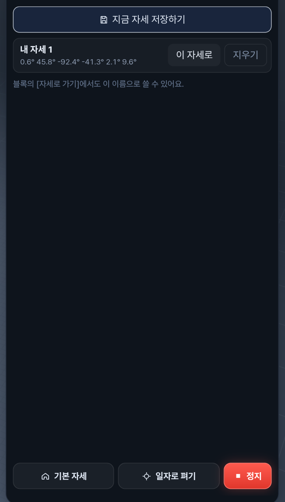{w=55}

## 도구 쓰기 — 그리퍼와 흡착 펌프

왼쪽 메뉴 [도구] 에서 **실제로 끼운 도구**를 고릅니다. 고른 도구의 버튼이 나옵니다.

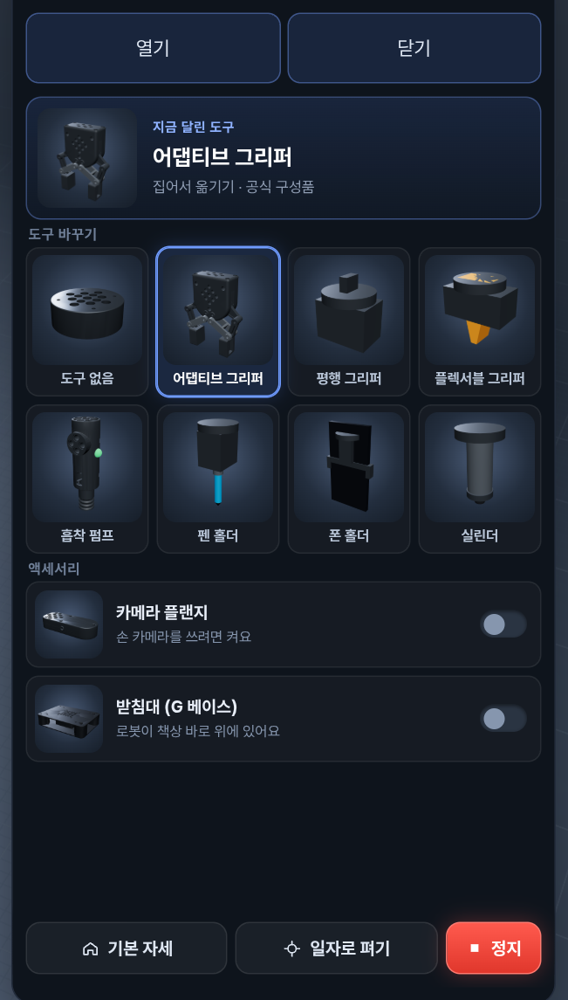{w=60}

- 그리퍼: [열기] · [닫기]. 블록을 잡으면 그 자리에서 멈춰 버팁니다(모터가 계속 밀지 않음).
- 흡착 펌프: [흡착 켜기] · [흡착 끄기].
- 손 카메라를 쓰면 [카메라 플랜지] 를 켭니다.
- 아무 도구도 없으면 맨 앞의 [도구 없음].

## 첫 프로그램 — 블록 코딩

글자 코드를 몰라도 블록을 쌓아 동작 순서를 만듭니다.

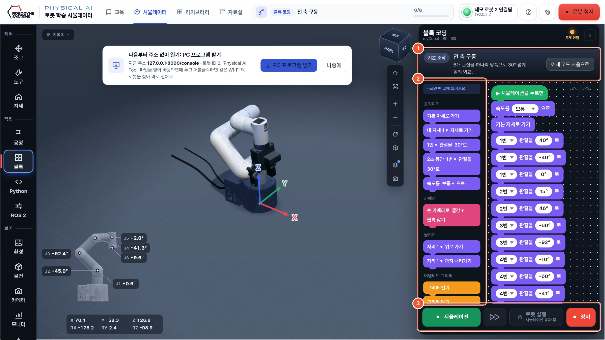

::: marks
① 지금 과제와 목표
② 블록 꾸러미: 눌러서 프로그램에 넣습니다
③ 실행 막대: [시뮬레이션] → 통과하면 [로봇 실행]
:::

::: step 왼쪽 메뉴 [블록] 열기
처음 열면 과제 "전 축 구동" 의 블록이 들어 있습니다. 관절 6개를 차례로 움직이는 프로그램입니다.
:::

::: step [시뮬레이션]
3D 로봇이 먼저 움직입니다. 책상 · 몸에 닿거나 관절 한계를 넘으면 그 블록에서 멈추고 알려 줍니다.
끝나면 결과 카드가 나옵니다.
:::

::: step [로봇 실행]
시뮬레이션을 통과한 프로그램만 실제 로봇으로 보냅니다.
실행 중에는 몇 번째 블록인지 보입니다. 이상하면 **Esc**.
:::

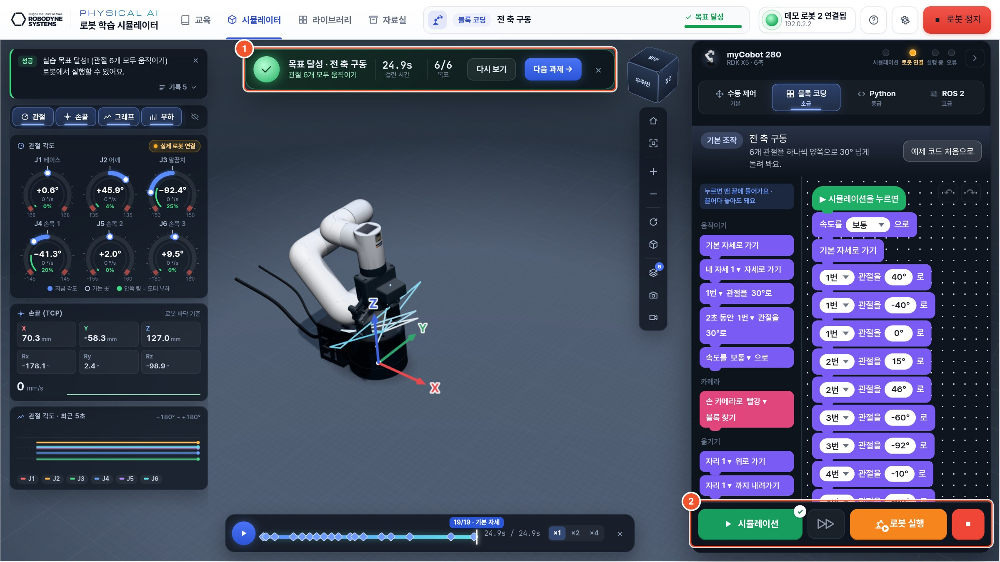

## 끄기

1. [기본 자세] 를 누릅니다.
2. 프로그램 창을 닫습니다.
3. 로봇 전원을 끕니다. 팔이 천천히 내려앉을 수 있으니 팔 아래를 비워 둡니다.

# 기초 수업 1차시 — 로봇팔과 친해지기

| 항목 | 내용 |
| --- | --- |
| 대상 | 고등학생 · 대학생, 로봇을 처음 만지는 학생 |
| 시간 | 50분 |
| 학습 목표 | ① 로봇팔의 관절 6개의 이름과 움직임을 말할 수 있다. ② 로봇을 안전하게 멈출 수 있다. ③ 반복 정밀도가 무엇인지 말할 수 있다. |
| 화면 | [교육] → 지도의 [로봇 실습 7] → [선생님과 함께 수업] → 기초교육 1차시: 7-1 전 축 구동 → 7-2 반복 위치제어 |
| 진행 | 선생님 화면(프로젝터)이 단계를 열면 학생 화면이 함께 넘어갑니다. 실물 로봇은 선생님이 허락한 뒤에만 움직입니다. |
| 준비 | 학생 1명에 PC 1대, 조마다 로봇 1대 (세팅 완료), 선생님 PC 의 학급 서버, 활동지, 로봇 둘레 50 cm 비우기 |

## 선생님과 함께 수업 — 진행 방법

기초 수업 두 차시는 **선생님이 프로젝터 화면으로 한 단계씩 이끌고, 학생 화면이 따라오는** 방식으로 합니다.
학생이 각자 화면을 넘기며 앞서가거나 뒤처지지 않고, 반 전체가 같은 단계를 같이 봅니다.

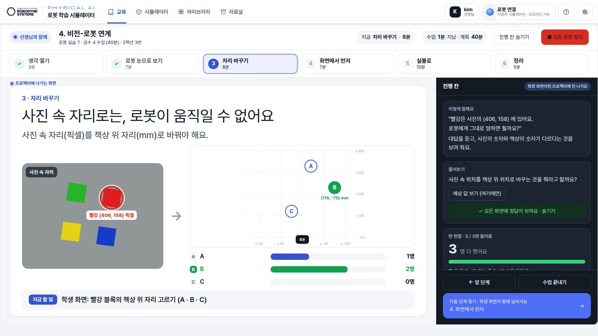

::: marks
① 단계: 지금 단계가 파랗게. 누르면 그 단계로 (학생 화면도 함께)
② 프로젝터 화면: 큰 제목 · 한 줄 설명 · 반 전체의 답 · 지금 할 일
③ 진행 칸: 이렇게 말해요 · 물어보기(예상 답은 여기에만) · 반 현황 · 도움 요청
④ [다음 단계 열기]: 학생 화면이 함께 넘어갑니다. 위쪽 [■ 모든 로봇 정지] 는 반 전체의 로봇을 멈춥니다
:::

::: step 1. 선생님 — 수업 시작
선생님 PC 에서 `교사용 학급 서버.cmd` 로 학급 서버를 켜고 교사로 로그인합니다(6장 학급 계정).
[교육] → [로봇 실습 7] → 위쪽 [선생님과 함께 수업] → 학급과 수업(기초교육 1차시: 7-1)을 고르고 [수업 시작].
:::

::: step 2. 학생 — 함께하기
학생이 학급 코드 · 번호 · PIN 으로 로그인해 [교육] 탭을 열면 "선생님이 수업을 시작했어요" 가 뜹니다.
[함께하기] → 조 번호 → **로봇 담당** 또는 **화면으로 따라오기** 를 고릅니다. 로봇 담당은 이 PC 로 조의 로봇을 움직이는 사람이에요(조마다 한 명).
:::

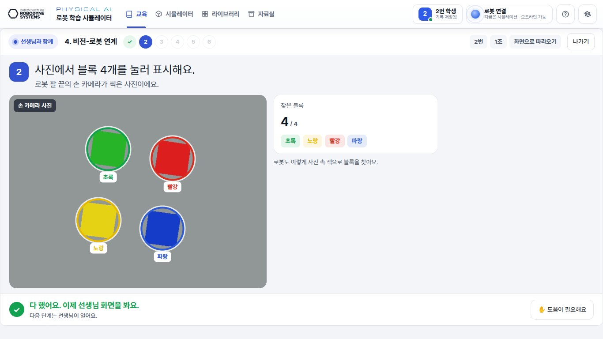

::: step 3. 한 단계씩
선생님이 [다음 단계 열기](또는 프레젠터의 → 키)를 누르면 모든 학생 화면이 그 단계로 넘어갑니다.
학생은 지난 단계를 다시 볼 수는 있지만 앞 단계로 먼저 갈 수는 없습니다.
학생이 고른 답은 프로젝터에 막대로 모이고, [도움이 필요해요] 를 누른 학생 번호가 진행 칸에 뜹니다.
문제 단계에서는 [모든 화면에 정답 보이기] 를 누를 때까지 학생 화면에 정답이 나오지 않습니다.
:::

::: step 4. 실물 로봇은 허락 뒤
실물 단계에서 로봇 담당 학생은 준비 3가지(로봇 둘레 비우기 · 손 떼기 · 정지 버튼 위치)를 확인합니다. 그러면 진행 칸에 그 조가 "준비 끝" 으로 보입니다.
선생님이 [모든 조 로봇 움직여도 돼요] 를 누르기 전에는 학생 화면의 실물 버튼이 잠겨 있습니다.
움직이는 중에 이상하면 위쪽 [■ 모든 로봇 정지] — 모든 조의 로봇이 바로 멈추고, 허락도 다시 잠깁니다.
모둠원은 결과를 먼저 예상하고, 화면에서 "우리 조 로봇" 의 상태(움직이는 중 · 끝)를 봅니다.
한 조에 로봇 담당은 한 명만 들어올 수 있고, 로봇도 한 번에 한 PC 의 명령만 받습니다. 다른 PC 가 움직이는 중이면 화면 위에 "다른 PC(○번 학생)가 이 로봇을 움직이는 중이에요" 가 뜹니다. 그 PC 가 끝내고 15초 뒤 다시 됩니다. **정지는 어느 PC 에서나 언제나** 됩니다.
로봇 담당 PC 가 잰 값은 선생님의 학급 관리 › 실시간 현황 아래 "로봇 실습 7 · 실물 결과" 표에 모입니다.
:::

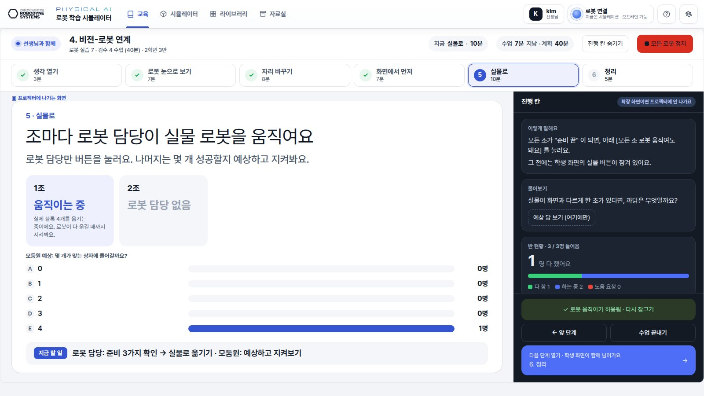

::: step 5. 다음 수업 · 끝내기
마지막 단계(정리)에서 [다음 수업] 을 누르면 7-2 로 넘어가고 학생 화면도 함께 갑니다.
수업이 끝나면 [수업 끝내기]. 학생 화면에 "선생님이 수업을 끝냈어요" 가 뜨고, 그 뒤에는 학생이 혼자 해 볼 수 있습니다.
:::

> 팁: 프로젝터는 노트북 화면을 **확장**하면 진행 칸은 노트북에만 남습니다. **복제**하면 진행 칸도 프로젝터에 나갑니다. 그때는 위쪽 [진행 칸 숨기기] 를 누릅니다. 오른쪽 아래 작은 단추(← → · 로봇 허용 · 정답)로 진행합니다.

> 참고: 학급 서버 없이도 됩니다. [수업 시작] 에서 "이 PC 에서만" 을 고릅니다. 프로젝터 화면만으로 같은 순서를 진행합니다. 학생은 손을 들어 답합니다.

## 수업 흐름 — 단계마다 화면과 질문

수업 시작 전에 안전 약속(**Esc** · [로봇 정지] 로 멈추기, 조마다 로봇 담당 한 명)을 먼저 합니다.
아래 표는 선생님 화면의 단계 그대로입니다. 예상 답은 진행 칸에만 나옵니다.

**7-1. 전 축 구동 · 25분 · 기초교육 1차시 (앞 25분)**

| 단계 | 시간 | 프로젝터 | 선생님이 묻기 → 예상 답 | 학생 화면 |
| --- | --- | --- | --- | --- |
| 1. 생각 열기 | 4분 | 로봇팔에는 관절이 몇 개 있을까요? | 관절이 많으면 무엇이 좋을까요? → 더 여러 방향으로 손끝을 댈 수 있어요. 이 로봇팔은 6개라서 자리와 방향을 모두 맞출 수 있어요. | 문제: 로봇팔에는 관절이 몇 개 있을까요? |
| 2. 아래 관절 3개 | 7분 | 아래 관절 3개: 베이스 · 어깨 · 팔꿈치 | J2(어깨)를 움직이면 왜 팔 전체가 숙여질까요? → J2 위에 달린 팔 전체가 함께 움직이기 때문이에요. 아래 관절일수록 많이 움직여요. | 3D 따라 하기: J1 · J2 · J3 를 차례로 눌러요. |
| 3. 손목 관절 3개 | 6분 | 손목 관절 3개: 손끝의 "방향" | J6 만 돌리면 손끝의 자리는 바뀔까요? → 거의 안 바뀌어요. 제자리에서 손끝이 돌기만 해요. 그래서 나사를 돌리거나 물건 방향을 맞출 때 써요. | 3D 따라 하기: J4 · J5 · J6 를 눌러요. |
| 4. 실물로 | 6분 | 조마다 실물 로봇의 관절 6개를 움직여요 | 명령한 각도와 로봇이 잰 각도가 조금 다른 까닭은? → 모터와 기어에 작은 틈과 무게가 있어서예요. 차이가 1° 안이면 괜찮아요. | 실물 (선생님 허락): 실물 로봇의 관절 6개를 움직여요. |
| 5. 정리 | 2분 | 관절 6개가 하는 일 | 다음 시간(반복 정밀도)에는 무엇을 잴까요? → 같은 곳에 여러 번 보냈을 때 얼마나 똑같이 도착하는지예요. | 정리 문제: 확인 문제를 풀어요. |

**7-2. 반복 위치제어 · 25분 · 기초교육 1차시 (뒤 25분)**

| 단계 | 시간 | 프로젝터 | 선생님이 묻기 → 예상 답 | 학생 화면 |
| --- | --- | --- | --- | --- |
| 1. 생각 열기 | 4분 | 다트를 다섯 번 던졌어요. 누가 더 "똑같이" 던졌나요? | 공장 로봇에게 더 중요한 것은 어느 쪽일까요? → 한 점에 모이는 쪽(반복 정밀도)이에요. 모이기만 하면 위치는 보정으로 옮길 수 있어요. | 문제: 누가 더 똑같이 던졌을까요? |
| 2. 화면에서 5번 | 7분 | 로봇을 같은 점에 다섯 번 보내요 | 시뮬레이션은 왜 흩어진 폭이 0 mm 일까요? → 계산 속 로봇에는 틈 · 무게 · 열이 없어서예요. 실물은 조금 흩어져요. | 3D 따라 하기: [목표 점 보기] 다음 [5번 다녀오기] 를 눌러요. |
| 3. 실물로 | 10분 | 실물 로봇은 얼마나 흩어질까요? | 조마다 값이 조금씩 다른 까닭은? → 로봇마다 조립 · 영점 · 모터가 조금씩 달라서예요. 그래서 공장은 로봇마다 이 값을 확인해요. | 실물 (선생님 허락): 실물 로봇을 같은 점에 5번 보내요. |
| 4. 정리 | 4분 | 반복 정밀도 = 같은 곳에 얼마나 똑같이 | 흩어진 폭이 크면 공장에서 어떤 일이 생길까요? → 나사 구멍을 비껴가거나 부품을 놓쳐요. 그래서 검수에서 이 값을 재요. | 정리 문제: 확인 문제를 풀어요. |

> 참고: 학생 혼자 해도 됩니다. [로봇 실습 7] 의 1 · 2 를 알아보기 → 따라 하기 → 문제 → 실물로 순서로 합니다(아래 활동 1 · 2).

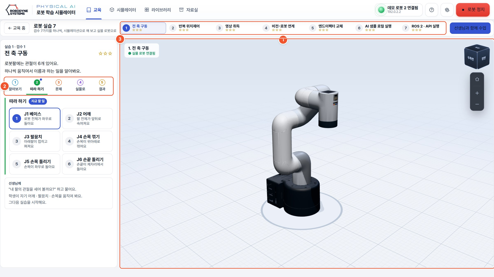

::: marks
① 실습 고르기: 1~7 (검수 7가지와 같은 순서)
② 순서: 알아보기 → 따라 하기 → 문제 → 실물로 → 결과
③ 3D 실습 화면: 따라 하기가 여기서 움직입니다
:::

## 활동 1 — 전 축 구동 (관절 6개)

::: step 알아보기 · 따라 하기
[따라 하기] 에서 J1 베이스부터 J6 손목 3 까지 차례로 누릅니다.
3D 로봇이 그 관절만 움직입니다. 학생은 활동지에 관절마다 "무엇이 움직였나" 를 적습니다.
:::

::: step 문제
O/X 와 객관식 두 문제를 풉니다. 다 맞혀야 다음으로 넘어갑니다.
:::

::: step 실물로
[실물로] 탭 → [실물로 6축 움직이기]. 실제 로봇이 관절 6개를 차례로 30° 씩 움직였다 돌아옵니다.
끝나면 "명령과 잰 각도 차이 최대 J○ ○°" 가 나옵니다. 활동지에 적습니다.
:::

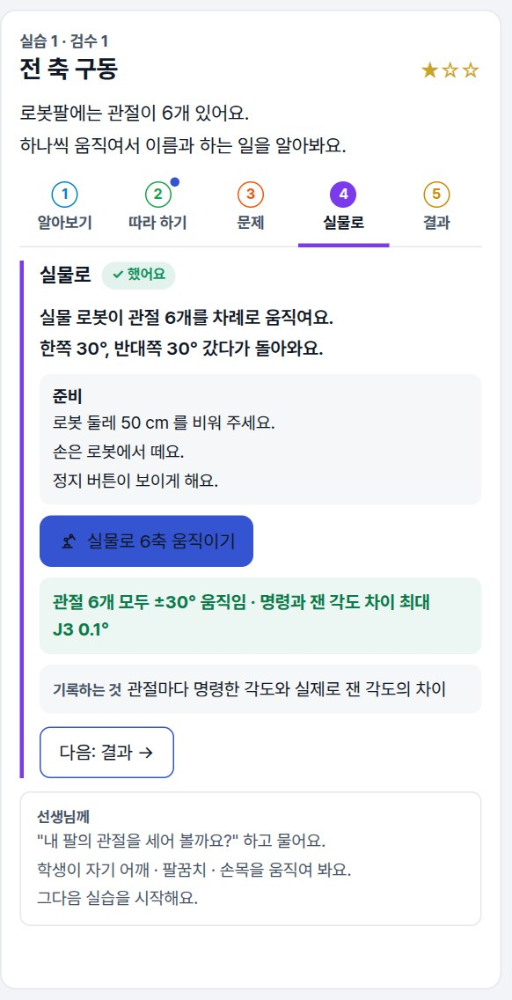{w=55}

## 활동 2 — 반복 위치제어 (5번 다녀오기)

::: step 목표 점 보기 → 5번 다녀오기
3D 에 빨간 목표 점이 생기고, 로봇이 기본 자세 ↔ 목표 점을 다섯 번 오갑니다.
:::

::: step 실물로 [실물로 5번 다녀오기]
실제 로봇이 같은 점에 다섯 번 다녀옵니다. 도착할 때마다 각도를 재서 도착점을 계산합니다.
결과 "흩어진 폭 ○ mm" 를 활동지에 적습니다.
:::

## 1차시 활동지

| 관절 | 이름 | 움직이면 무엇이 움직였나 (내 말로) |
| --- | --- | --- |
| J1 | 베이스 | |
| J2 | 어깨 | |
| J3 | 팔꿈치 | |
| J4 | 손목 1 | |
| J5 | 손목 2 | |
| J6 | 손목 3 | |

| 잰 것 | 우리 조 값 | 다른 조 값 |
| --- | --- | --- |
| 명령과 잰 각도 차이 (가장 큰 관절) | J__ ____ ° | |
| 다섯 도착점이 흩어진 폭 | ____ mm | |

## 1차시 확인 문제

1. J1(베이스)을 돌리면 로봇팔 전체가 좌우로 돈다. (O / X)
2. 이 로봇팔은 관절이 6개다. 따로 움직이는 방향은 몇 가지인가? (3가지 / 6가지 / 12가지)
3. 같은 곳에 여러 번 보낼 때 도착점이 모이는 정도를 무엇이라 하는가?
4. 로봇이 이상하게 움직일 때 가장 먼저 할 일 두 가지를 쓰시오.

> 참고: 정답 — 1. O (J1 은 맨 아래 관절이라 위의 팔 전체가 돈다) · 2. 6가지 (자유도 6) · 3. 반복 정밀도 · 4. Esc 키 또는 [로봇 정지] 누르기, 로봇 둘레에서 손 떼기.

# 기초 수업 2차시 — 로봇에게 일 시키기

| 항목 | 내용 |
| --- | --- |
| 대상 | 1차시를 마친 학생 |
| 시간 | 50분 |
| 학습 목표 | ① 도구(그리퍼 · 흡착 펌프)를 물건에 맞게 고를 수 있다. ② 고정 카메라와 손 카메라의 차이를 말할 수 있다. ③ 블록이나 코드로 만든 프로그램을 시뮬레이션으로 확인한 뒤 로봇에서 실행할 수 있다. |
| 화면 | [교육] → [로봇 실습 7] → [선생님과 함께 수업] → 기초교육 2차시: 7-5 엔드이펙터 교체 → 7-3 영상 취득 → 7-7 ROS 2 · API 실행 (진행 방법은 4장) |
| 준비 | 그리퍼와 흡착 펌프 (조마다), 블록 4개, 키트 카메라 · 손 카메라 연결 |

## 수업 흐름 — 단계마다 화면과 질문

세 수업을 이어서 합니다. 7-5 의 마지막 단계에서 [다음 수업] 을 누르면 7-3, 다시 7-7 로 학생 화면이 함께 넘어갑니다.

**7-5. 엔드이펙터 교체 · 20분 · 기초교육 2차시 (앞 20분)**

| 단계 | 시간 | 프로젝터 | 선생님이 묻기 → 예상 답 | 학생 화면 |
| --- | --- | --- | --- | --- |
| 1. 생각 열기 | 3분 | 얇고 평평한 카드를 집기 좋은 도구는? | 둥근 공은 어느 도구가 좋을까요? → 집게예요. 둥근 면에는 흡착 컵이 잘 붙지 않아요. | 문제: 얇고 평평한 카드를 집기 좋은 도구는? |
| 2. 그리퍼로 | 4분 | 집게(그리퍼)로 노랑 블록을 옮겨요 | 그리퍼는 블록의 어디를 잡나요? → 옆면 가운데예요. 흡착 펌프는 윗면을 잡아요. | 3D 따라 하기: [그리퍼로 옮기기] 를 눌러요. |
| 3. 바꿔 끼우기 | 4분 | 도구를 흡착 펌프로 바꿔요 | 도구를 바꿀 때 지킬 약속은? → 로봇이 멈춘 뒤에, 두 사람이 함께, 전원은 그대로 두고 바꿔요. | 3D 따라 하기: 도구를 바꾸고 펌프로 옮겨요. |
| 4. 실물로 | 7분 | 실물 도구를 바꿔 끼우고 써 봐요 | 펌프를 켜면 어떤 소리가 나나요? → 작은 모터 소리가 나요. 소리가 없으면 배선을 확인해요. | 실물 (선생님 허락): 실물 도구를 쓰고, 바꿔 끼우고, 다시 써요. |
| 5. 정리 | 2분 | 물건에 따라 손을 바꿔요 | 자동차 공장 로봇은 도구를 어떻게 바꿀까요? → 도구 교환 장치로 스스로 바꿔 껴요 (용접기 · 집게 · 흡착판). | 정리 문제: 확인 문제를 풀어요. |

**7-3. 영상 취득 · 15분 · 기초교육 2차시 (가운데 15분)**

| 단계 | 시간 | 프로젝터 | 선생님이 묻기 → 예상 답 | 학생 화면 |
| --- | --- | --- | --- | --- |
| 1. 생각 열기 | 3분 | 천장 CCTV 와 손에 든 휴대폰, 물건 자리를 재기 좋은 것은? | 로봇에는 왜 카메라가 두 대일까요? → 위에서 전체를 보는 카메라와, 집기 직전에 가까이 보는 카메라가 하는 일이 달라서예요. | 문제: 물건 자리를 재기 좋은 카메라는? |
| 2. 두 카메라로 찍기 | 5분 | 키트 카메라와 손 카메라로 한 장씩 | 손 카메라 사진에서 블록이 더 크게 보이는 까닭은? → 팔 끝에서 가까이 내려다보기 때문이에요. 가까울수록 크게, 자세히 보여요. | 3D 따라 하기: 두 카메라로 한 장씩 찍어요. |
| 3. 실물로 | 5분 | 실제 카메라 두 대로 찍어요 | 사진의 크기 640×480 은 무슨 뜻일까요? → 가로 640 개, 세로 480 개의 점(픽셀)으로 된 사진이에요. | 실물 (선생님 허락): 실제 카메라 두 대로 사진을 찍어요. |
| 4. 정리 | 2분 | 로봇의 눈 두 개 | 물류센터 로봇은 두 카메라를 어떻게 나눠 쓸까요? → 천장 카메라로 상자를 찾고, 집기 직전에 손 카메라로 다시 확인해요. | 정리 문제: 확인 문제를 풀어요. |

**7-7. ROS 2 · API 실행 · 15분 · 기초교육 2차시 (뒤 15분)**

| 단계 | 시간 | 프로젝터 | 선생님이 묻기 → 예상 답 | 학생 화면 |
| --- | --- | --- | --- | --- |
| 1. 생각 열기 | 2분 | 같은 일을 백 번 시킬 때, 리모컨과 문자 명령 중 좋은 것은? | 코드로 명령하면 좋은 점은? → 저장해서 몇 번이고 똑같이 실행할 수 있고, 숫자 하나만 바꿔 다르게 할 수 있어요. | 문제: 같은 일을 여러 번 시키기 좋은 것은? |
| 2. 코드 한 줄씩 | 5분 | 코드 한 줄 = 동작 하나 | 두 번째 줄의 20 은 어느 관절의 각도일까요? → J1(베이스)이에요. 첫 번째 숫자가 J1 이에요. | 3D 따라 하기: [코드 보기] 다음 [한 줄씩 실행] 을 눌러요. |
| 3. 숫자 바꾸기 | 3분 | 20 을 -20 으로 바꾸면? | 속도 30 을 60 으로 바꾸면? → 같은 곳으로 두 배쯤 빠르게 움직여요. | 문제: sync_send_angles([20, 0, 0, 0, 0, 0], 30) 에서 20 을 -20 으로 바꾸면? |
| 4. 실물로 | 4분 | 같은 코드를 실물 로봇에서 | 화면의 코드와 로봇의 코드가 같은 까닭은? → 둘 다 같은 pymycobot API 를 써요. 화면에서 확인한 코드를 그대로 실물에 보낼 수 있어요. | 실물 (선생님 허락): 같은 코드를 실물로 실행해요. |
| 5. 정리 | 1분 | 코드로 로봇에게 말하기 | 오늘 배운 것 셋은? → 도구 바꾸기 · 카메라 두 대 · 코드로 명령하기. | 정리 문제: 확인 문제를 풀어요. |

> 팁: 시간이 남으면 [시뮬레이터] → [블록 코딩] 에서 블록의 숫자 하나를 바꿔 봅니다. 예상한 뒤 [시뮬레이션] → [로봇 실행] (아래 활동 3).

## 활동 1 — 도구 바꾸기

::: step 시뮬레이션으로 먼저
[따라 하기] 에서 그리퍼로 노랑 블록 옮기기 → 흡착 펌프로 바꾸기 → 펌프로 파랑 블록 옮기기.
:::

::: step 실물로
[① 그리퍼 열기 · 닫기] 를 합니다. 로봇이 멈춘 것을 확인하고 흡착 펌프로 바꿔 낍니다. [흡착 펌프로 바꿔 끼웠어요] 에 체크 → [② 펌프 켜기 · 끄기].
두 도구를 모두 써야 검수 5 가 기록됩니다.
:::

> 안전: 도구를 바꿔 끼울 때는 로봇이 멈춰 있는지 먼저 봅니다. 두 학생이 한 조가 되어 한 명은 팔을 잡고, 한 명은 끼웁니다.

## 활동 2 — 카메라 두 대

키트 카메라는 교실 천장의 CCTV 처럼 늘 같은 곳을 봅니다.
손 카메라는 들고 다니는 휴대폰처럼 팔을 따라 보는 곳이 바뀝니다.
[실물로] → [실제 카메라 2대로 찍기] 를 누르면 두 사진이 나란히 나옵니다.

## 활동 3 — 숫자 하나 바꿔 보기

::: step 예상하기
7. ROS 2 · API 실행의 코드 `sync_send_angles([0, 0, 0, 0, 0, 0], 30)` 를 봅니다. 숫자 하나를 바꿉니다(예: 20 → −20). 로봇이 어떻게 움직일지 먼저 적습니다.
:::

::: step 시뮬레이션 → 실물
시뮬레이션으로 확인한 뒤 [같은 코드를 실물로 실행]. 예상과 같았는지 적습니다.
블록 코딩으로 해도 됩니다: [시뮬레이터] → [블록 코딩] → 블록의 숫자를 누르면 바꿀 수 있습니다.
:::

## 2차시 활동지

| 물건 | 그리퍼 / 흡착 펌프 | 까닭 |
| --- | --- | --- |
| 나무 블록 (윗면이 평평) | | |
| 탁구공 (둥근 면) | | |
| 종이 한 장 | | |

| 카메라 | 보는 곳 | 좋은 점 |
| --- | --- | --- |
| 키트 카메라 (고정) | | |
| 손 카메라 (팔 끝) | | |

| 바꾼 숫자 | 예상한 움직임 | 실제 움직임 |
| --- | --- | --- |
| | | |

## 2차시 확인 문제

1. 흡착 펌프는 윗면이 평평하고 매끈한 물건을 잘 집는다. (O / X)
2. 둥근 공을 집기에 더 알맞은 도구는? (그리퍼 / 흡착 펌프 / 펜)
3. 손 카메라는 팔이 움직이면 보는 곳도 함께 바뀐다. (O / X)
4. 코드 `sync_send_angles([0, 0, 0, 0, 0, 0], 30)` 의 마지막 숫자 30 은? (속도 / 시간 / 관절 번호)
5. 실제 로봇에서 실행하기 전에 시뮬레이션을 먼저 하는 까닭을 한 문장으로 쓰시오.

> 참고: 정답 — 1. O · 2. 그리퍼 · 3. O · 4. 속도 (1~100) · 5. 예: 책상이나 로봇 몸에 부딪히는 동작을 실제로 움직이기 전에 찾아 막기 위해.

> 팁: 2차시 뒤에는 로봇 실습 7 의 4. 비전-로봇 연계(카메라로 블록을 찾아 분류함에 넣기)와 6. AI 샘플 로컬 실행(로봇 안의 AI 가 물건 알아보기)으로 이어 갑니다. 다음은 지도의 로봇 아카데미 28차시입니다(6장).

# 학습 프로그램 사용 가이드

## 위쪽 탭 네 개

| 탭 | 하는 일 |
| --- | --- |
| [교육] | 첫 화면은 산업단지 지도. 로봇 아카데미 28차시, 현장 실습 7곳, 디지털 트윈 관제센터, 로봇 실습 7, 마무리 평가 |
| [시뮬레이터] | 3D 로봇을 조그 · 공정 · 블록 코딩 · Python · ROS 2 로 움직이고 실제 로봇에서 실행 |
| [라이브러리] | 실습 과제 · 실습 환경 · 도구를 골라 시뮬레이터에 열기 |
| [자료실] | PC 프로그램, 교재 · 문항지 PDF, 매뉴얼 PDF 내려받기 |

## 교육 — 지도에서 시작

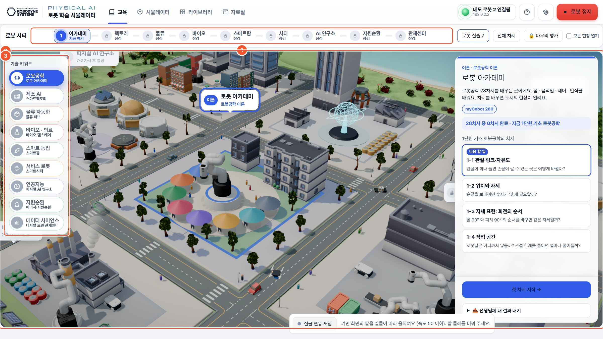

::: marks
① 로드맵: 배우는 순서. 지금 할 차례가 강조됩니다
② 3D 지도: 구역을 누르면 그 구역의 안내 카드가 열립니다
③ 기술 키워드로 찾기: 배우고 싶은 기술로 바로 가기
:::

- **로봇 아카데미**: 8개 단원 28차시 수업. 한 차시는 도입 → 개념 → 활동 1 · 2 · 3 → 정리 → 평가입니다. 결과를 보거나 평가를 맞혀야 다음이 열립니다(선생님 계정은 건너뛰기 가능).
- **현장 실습**: 7곳 — 스마트팩토리, 물류 허브, 바이오·헬스케어, 스마트팜, 스마트시티, 피지컬 AI 연구소, 에너지·자원순환. 현장마다 문제 3개를 6단계로 풉니다.
- **디지털 트윈 관제센터**: 현장 실습 기록과 실제 로봇 결과를 비교합니다.
- **로봇 실습 7**: 검수 7가지를 쉬운 5단계로 (4 · 5장).
- **마무리 평가**: 대단원을 마친 뒤.

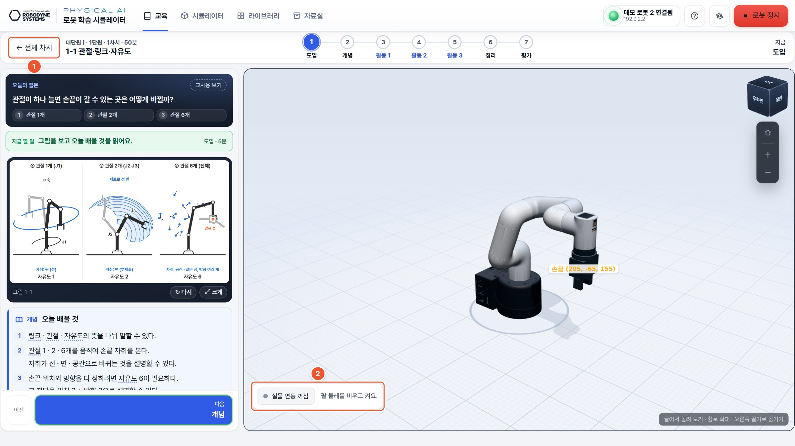

## 실물 연동 — 화면의 팔을 실제 로봇이 따라가기

로봇이 연결되어 있으면 수업 · 현장 실습 화면 아래에 [실물 연동] 이 나옵니다.
켜면 화면의 3D 팔을 실제 로봇이 따라 움직입니다(속도 50 이하).

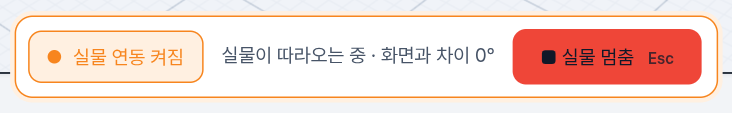{w=70}

- 현장 실습은 값을 고친 뒤 [다시 가동 · 비교] 에서 **기준을 모두 넘은 프로그램만** 실물이 따라갑니다.
- [실물 멈춤] 또는 **Esc**, 위쪽 [로봇 정지] 를 누르면 실물 연동이 꺼집니다. 다시 쓰려면 다시 켭니다.
- 다른 화면으로 옮기면 저절로 꺼지고, 왜 꺼졌는지 알려 줍니다.

## 시뮬레이터 — 왼쪽 메뉴

| 메뉴 | 수준 | 하는 일 |
| --- | --- | --- |
| [조그] [도구] [자세] | 기본 | 좌표 · 관절로 직접 움직이기, 도구 바꾸기, 자세 저장 (3장) |
| [공정] | 기본 | 점을 찍어 동작 순서 만들기(MOVE J · MOVE L) |
| [블록] | 초급 | 블록을 쌓아 순서 만들기 → 시뮬레이션 → 로봇에서 실행 (3장) |
| [Python] | 중급 | 실제 로봇과 같은 pymycobot 문법으로 코드 쓰기 |
| [ROS 2] | 고급(심화) | ROS 2 노드 · 토픽으로 팔 움직이기 |
| [환경] [물건] [카메라] [모니터] | | 장면(빈 화면 · AI 실험실 · 제조 라인 · 물류 · 서비스 · AI 키트) 고르기와 ▶ 데모, 물건 놓기, 카메라 화면, 관절 · 손끝 자세히 |
| [영점] | | 로봇이 연결됐을 때 영점 맞추기 (1장) |

고른 메뉴는 오른쪽 패널에 한 화면으로 열립니다. 같은 메뉴를 다시 누르면 패널이 접혀 3D 가 넓어집니다.

## 라이브러리와 자료실

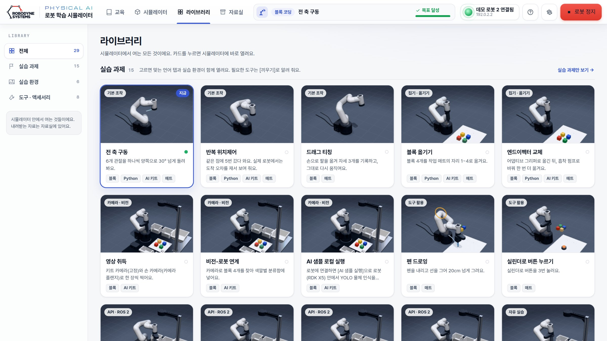

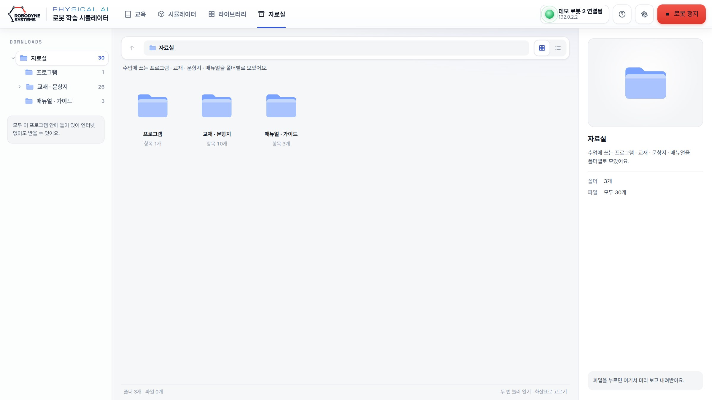

## 설정 메뉴 ⚙

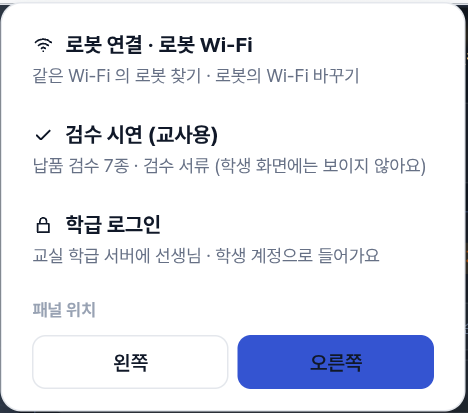{w=50}

| 항목 | 하는 일 |
| --- | --- |
| 로봇 연결 · 로봇 Wi-Fi | 같은 Wi-Fi 의 로봇 찾기, 로봇의 Wi-Fi 바꾸기 |
| 검수 시연 (교사용) | 납품 검수 7종 · 검수 준비 점검 · 검수 결과표 (학생 화면에는 보이지 않음) |
| 학급 로그인 | 교실 학급 서버에 선생님 · 학생 계정으로 들어가기 |

## 검수 시연과 검수 결과표

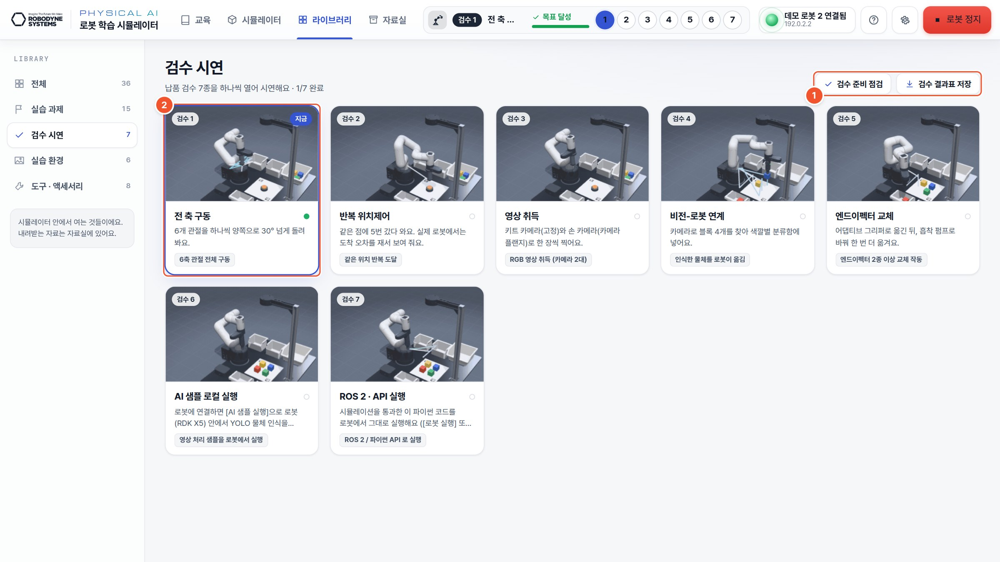

::: marks
① [검수 준비 점검] [검수 결과표 저장]
② 검수 1~7 카드: 누르면 시뮬레이터에 그 검수가 열립니다
:::

- 검수 1~7 은 [시뮬레이터] 의 검수 카드로 해도 되고, [교육] → [로봇 실습 7] 의 [실물로] 로 해도 됩니다. 두 곳의 기록이 한 결과표에 모입니다.
- [검수 결과표 저장] 은 검수마다 시각 · 실측값을 한 장의 HTML 로 저장합니다. 브라우저로 열어 인쇄(PDF 저장)합니다.
- 결과표는 실제 로봇 기록만 ✓ 로 셉니다. 시뮬레이션만 한 검수는 △, 연습용 데모 로봇 기록은 ◇ 로 따로 표시합니다.
- 새로 시작하려면 검수 준비 점검 창의 [검수 기록 새로 시작].

## 학급 계정 (선택)

- 선생님 PC 에서 `교사용 학급 서버.cmd` 를 더블클릭하면 학급 서버가 켜집니다. 처음 한 번 관리자 계정을 만듭니다.
- 학생은 ⚙ → [학급 로그인] 에서 학급 코드 · 번호 · PIN 으로 들어옵니다. 진도가 선생님 화면(학급 관리)에 모입니다.
- 로봇 실습 7 을 실물로 하면 잰 값도 모입니다. 각도 차이 · 흩어진 폭 · 카메라 수 · 옮긴 블록 · AI 시간 같은 값이에요. 학급 관리 › 실시간 현황 아래 "로봇 실습 7 · 실물 결과" 표에 있습니다.
- 학생 이름은 서버에 저장하지 않습니다. 번호 ↔ 이름 표는 선생님 PC 의 브라우저에만 둡니다.

# 문제가 생기면

| 이럴 때 | 이렇게 |
| --- | --- |
| 로봇 목록에 내 로봇이 없다 | 전원을 켜고 1~2분 기다린 뒤 [다시 찾기]. PC 와 로봇이 같은 Wi-Fi 인지. 안 되면 [ID 로 연결] 에 로봇 ID |
| "로봇 서버와 연결이 끊겼어요" | 로봇 전원, 같은 공유기인지, 로봇이 켜진 지 2분이 지났는지 |
| "로봇 팔이 대답하지 않아요" | 팔 전원 · 케이블을 보고 [다시 연결] |
| 실제 팔이 화면과 다른 자세로 간다 | 2장 「영점 맞추기」 |
| "책상에 닿아요" 로 움직이지 않는다 | 받침대 위라면 [받침대 (G 베이스)] 를 켜고 높이를 넣기. 아니면 더 높은 자세로 |
| 흡착 펌프가 안 된다 | [흡착 켜기] 아래 빨간 안내의 이유. 배선: 5V → 2 · 4, GND → 6, G5 → 37, G2 → 31 |
| 카메라가 1대만 보인다 | 두 번째 카메라 USB 를 꽂고 로봇을 다시 켜기 |
| "로봇에 그리퍼가 끼워져 있어요" | 화면의 도구와 실제 도구가 다릅니다. 안내의 [어댑티브 그리퍼로 바꾸기] 를 누르거나, 실제 도구를 화면에 맞게 바꿔 끼우기 |
| "로봇의 그리퍼가 대답하지 않아요" | 그리퍼가 끼워져 있는지, 그리퍼 케이블이 팔 끝에 꽂혀 있는지. 다른 도구를 끼웠다면 화면의 도구 칸에서 그 도구로 |
| 그리퍼에서 '지지직' 소리 | 정상 동작은 잡은 자리에서 버팁니다. 계속되면 [열기] 후 다시 [닫기] |
| Wi-Fi 가 다른 교실로 옮긴다 | [로봇 USB 만들기] 에서 Wi-Fi 를 바꿔 다시 만들고 켜진 로봇에 꽂기 (2장) |
| "다른 PC(○번 학생)가 이 로봇을 움직이는 중이에요" | 같은 로봇을 다른 PC 가 쓰고 있습니다. 그 PC 가 끝내고 15초 뒤 다시 됩니다. 조마다 로봇 담당 한 명만 움직입니다 (멈추기는 언제나 됨) |
| "○번이 이미 ○조의 로봇 담당이에요" | 그 조의 로봇 담당이 이미 있습니다. [화면으로 따라오기] 로 들어오거나, 조 번호를 확인합니다 |

## 수업 전 점검표

| 언제 | 확인할 것 |
| --- | --- |
| 학기 전 | 로봇마다 USB 설치 · 로봇 ID 스티커 · 영점 · 검수 준비 점검 |
| 학기 전 | 학생 PC 마다 프로그램이 열리고 [교육] 지도가 보이는지 |
| 로봇 쓰는 날 | 전원 · 교실 공유기 · 로봇 둘레 50 cm 비우기 · 도구와 블록 |
| 수업 직전 | 선생님 화면을 스크린에 띄우고 오늘 화면을 열어 두기 · 정지 약속 |
| 수업 끝 | [기본 자세] → 프로그램 닫기 → 로봇 전원 끄기 · 도구 정리 |
