# 과정 한눈에 보기

## 이 과정이 가르치는 것

이 과정은 산업용 · 협동 로봇에 쓰이는 **로봇공학의 핵심 단원 8개**를, 실제 로봇팔(myCobot 280 RDK X5)과 똑같이 움직이는 시뮬레이터로
**직접 움직이고 관찰하며** 배우는 28차시 과정입니다. 학생은 공식을 외우기 전에 먼저 예상하고, 한 가지만 바꿔 해 보고, 왜 그런지 설명합니다.

- **끝에 하는 일**: 마지막 미션(8-2 캡스톤) — *카메라로 블록을 찾아, 피해 가서 집고, 색깔별로 놓기*. 8개 단원은 이 미션을 해내는 데 필요한 능력을 하나씩 더합니다.
- **대상**: 고등학교(50분 한 차시) · 대학교(75분 한 차시). 대학교를 고르면 대학 수식과 심화 문항이 더해집니다.
- **장비**: PC 만 있으면 28차시 모두 됩니다. 로봇이 있으면 그 장비로 할 수 있는 차시가 지도에서 **실물**로 표시됩니다.

## 처음 열면 — 대상 → 장비 → 지도

[교육] 탭을 처음 열면 두 가지를 묻고, 그다음부터는 바로 커리큘럼 지도가 열립니다. 둘 다 지도 위쪽에서 언제든 바꿀 수 있습니다.

::: cols
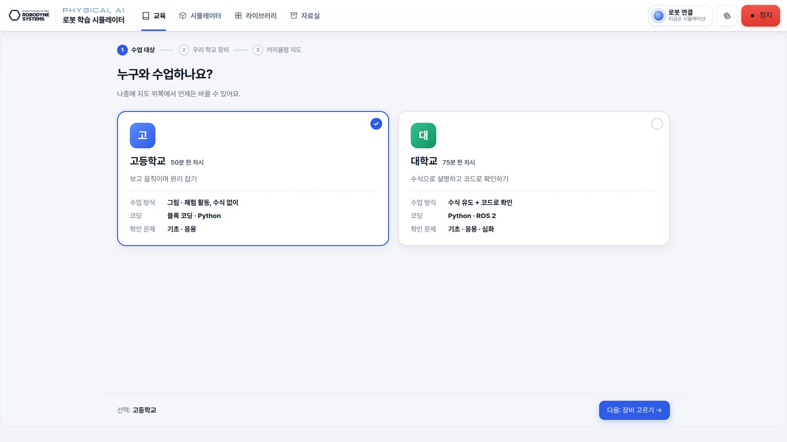
+++
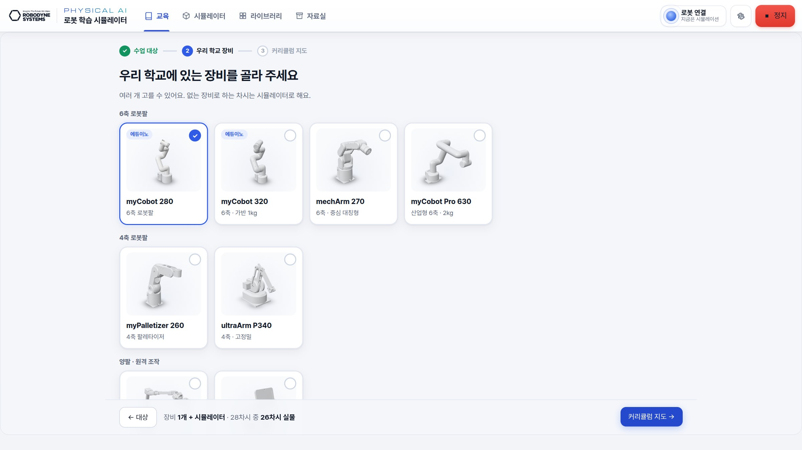
:::

## 커리큘럼 지도

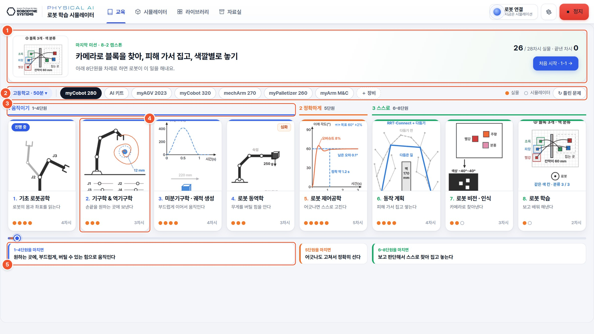

::: marks
1. **마지막 미션** — 과정 끝에 로봇이 해낼 일. 오른쪽은 실물로 하는 차시 수와 **[이어서]** 버튼입니다.
2. **대상 · 장비 칩** — 장비를 켜고 끄면 아래 점이 실물 ●/시뮬레이터 ○ 로 뒤집히고, 몇 차시가 바뀌었는지 잠깐 보입니다.
3. **세 단계** — 1 움직이기(1~4단원) → 2 정확하게(5단원) → 3 스스로(6~8단원).
4. **단원 타일** — 단원 이름이 제목, 그 아래가 *그 단원을 마치면 로봇이 할 수 있게 되는 것*. 움직이는 그림과 차시 점이 있습니다.
5. **진도 막대와 단계 요약** — 지금 위치(파란 점)와, 각 단계를 마치면 할 수 있게 되는 것.
:::

> 참고: 고등학교에서는 4단원(로봇 동역학)에 **심화** 표시가 붙습니다. 건너뛰어도 5단원으로 갈 수 있습니다.

## 단원 미리보기

단원 타일을 누르면 바로 수업으로 가지 않고, 오른쪽에 그 단원이 열립니다. 차시를 고른 뒤 **[n-m 수업 시작 →]** 을 눌러야 수업 화면으로 갑니다.

::: cols
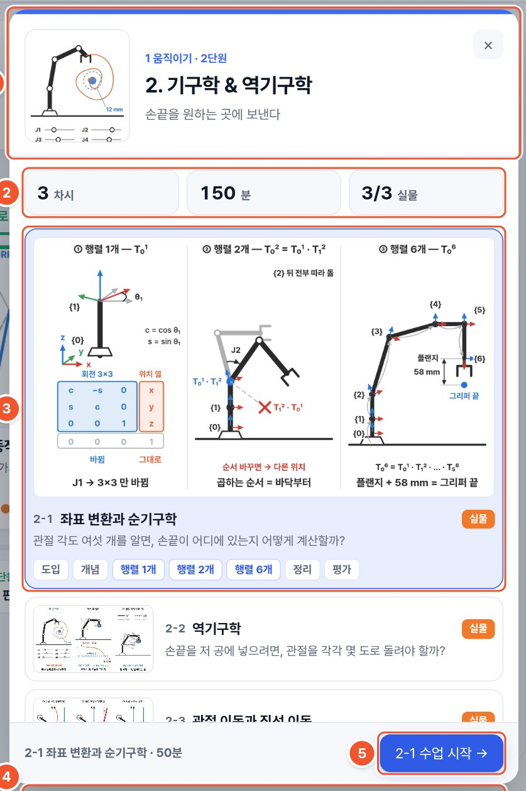
+++
::: marks
1. **단원 머리** — 단계 · 단원 번호 · 할 수 있게 되는 것.
2. **차시 · 분 · 실물** — 이 단원에 드는 시간과 실물로 하는 차시.
3. **차시 목록** — 차시마다 움직이는 그림. 고른 차시는 크게 보이고, 도입부터 평가까지의 순서가 나옵니다.
4. **먼저 할 단원 · 장비 · PDF** — 앞 단원을 끝냈는지(✓), 이 단원에 쓰는 장비, 이론 · 문항지 PDF.
5. **[수업 시작]** — 고른 차시의 수업 화면을 엽니다.
:::
:::

## 8개 단원과 순서

단원은 **움직이기(1~4) → 정확하게(5) → 스스로(6~8)** 순서로 쌓입니다(대학 로봇공학 교과의 표준 순서와 같습니다). 앞 단원의 개념을 뒤 단원이 그대로 씁니다.

| 단원 | 차시 | 할 수 있게 되는 것 | 학생이 할 수 있는 것 |
| --- | --- | --- | --- |
| 1 기초 로봇공학 | 1~4 | 로봇의 몸과 좌표를 읽는다 | 로봇을 자유도와 좌표로 설명하고, 손끝이 닿는 곳과 안 닿는 곳을 안다 |
| 2 기구학 & 역기구학 | 5~7 | 손끝을 원하는 곳에 보낸다 | 관절 각도와 손끝 포즈를 서로 바꿔 계산하고, 관절 이동과 직선 이동을 고른다 |
| 3 미분기구학 · 궤적 생성 | 8~11 | 부드럽게 이어서 움직인다 | 손끝 속도와 특이점을 알고, 블록을 떨어뜨리지 않는 궤적을 만든다 |
| 4 로봇 동역학 | 12~14 | 무게를 버틸 힘을 안다 | 움직이는 데 필요한 토크를 알고, 모터 한계 안에서 자세 · 무게 · 빠르기를 정한다 |
| 5 로봇 제어공학 | 15~19 | 어긋나면 스스로 고친다 | 짐 무게가 바뀌어도 같은 자리에 서게 하고, 힘을 제한하고, 보정으로 차이를 맞춘다 |
| 6 동작 계획 | 20~23 | 피해 가서 집고 쌓는다 | 장애물을 피해 길을 찾고, 블록을 밀지 않고 집어 놓고 쌓는다 |
| 7 로봇 비전 · 인식 | 24~26 | 카메라로 찾아낸다 | 픽셀을 mm 로 바꾸고, 색으로 물체를 찾고, 보면서 따라간다 |
| 8 로봇 학습 | 27~28 | 보고 배워 해낸다 | 시연에서 배우는 원리를 알고, 보고 판단해서 집어 놓는 프로그램을 끝까지 잇는다 |

## 운영 방식 고르기

| 방식 | 장비 | 이런 수업에 |
| --- | --- | --- |
| **PC 만** | 학생 PC 마다 시뮬레이터 | 이론 중심 정규 수업, 로봇이 없는 학교, 원격 수업 |
| **조별 로봇** | PC 2~3 대 + 로봇 1 대 / 조 | 시뮬레이터로 탐구한 뒤 조마다 실물로 확인 |
| **시연 로봇** | 선생님 PC + 로봇 1 대 | 학생은 PC 로 탐구하고, 선생님이 대표로 실물을 보여 줌 |

28차시는 주 2차시면 14주(한 학기), 주 1차시면 1년 과정입니다. 단원 단위로 끊어 방과후 · 캠프(예: 단원 1~2, 7차시)로 운영해도 됩니다.

# 수업 준비

## 교실 배치

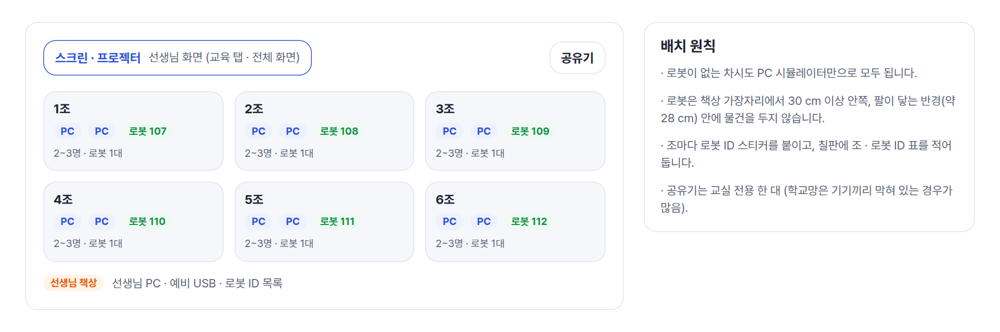

## 소프트웨어 준비 (수업 전 한 번)

::: step 학생 PC 에 시뮬레이터
`PhysicalAI-Simulator.zip` 을 풀어 바탕화면에 둡니다. 설치 · 관리자 권한 · 인터넷이 필요 없습니다.
처음 실행할 때 "Windows의 PC 보호" 가 나오면 [추가 정보] → [실행] (「시뮬레이터 사용 매뉴얼」 2장).
:::

::: step 교육 탭 열어 보기
시뮬레이터 시작 화면에서 **시뮬레이터로 시작** → 모델 → 윗줄 **[교육]**. 처음이면 수업 대상(고등학교 / 대학교)과 우리 학교 장비를 고르고, 커리큘럼 지도가 보이면 준비된 것입니다.
고른 것은 PC 마다 기억됩니다.
:::

::: step 자료실 PDF 인쇄
[자료실] 에서 이번에 가르칠 단원의 **이론 교재**(학생 1부씩)와 **문항지**를 받아 둡니다(6장).
:::

::: step 로봇이 있으면 — Wi-Fi 연결
로봇마다 USB 의 `wifi.txt` 로 교실 공유기에 붙여 두고, 로봇 ID 스티커를 붙입니다(「시뮬레이터 사용 매뉴얼」 10장).
:::

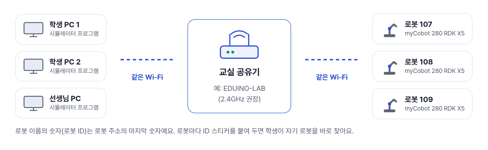

## 수업 전 점검표

| 언제 | 확인할 것 |
| --- | --- |
| 학기 전 | 학생 PC 마다 시뮬레이터가 열리는지 · 교육 탭 커리큘럼 지도가 보이는지 |
| 학기 전 | 이론 교재 · 문항지 인쇄 (단원별) |
| 로봇 쓰는 날 | 로봇 전원 · 교실 공유기 · 로봇 ID 목록 · 로봇 주변 30 cm 비우기 |
| 로봇 쓰는 날 | 처음 쓰는 로봇이면 영점 맞추기 (화면과 실제 팔의 자세가 같은지) |
| 수업 직전 | 선생님 화면을 스크린에 띄우고 오늘 차시의 **도입** 쪽을 열어 두기 |

## 안전 수칙 (로봇을 쓸 때)

> 안전: 로봇이 움직이는 동안에는 팔이 닿는 반경(약 30 cm) 안에 손 · 얼굴 · 물건을 두지 않습니다. 이상하면 누구든 **Esc** 또는 윗줄 **[■ 정지]** 를 누르게 미리 약속합니다.

- 실제 로봇으로는 **시뮬레이션을 통과한 동작만** 보냅니다. 시뮬레이터가 책상에 닿는 자세와 너무 빠른 동작을 먼저 막습니다.
- 속도는 최대 50 으로 제한되고, 모든 관절 각도는 로봇 한계 안에서만 보냅니다.
- 한 조에 한 사람이 로봇 담당을 맡아, 실행 버튼은 담당자만 누르게 합니다.
- 흡착 펌프 · 그리퍼를 쓰는 차시는 블록을 화면과 같은 자리에 둡니다.

# 한 차시 운영 — 50분

## 수업 흐름

모든 차시가 같은 순서입니다. 수업 화면 위쪽의 **단계 막대**(도입 · 개념 · 활동 1 · 2 · 3 · 정리 · 평가)가 이 흐름 그대로이고,
지금 하는 단계가 파랗게 깜빡이며 끝낸 단계에는 ✓ 가 붙습니다. 대학교(75분)는 개념 · 활동 · 정리 · 평가가 조금씩 길어집니다.

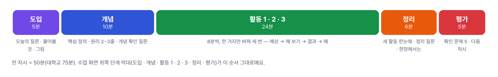

## 수업 화면 구성

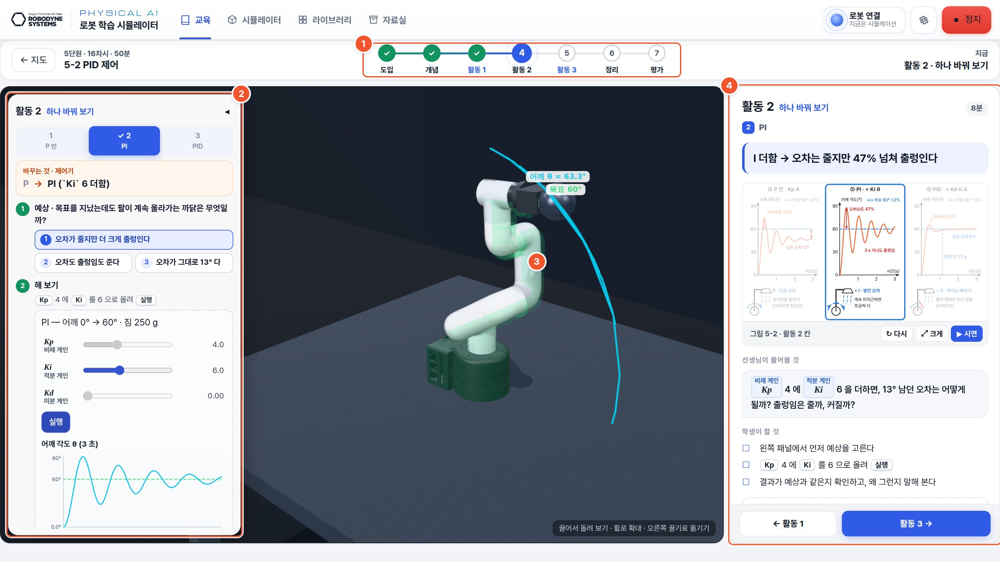

::: marks
1. **단계 막대** — ← 지도, 차시 이름, 7단계와 "지금" 하는 단계. 단계를 누르면 그리로 갑니다.
2. **활동 패널** — 활동 단계에서 바꾸는 것 · 예상 · 해 보기 · 결과 · 왜를 차례로 보여 줍니다. ◂ 로 접을 수 있습니다.
3. **3D 화면** — 로봇이 움직이는 곳. 패널에 가리지 않게 로봇이 빈 곳 가운데에 섭니다.
4. **수업 카드** — 지금 단계의 핵심 한 줄, 그림, 선생님이 물어볼 것, 학생이 할 것, 정답. 아래 [← 이전] [다음 →].
:::

> 팁: 카드는 짧게 쓰여 있고, 긴 설명은 **자세히 · 정답 보기** 를 눌러야 펼쳐집니다. 수업 중에는 핵심 한 줄과 발문만 읽어도 흐름이 이어집니다.

## 도입 (5분) — 질문으로 시작

::: cols
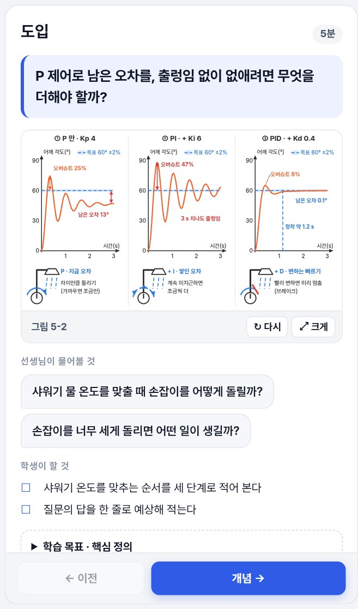
+++
**카드에 있는 것**: 오늘의 질문(핵심 한 줄), 움직이는 그림, **선생님이 물어볼 것** 1~2개, **학생이 할 것**, 접힌 *학습 목표 · 핵심 정의*, 용어.

**선생님이 할 일**
- 물어볼 것을 그대로 읽고 학생 2~3 명의 생각을 듣습니다. **답을 알려 주지 않습니다.** 정리 단계에서 다시 이 질문으로 돌아옵니다.
- 그림의 세 칸이 오늘의 활동 1 · 2 · 3 이라고 짚어 줍니다.
:::

## 개념 (10분) — 원리만 짧게

**카드에 있는 것**: 핵심 정의 한 줄, 원리 2~3줄, 그림, 개념 확인 질문, 접힌 *자세히 · 기호*(대학교는 수식도).

**선생님이 할 일**
- 원리 2~3줄만 확실히 짚고, 개념 확인 질문으로 이해를 확인합니다. 자세한 설명은 탐구 활동 뒤에 읽으면 더 잘 이해됩니다.
- 본문의 파란 기호 칩(예: `Kp`)은 누르면 읽는 법 · 뜻 · 단위가 나옵니다(오른쪽 그림).

::: cols
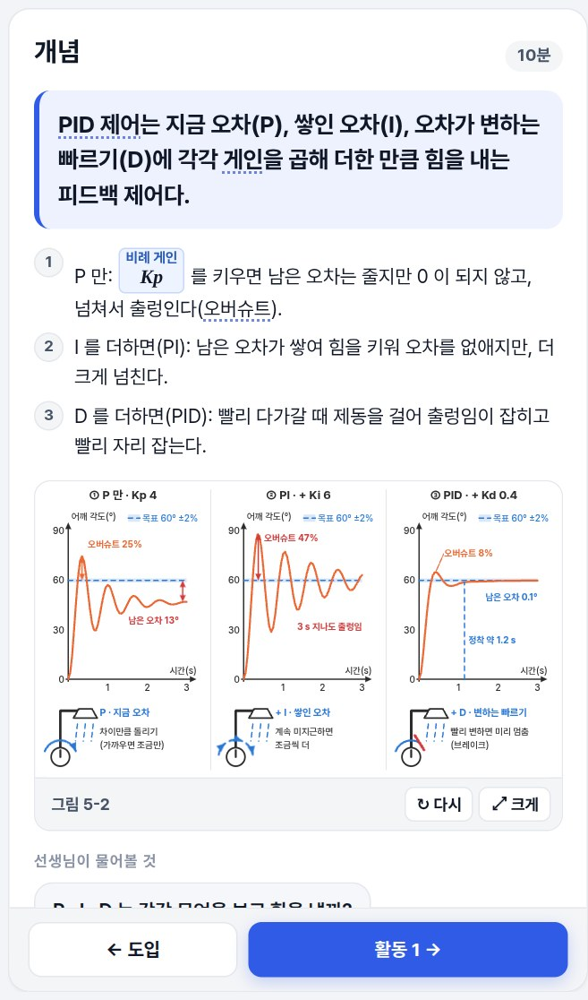
+++
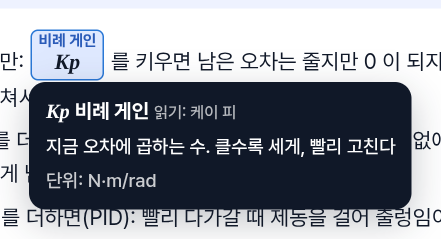
:::

## 탐구 활동 1 · 2 · 3 (8분씩) — 한 가지만 바꿔 세 번

세 활동은 **같은 동작에서 한 가지만** 바꿉니다. 활동 1은 *그대로 해 보기*, 활동 2는 *하나 바꿔 보기*, 활동 3은 *한 번 더 바꾸기* 입니다.
무엇이 바뀌는지는 활동 패널 맨 위 **바꾸는 것** 상자에 크게 나옵니다(예: P → PI → PID).

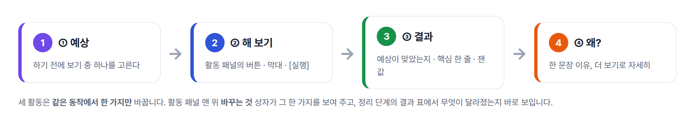

### 활동 패널 — 예상 → 해 보기 → 결과 → 왜

::: cols
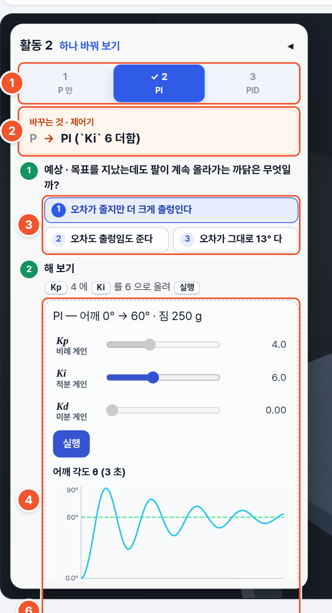
+++
::: marks
1. **세 활동** — 끝낸 활동에 ✓. 누르면 그 활동으로 갑니다.
2. **바꾸는 것** — 이번 활동에서 바뀌는 한 가지와 앞 → 뒤 값.
3. **① 예상** — 하기 전에 보기 중 하나를 고릅니다.
4. **② 해 보기** — 그 차시의 버튼 · 막대 · 그래프. 할 일 한 줄이 위에 있습니다.
5. **③ 결과** — 예상이 맞았는지, 핵심 한 줄, 시뮬레이터가 잰 값.
6. **④ 왜 그럴까?** — 한 문장 이유, [더 보기] 로 긴 설명.
:::
:::

**선생님이 할 일**
- 예상을 먼저 고르게 한 뒤 해 보게 합니다. 예상이 틀려도 괜찮다고 미리 말해 줍니다. 인쇄 교재에도 같은 보기가 있습니다.
- 조를 돌며 카드의 **선생님이 물어볼 것** 을 묻습니다. 결과가 나오면 "예상과 무엇이 달랐나요?" 를 묻습니다.
- 왜 그럴까는 학생이 먼저 자기 말로 설명해 보게 한 뒤 펼칩니다.

::: cols
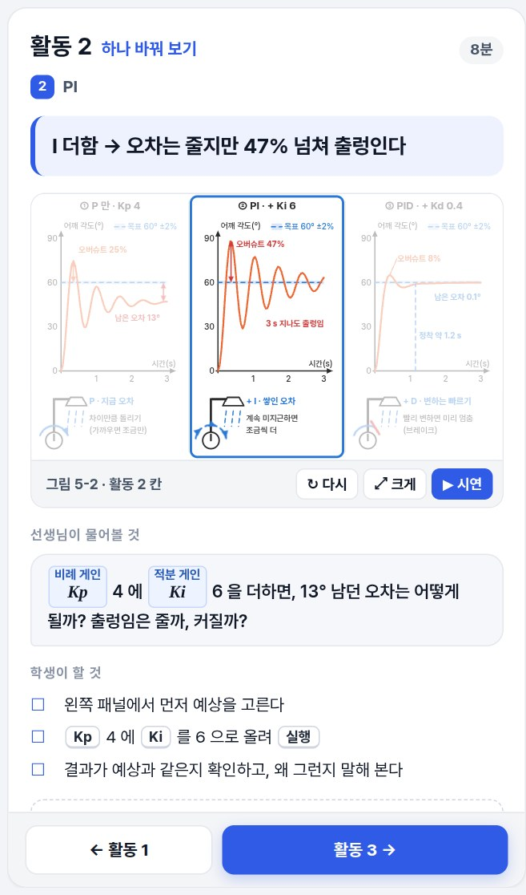
+++
**활동 카드에 있는 것**: 이번 활동의 핵심 한 줄, 그림(이번 활동 칸만 파란 테두리), 선생님이 물어볼 것(예상 질문), 학생이 할 것, 접힌 *정답 · 설명*.

**시연 보기** — 카드 그림 아래 **[▶ 시연]** 을 누르면, 원고의 할 일대로 했을 때의 화면(GIF)이 크게 나옵니다.
막힌 조에 보여 주거나, 해 본 뒤 결과를 비교할 때 씁니다. 창 아래 [GIF 내려받기] 로 수업 슬라이드에 넣을 수 있습니다.
:::

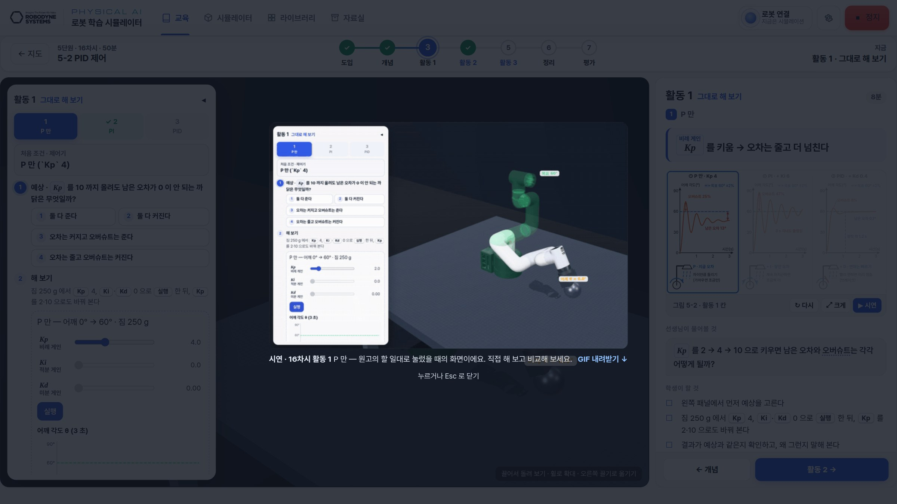{w=80}

## 정리 (6분) — 세 활동 비교

::: cols
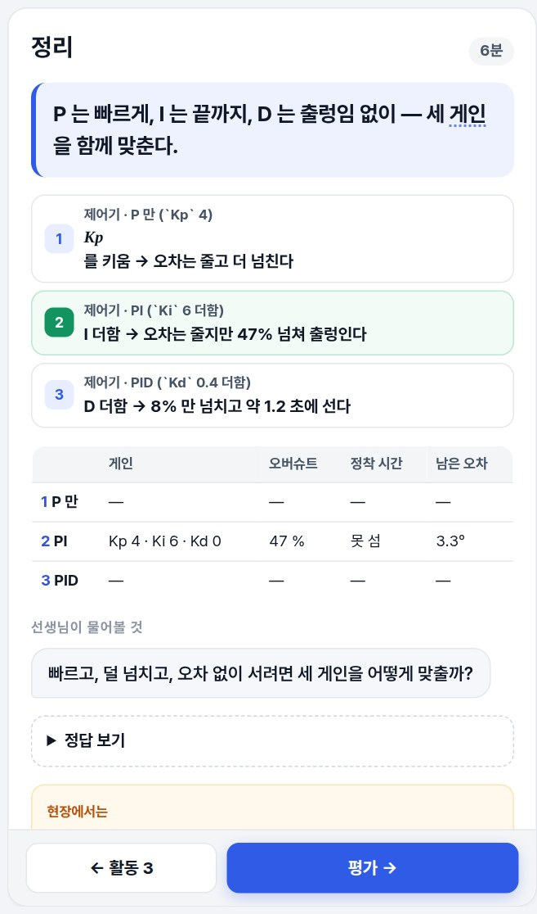
+++
**선생님이 할 일**
- **세 활동 한눈에** 를 함께 읽고, 바꾼 한 가지가 어떤 값을 어떻게 바꿨는지 한 문장으로 말하게 합니다.
- **정리 질문** 을 묻고 답을 들은 뒤 [정답 보기] 로 확인합니다. 도입의 질문으로 돌아가 다시 답하게 합니다.
- **현장에서는** 으로 이 개념이 실제 산업 현장 어디에 쓰이는지 이어 줍니다.
- 학습 목표 확인을 학생이 스스로 표시하게 합니다.
:::

## 평가 (5분) — 형성 평가와 다음 차시

- 확인 문제는 **OX 3 + 객관식 2** 입니다. 누르면 바로 맞음 · 틀림과 해설이 나옵니다. 대학교면 심화 문항이 더해집니다.
- 다 맞히면 그 차시가 끝난 것으로 표시되고, 지도의 진도가 올라갑니다. 틀린 문제는 지도의 **[↻ 틀린 문제]** 에 모여 다시 풀 수 있습니다.
- 맨 아래 **다음 차시** 카드로 다음 차시의 질문을 미리 보여 주고 마칩니다.

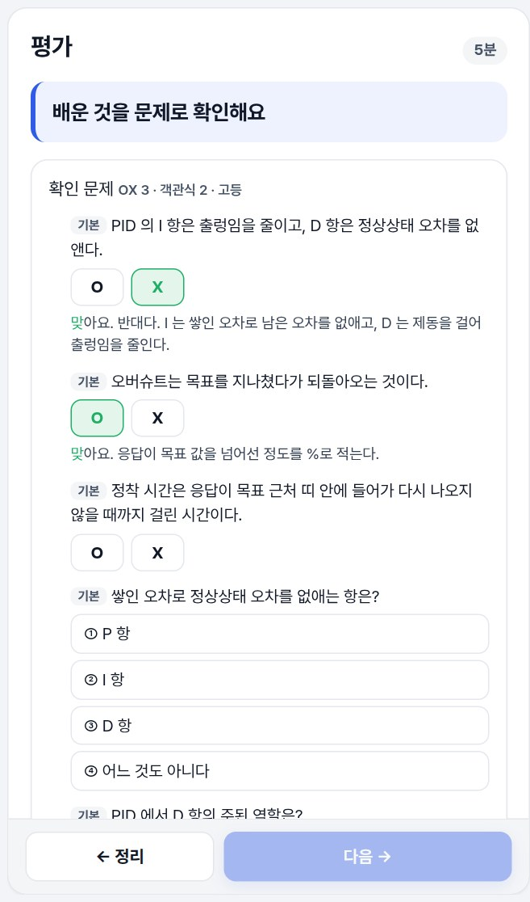{w=52}

## 수업 지도안 예시 — 16차시 PID 제어

| 단계 | 시간 | 선생님 | 학생 | 화면 · 자료 |
| --- | --- | --- | --- | --- |
| 도입 | 5분 | "P 제어로 남은 오차를 출렁임 없이 없애려면 무엇을 더해야 할까?" 를 묻고 생각을 듣는다 | 질문에 답하고 할 일을 한다 | 도입 카드 · 그림 5-2 |
| 개념 | 10분 | P · I · D 가 각각 지금 오차 · 쌓인 오차 · 오차의 빠르기에 반응한다는 것을 짚는다 | 기호 칩에서 `Kp` `Ki` `Kd` 의 뜻과 단위를 확인한다 | 개념 카드 |
| 활동 1 | 8분 | 예상을 먼저 고르게 한다 | P 만으로 실행 — 남은 오차 13° 를 확인한다 | 활동 패널 · 결과 |
| 활동 2 | 8분 | "오차는 줄었는데 무엇이 나빠졌나?" 를 묻는다 | Ki 6 을 더해 실행 — 오버슈트 47 %, 출렁임을 확인한다 | 활동 패널 · 시연 보기 |
| 활동 3 | 8분 | 세 값의 균형을 묻는다 | Kd 0.4 를 더해 실행 — 남은 오차 0.1°, 정착 약 1.2 s 를 확인한다 | 활동 패널 |
| 정리 | 6분 | 세 활동 한눈에를 함께 읽고 정리 질문을 묻는다 | "P 는 빠르게, I 는 끝까지, D 는 출렁임 없이" 를 자기 말로 정리한다 | 정리 쪽 · 현장에서는 |
| 평가 | 5분 | 많이 틀린 문항을 짚는다 | 확인 문제 5개를 푼다 | 평가 카드 · 다음 차시 |

# 28차시 수업 계획표

각 차시의 질문은 도입의 **생각 열기**이고, 활동 1 · 2 · 3 은 같은 동작에서 한 가지만 바꾼 세 실습입니다.

## 역학 — 단원 1 ~ 4

| 차시 | 주제 | 생각 열기 질문 | 활동 1 · 2 · 3 |
| --- | --- | --- | --- |
| 1 | 1-1 관절 · 링크 · 자유도 | 관절이 하나 늘어나면 손끝이 갈 수 있는 곳은 어떻게 달라질까? | ① 관절 1개 ② 관절 2개 ③ 관절 6개 |
| 2 | 1-2 위치와 자세 | "손끝을 저기로 보내" 라고 하려면 숫자가 몇 개 필요할까? | ① x·y 만 ② x·y + z ③ 위치 고정 + 자세 |
| 3 | 1-3 자세 표현 — 회전의 순서 | 롤 90°, 피치 90° 를 적용하는 순서를 바꾸면 같은 자세가 나올까? | ① 축 하나씩 ② 순서 바꾸기 ③ 피치 90° |
| 4 | 1-4 작업 공간 | 로봇팔이 닿을 수 있는 곳은 어디까지이고, 관절 한계를 줄이면 얼마나 줄어들까? | ① J1 만 ② 세로 단면 ③ 3D + 관절 한계 |
| 5 | 2-1 좌표 변환과 순기구학 | 관절 각도 여섯 개를 알면, 손끝이 어디에 있는지 어떻게 계산할까? | ① 행렬 1개 ② 행렬 2개 ③ 행렬 6개 |
| 6 | 2-2 역기구학 | 손끝을 저 공에 넣으려면, 관절을 각각 몇 도로 돌려야 할까? | ① 손으로 ② 반복 풀이 ③ 출발 자세 여러 개 |
| 7 | 2-3 관절 이동과 직선 이동 | A 에서 B 로 갈 때, 손끝은 어떤 길로 갈까? | ① 관절 보간 ② 직선 보간 (위치만) ③ 직선 + 자세 유지 |
| 8 | 3-1 속도와 자코비안 | 관절을 조금 돌리면, 손끝은 어느 쪽으로 얼마나 빨리 움직일까? | ① 관절 하나 ② 섞어서 한 방향 ③ 특이점 근처 |
| 9 | 3-2 궤적 프로파일 | 판 위에 블록을 올려 나를 때, 어떻게 움직여야 블록이 떨어지지 않을까? | ① 위치만 ② 위치 + 속도 ③ 위치 + 속도 + 가속도 |
| 10 | 3-3 경유점과 블렌딩 | 여러 점을 차례로 지나갈 때, 점마다 멈춰야 할까? | ① 점마다 멈춤 ② 꺾어 가기 ③ 둥글게 잇기 |
| 11 | 3-4 관절 동기화 | 여러 관절이 각자 다른 각도만큼 돌 때, 어떻게 맞춰 움직일까? | ① 따로 ② 같은 시간 2 초 ③ 가장 느린 관절에 맞춤 |
| 12 | 4-1 중력 토크 | 팔이 가만히 멈춰 있기만 해도 모터는 힘을 내야 할까? | ① 버티는 자세 ② 무게 들기 ③ 팔 뻗기 |
| 13 | 4-2 관성과 가속 토크 | 같은 곳으로 가도 빨리 움직이려면 모터는 얼마나 더 힘을 내야 할까? | ① 느리게 ② 빠르게 ③ 빠르고 급하게 |
| 14 | 4-3 질량과 마찰 | 같은 동작으로 밀어도 블록마다 다르게 움직이는 까닭은? | ① 가벼운 블록 ② 무거운 블록 ③ 미끄러운 블록 |

## 제어 — 단원 5

| 차시 | 주제 | 생각 열기 질문 | 활동 1 · 2 · 3 |
| --- | --- | --- | --- |
| 15 | 5-1 피드백의 원리 | 필요한 토크를 계산해서 그대로 내면, 짐을 달아도 원하는 각도에 설까? | ① 개루프·짐 없음 ② 개루프·짐 있음 ③ 폐루프 P 제어 |
| 16 | 5-2 PID 제어 | P 제어로 남은 오차를, 출렁임 없이 없애려면 무엇을 더해야 할까? | ① P 만 ② PI ③ PID |
| 17 | 5-3 궤적 추종 | 목표가 한 점이 아니라 움직이는 궤적이면, 관절은 얼마나 늦게 따라갈까? | ① 느리게 ② 빠르게 ③ 빠르게 + 피드포워드 |
| 18 | 5-4 힘 제한과 안전 여유 | 로봇팔이 사람 손에 닿았을 때, 얼마나 세게 누르게 될까? | ① 제한 3 N·m ② 제한 1.5 N·m ③ 제한 0.6 N·m |
| 19 | 5-5 오차와 캘리브레이션 | 같은 명령을 보냈는데 실제 로봇은 왜 시뮬레이터와 조금 다른 곳에 갈까? | ① 이상적 ② 영점이 어긋나면 ③ 측정해서 보정 |

## 계획 · 인식 · 학습 — 단원 6 ~ 8

| 차시 | 주제 | 생각 열기 질문 | 활동 1 · 2 · 3 |
| --- | --- | --- | --- |
| 20 | 6-1 충돌 검사 | 로봇이 움직이기 전에, 가는 도중 어디에 부딪힐지 어떻게 미리 알까? | ① 멈춘 자세만 ② 30° 간격 ③ 5° 간격 |
| 21 | 6-2 경로 계획 | 벽 너머 목표까지, 로봇이 부딪히지 않는 길을 스스로 찾을 수 있을까? | ① 그냥 직선 ② 경유점 직접 ③ 자동 탐색 RRT |
| 22 | 6-3 집기와 놓기 | 블록을 밀지 않고 집어서 원하는 자리에 반듯하게 놓으려면, 어떤 순서로 움직여야 할까? | ① 바로 집기 ② 4단계로 집기 ③ 놓는 높이 |
| 23 | 6-4 쌓기 | 블록 세 개를 탑으로 쌓을 때, 얼마나 빨리 움직여도 될까? | ① 느리게 ② 빠르게 ③ 너무 빠르게 |
| 24 | 7-1 카메라와 좌표 | 카메라가 본 "사진 속 위치" 를 로봇이 갈 "책상 위 위치" 로 어떻게 바꿀까? | ① 픽셀만 ② 마커 보정 ③ 손 카메라 |
| 25 | 7-2 색으로 찾기 | 카메라는 사진 속에서 빨간 블록을 어떻게 찾고, 방이 어두워지면 왜 놓칠까? | ① 임계값 ② 조명 ③ 여러 개 · 가림 |
| 26 | 7-3 시각 서보 | 움직이는 블록을 카메라로 보면서 따라가려면 어떻게 해야 할까? | ① 한 번 보고 ② 계속 보기 · 이득 3 ③ 계속 보기 · 이득 9 |
| 27 | 8-1 시연으로 배우기 | 사람이 한 번 보여 준 동작을, 블록이 다른 자리에 있을 때도 할 수 있을까? | ① 시연 1개 ② 블록 옮기고 재생 ③ 시연 3개로 일반화 |
| 28 | 8-2 캡스톤 | 블록이 어디에 몇 개 있는지 모를 때, 로봇이 스스로 보고 색깔별로 나눠 놓으려면 무엇을 어떤 순서로 이어야 할까? | ① 블록 1개 · 정해진 자리 ② 블록 1개 · 무작위 자리 ③ 블록 3개 · 색 분류 |

# 단원별 지도 포인트

학생이 자주 헷갈리는 곳과, 그때 시뮬레이터의 어느 화면을 다시 보여 주면 좋은지 정리했습니다.

## 1 기초 로봇공학 (1~4차시)

- **핵심**: 손끝의 위치(3개)와 자세(3개)를 모두 정하려면 숫자 6개가 필요하고, 그래서 6축 로봇팔이 쓰입니다.
- **자주 헷갈리는 것**: "관절이 많을수록 무조건 좋다" — 1-1 활동 3 에서 관절이 늘면 같은 손끝 위치에 여러 팔 모양이 생겨 오히려 골라야 할 것이 많아짐을 보여 줍니다.
- 회전의 순서(1-3)는 손으로 책을 들고 롤 → 피치, 피치 → 롤 로 직접 돌려 보게 하면 바로 이해합니다.

## 2 기구학 & 역기구학 (5~7차시)

- **핵심**: 순기구학은 답이 하나, 역기구학은 답이 여럿이거나 없을 수 있습니다.
- **자주 헷갈리는 것**: "관절 이동도 손끝은 곧게 간다" — 2-3 에서 관절 보간의 손끝 궤적(곡선)과 직선 보간을 겹쳐 보여 줍니다. [표시 ▾] → 도구 궤적.
- 2-2 활동 3(출발 자세 여러 개)에서 같은 목표에 다른 팔 모양이 나오는 것을 꼭 짚습니다.

## 3 미분기구학 · 궤적 생성 (8~11차시)

- **핵심**: 같은 길도 **속도 · 가속도를 어떻게 바꾸느냐**에 따라 블록이 떨어지기도 하고 안 떨어지기도 합니다.
- **자주 헷갈리는 것**: "빨리 가면 무조건 위험하다" — 3-2 에서 문제는 빠르기보다 **갑자기 바뀌는 가속도**임을 그래프로 보여 줍니다.
- 특이점(3-1 활동 3)은 팔을 거의 곧게 편 자세에서 손끝이 어느 방향으로는 움직이지 못하는 모습으로 보여 줍니다.

## 4 로봇 동역학 (12~14차시)

- **핵심**: 모터는 멈춰 있을 때도 중력을 버티는 힘(토크)을 내고, 빨리 움직일수록 더 큰 힘이 듭니다.
- 팔을 뻗을수록(4-1 활동 3) 어깨 토크가 커지는 것을, 학생이 직접 팔에 물병을 들고 뻗어 보는 활동과 이어 주면 좋습니다.

> 참고: 4 · 5 단원의 질량 · 관성 · 모터 한계는 공식 자료에 없어 3D 모델 부피로 추정한 **근사값**입니다. 숫자 자체보다 "커진다 · 줄어든다" 경향을 보게 지도합니다.

## 5 로봇 제어공학 (15~19차시)

- **핵심**: 계산만으로 움직이면(개루프) 짐이 바뀔 때 틀어지고, 재면서 고치면(폐루프) 맞출 수 있습니다.
- **자주 헷갈리는 것**: PID 의 I 와 D 의 역할을 반대로 기억하는 경우가 많습니다 — "I 는 끝까지(남은 오차), D 는 브레이크(출렁임)".
- 5-4 힘 제한은 협동 로봇이 사람과 함께 일할 수 있는 이유와 연결해 줍니다(협동 로봇의 힘 한계 기준: ISO/TS 15066).
- 5-5 캘리브레이션은 실제 로봇이 있으면 [실물로 확인] 으로 시뮬레이터와 실물의 차이를 직접 재 봅니다.

## 6 동작 계획 (20~23차시)

- **핵심**: 충돌을 미리 검사하고, 장애물을 피하는 길을 스스로 찾고, 집기 · 놓기는 **접근 → 내려가기 → 집기 → 올라가기** 순서로 나눕니다.
- 6-1 에서 검사 간격이 넓으면 얇은 장애물을 건너뛰고 지나간다는 점을 꼭 보여 줍니다.
- 6-2 의 RRT 는 실행할 때마다 길이 달라집니다. 여러 조의 결과를 비교하면 "무작위로 찾는다" 는 뜻이 잘 전달됩니다.

## 7 로봇 비전 · 인식 (24~26차시)

- **핵심**: 카메라의 픽셀 좌표를 로봇의 mm 좌표로 바꾸려면 기준(마커)으로 보정해야 합니다.
- 7-2 에서 조명이 바뀌면 색 인식이 흔들리는 것을 보여 주고, 실제 교실 조명에서도 같은 일이 생긴다고 이어 줍니다.
- 7-3 시각 서보는 이득이 너무 크면 목표를 지나쳐 흔들립니다 — 5 단원의 오버슈트와 같은 현상임을 연결합니다.

## 8 로봇 학습 (27~28차시)

- **핵심**: 시연을 그대로 따라 하는 것과, 여러 시연에서 "블록 기준의 움직임" 을 배워 새 자리에도 하는 것의 차이.
- 8-2 캡스톤은 7 · 6 · 3 단원을 이어 붙이는 종합 프로젝트입니다. 2차시로 늘려 조별 발표까지 하면 좋습니다.

# 평가

## 평가 자료

| 자료 | 어디서 | 쓰는 때 |
| --- | --- | --- |
| 형성 평가 (OX 3 + 객관식 2) | 각 차시의 평가 카드 | 매 차시 끝 5분 — 바로 채점 · 해설 |
| OX 문항지 | 자료실 · 단원별 PDF | 단원을 마친 뒤 복습 · 쪽지 시험 (차시마다 10문항, 맨 뒤에 정답 · 해설) |
| 객관식 문항지 | 자료실 · 단원별 PDF | 단원 평가 (4지 선다, 차시마다 10문항) |
| 전체 문항집 | 자료실 | 학기말 평가 문항 고르기 (560문항) |
| 이론 교재의 예상 보기 · 기록표 · 정리 질문 | 자료실 · 이론 교재 | 수행 평가 — 탐구 과정 기록 (맨 아래 교사용 답) |

## 수행 평가 기준 예시 — 탐구 활동 기록

| 평가 요소 | 잘함 | 보통 | 노력 필요 |
| --- | --- | --- | --- |
| 예상 | 활동 전에 근거를 들어 예상을 적었다 | 예상을 적었으나 근거가 없다 | 예상을 적지 않았다 |
| 기록 | 세 활동의 결과를 단위와 함께 빠짐없이 기록했다 | 일부 값이나 단위가 빠졌다 | 기록이 대부분 비어 있다 |
| 비교 | 바꾼 한 가지가 어떤 값을 어떻게 바꿨는지 설명했다 | 결과의 차이만 적었다 | 비교하지 않았다 |
| 설명 | "왜 그럴까" 를 자기 말로, 숫자를 들어 설명했다 | 화면의 설명을 옮겨 적었다 | 설명하지 않았다 |

> 팁: 지도의 진도(끝낸 차시 · 단원의 ✓ 완료)는 PC 마다 저장됩니다. 학생이 같은 PC 를 쓰게 하면 진도 확인에 그대로 쓸 수 있습니다.

**문항지 · 교재 견본** — 문항지는 2단 시험지 형식이고, 맨 뒤에 정답과 해설이 있습니다.

::: cols
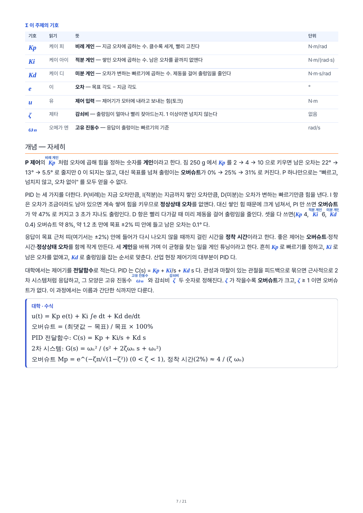
+++
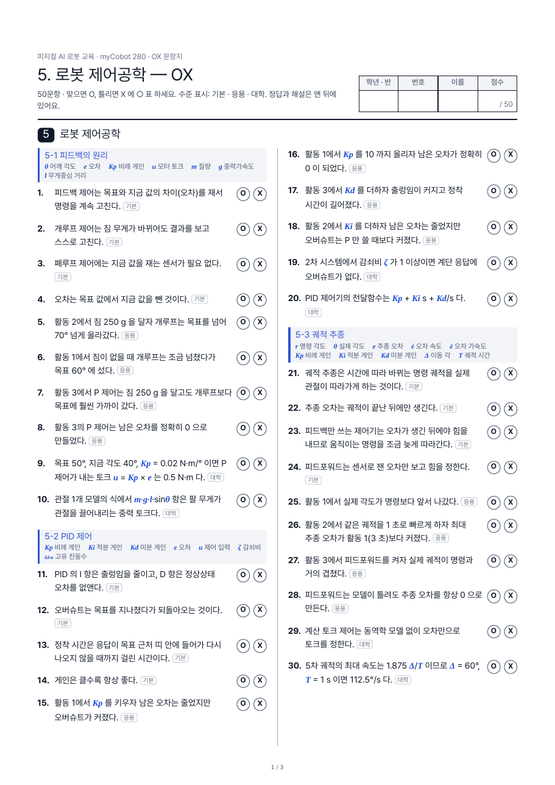
:::

# 자료실 활용

윗줄의 **[자료실]** 은 공유 폴더처럼 열립니다. 왼쪽 폴더 나무에서 고르고, 가운데에서 파일을 누르면 오른쪽에 첫 쪽 미리보기와 **[내려받기]** 가 나옵니다.
폴더는 두 번 눌러 들어가고, 위쪽 경로나 [↑] 로 나옵니다. 모두 프로그램 안에 들어 있어 인터넷 없이 받습니다.

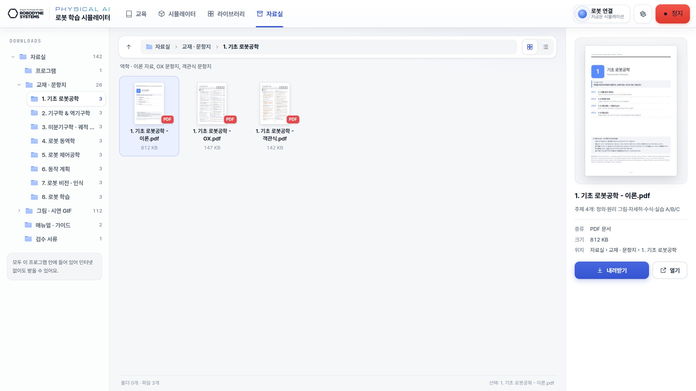

| 종류 | 개수 | 내용 |
| --- | --- | --- |
| 이론 교재 | 단원마다 1 (8) | 단원 표지 + 차시마다: 학습 목표 · 생각 열기 · 함께 생각해 보기 · 그림 · 정의 · 원리 · 기호 표 · 탐구 활동 1 · 2 · 3(바꾸는 것 · 예상 보기 · 핵심 · 빈 기록표) · 정리 질문 · 현장에서는 · 교사용 답 · 다음 차시 |
| OX 문항지 | 단원마다 1 (8) | 차시마다 10문항(기본 4 · 응용 4 · 대학 2), 맨 뒤에 정답과 해설 |
| 객관식 문항지 | 단원마다 1 (8) | 4지 선다, 차시마다 10문항, 맨 뒤에 정답과 해설 |
| 전체 문항집 | 1 | 모든 단원의 OX · 객관식 560문항 |
| 용어 사전 | 1 | 단원별로 처음 나오는 곳에 모은 용어, 영어 이름과 쉬운 설명 |
| 그림 · 시연 GIF | 28 + 84 | 주제 그림 애니메이션, 활동마다 원고대로 한 화면 — 수업 슬라이드용 |

**그림 · 시연 GIF** 폴더에는 단원마다 차시 그림 애니메이션과 활동 1 · 2 · 3 시연이 있습니다. 미리보기에서 움직임을 바로 확인할 수 있습니다.

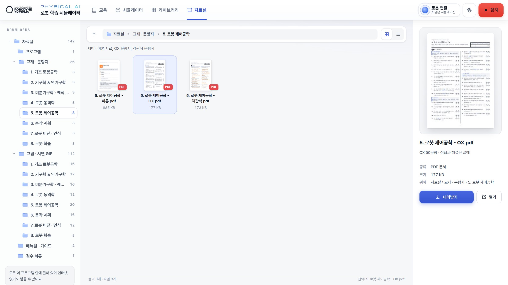

**인쇄 교재 견본** — 이론 교재는 단원 표지 다음에 차시마다 한 부분씩 이어집니다.

::: cols
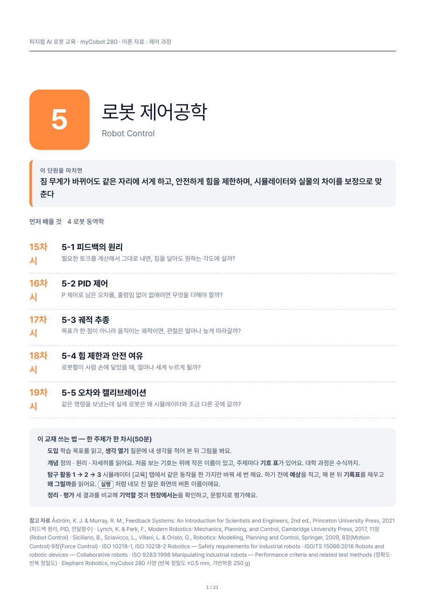
+++
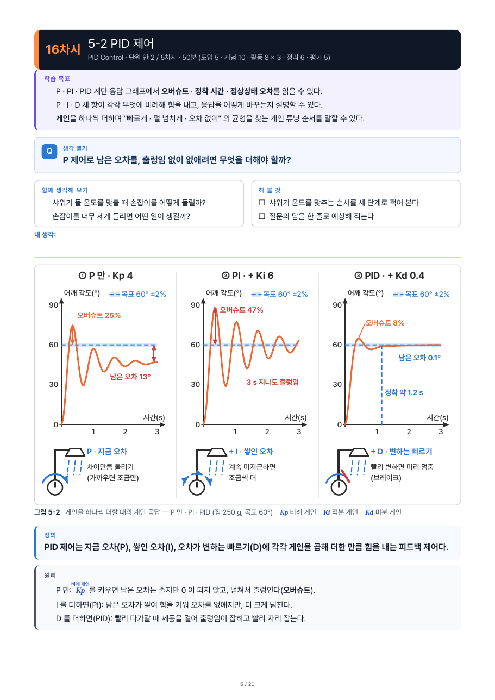
:::

# 자주 묻는 질문

| 질문 | 답 |
| --- | --- |
| 인터넷이 없는 교실에서도 되나요? | 됩니다. 시뮬레이터 · 교육 탭 · 자료실 PDF 가 모두 프로그램 안에 들어 있습니다 |
| 로봇이 한 대도 없으면? | 28차시 모두 PC 시뮬레이터만으로 운영할 수 있습니다. 지도의 점이 모두 시뮬레이터(○)로 표시됩니다 |
| 학생마다 진도가 다르면? | 지도에서 아무 단원 · 차시나 바로 열 수 있습니다. 끝낸 단원에는 ✓ 완료, 차시 점에는 초록 테두리가 남습니다 |
| 고등학교와 대학교의 차이는? | 대학교를 고르면 한 차시가 75분이 되고, 개념 카드에 수식, 평가에 심화 문항이 더해집니다. 탐구 활동은 같습니다 |
| 수치가 실제 로봇과 다를 수 있나요? | 기구학 · 궤적은 실제 로봇의 공식 3D 모델로 계산합니다. 4 · 5 단원의 질량 · 모터 값은 근사값이므로 경향을 봅니다 |
| 3D 화면을 넓게 보려면? | 활동 패널 머리의 ◂ 로 패널을 접습니다. 그림은 [크게] 또는 그림 클릭 |
| 시연 GIF 를 슬라이드에 넣으려면? | 자료실 → 그림 · 시연 GIF 에서 받거나, 시연 보기 창의 [GIF 내려받기] |
| 화면 조작이 막히면? | 「시뮬레이터 사용 매뉴얼」 12장(문제가 생기면) |

