# 시작하기

이 가이드는 **로봇 없이** PC 에서 돌아가는 시뮬레이터만 다뤄요. 인터넷이 없어도 돼요.
화면 속 로봇은 실제 로봇(myCobot 280 RDK X5)과 크기 · 관절 · 움직일 수 있는 범위가 같아요.

## 프로그램 켜기

::: step 켜기
바탕화면의 **Physical AI 시뮬레이터** 를 더블클릭해요. 검은 창이 뜨고 잠시 뒤 프로그램 창이 열려요.
브라우저로 쓰는 반이면 선생님이 알려 준 주소를 열어요.
:::

::: step [시뮬레이터로 시작]
시작 화면에서 **① [시뮬레이터로 시작]** 을 눌러요. 로봇 고르기가 나오면 **myCobot 280 RDK X5** 를 골라요.
:::

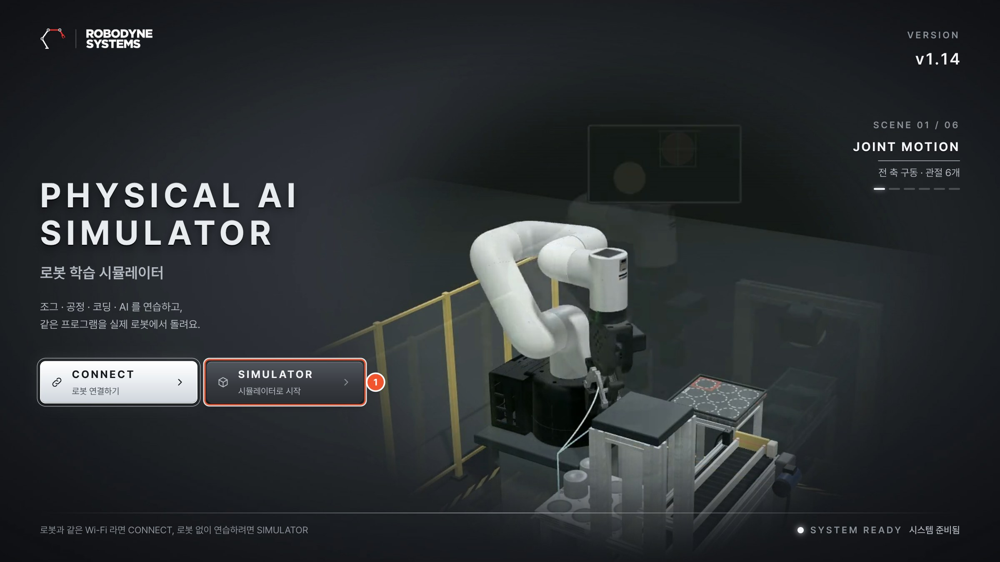{w=84}

## 처음 시작 안내

처음 열면 3D 화면 왼쪽 위에 **처음 시작** 카드가 떠요. 세 단계를 차례로 해 보면 프로그램의 큰 흐름을 한 번씩 경험해요.

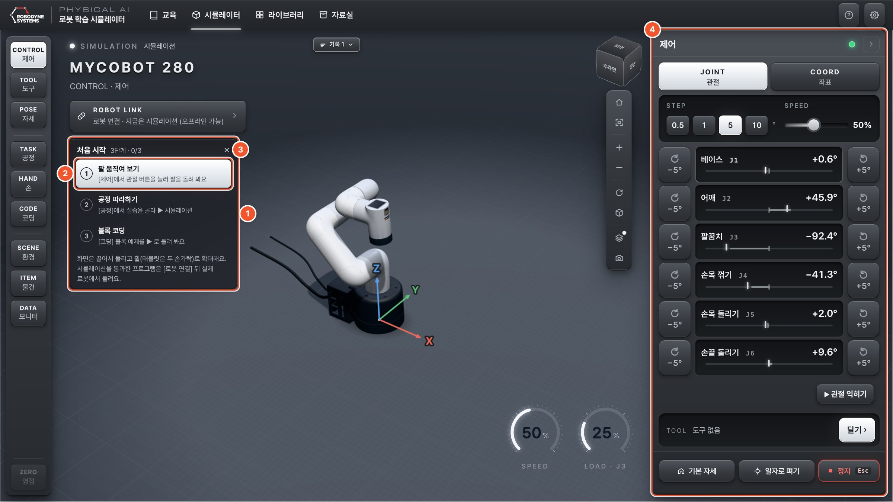

::: marks
1. **처음 시작** — 세 단계: 팔 움직여 보기 → 공정 따라하기 → 블록 코딩. 한 단계를 해내면 번호가 ✓ 로 바뀌어요.
2. **단계 누르기** — 그 단계의 화면이 오른쪽 작업 패널에 열려요.
3. **× 접기** — 작은 칩으로 접혀요. 칩을 누르면 다시 펼쳐져요.
4. **작업 패널** — 처음에는 [제어] 가 열려 있어요.
:::

::: cols
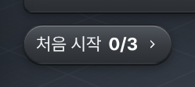
+++
- 세 단계를 다 하면 카드가 저절로 접혀 **처음 시작 3/3** 칩이 돼요.
- 다시 보고 싶으면 위 막대의 **[?] 도움말** → **[처음 시작 안내 다시 보기]**.
- 한 일은 이 PC 에 남아요. 다음에 켜도 ✓ 가 그대로예요.
:::

## 끄기

프로그램 창을 닫고, 뒤의 **검은 창**도 닫아요. 쓰는 동안에는 검은 창을 닫지 않아요.
만든 블록 프로그램과 공정은 저절로 저장돼요.

# 화면 둘러보기

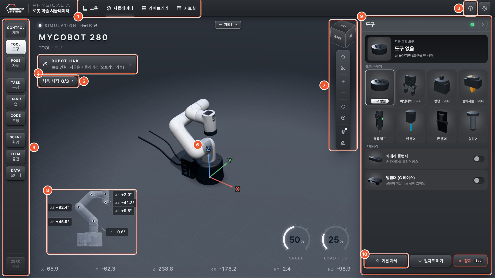

::: marks
1. **화면 탭** — [시뮬레이터] 에서 실습해요. [라이브러리] 는 과제와 예제 모음이에요.
2. **로봇 연결** — 실제 로봇과 연결할 때만 써요. 이 가이드에서는 쓰지 않아요.
3. **[?] 도움말** — 화면 설명, 순서, 단축키, 처음 시작 안내 다시 보기.
4. **왼쪽 메뉴** — [제어] [도구] [자세] · [공정] [손] [코딩] · [환경] [물건] [모니터]. 누르면 작업 패널이 그 화면으로 바뀌어요.
5. **처음 시작** — 접힌 칩. 누르면 펼쳐져요.
6. **3D 화면** — 화면 속 로봇과 책상.
7. **보기 도구** — 처음 시점, 전체 맞춤, 확대 · 축소, 시점 상자.
8. **작은 로봇** — 관절 각도. [제어] 를 열면 같은 숫자가 패널에 있어서 숨겨져요. 3D 아래 줄에는 손끝 위치(X · Y · Z · RX · RY · RZ)와 속도 · 부하 계기가 있어요.
9. **작업 패널** — 왼쪽 메뉴에서 고른 화면.
10. **[기본 자세] [일자로 펴기] [정지]** — 늘 맨 아래에 있어요.
:::

## 3D 화면 돌려 보기

| 마우스 | 하는 일 |
| --- | --- |
| 왼쪽 버튼 끌기 | 돌려 보기 |
| 휠 굴리기 | 확대 · 축소 (태블릿은 두 손가락) |
| 오른쪽 버튼 끌기 | 옮기기 |

> 팁: 로봇이 화면에서 사라지면 보기 도구의 **처음 시점**(집 모양)을 눌러요.

## 상황판과 기록

3D 화면 위 가운데에 지금 일어난 일이 한 줄로 떠요. **안내**(파랑) · **성공**(초록) · **주의**(주황) · **오류**(빨강) 로 색이 달라요.
오류에는 **어떻게 고치면 되는지** 가 함께 나와요. 지나간 알림은 옆의 **[기록]** 을 눌러 다시 봐요.

## 도움말과 단축키

::: cols
![[?] 도움말](img/g-help.png)
+++
| 키 | 하는 일 |
| --- | --- |
| **Esc** | 정지 (실행 중에는 스페이스도) |
| **Ctrl + Enter** | 시뮬레이션 실행 |
| **+ −** | 3D 확대 · 축소 |
| **↑ ↓ ← →** | 제어: 관절 고르기 · 돌리기 |
| **Ctrl + Z / Y** | 블록: 되돌리기 · 다시 하기 |
:::

# 팔 움직이기 — [제어]

[제어] 는 버튼으로 팔을 직접 움직이는 화면이에요. **관절** 로 하나씩 돌리거나, **좌표** 로 손끝을 옮겨요.

## 관절 하나씩 — [관절]

::: cols
![[제어] → [관절]](img/g-jog.png)
+++
- [−5°] [+5°] 를 짧게 누르면 한 칸, **누르고 있으면 계속** 돌아요.
- **STEP** 은 한 칸의 크기(0.5 · 1 · 5 · 10°), **SPEED** 는 빠르기예요.
- 베이스 J1 은 몸통, 어깨 J2 · 팔꿈치 J3 은 팔, J4 · J5 · J6 은 손목과 손끝이에요.
- 가운데 막대는 그 관절이 돌 수 있는 범위와 지금 위치예요.
- [▸ 관절 익히기] 를 누르면 여섯 관절을 하나씩 안내해 줘요.
:::

## 손끝 옮기기 — [좌표]

::: cols
![[제어] → [좌표]](img/g-jog-xyz.png)
+++
- 십자 다이얼: 로봇에서 본 **앞 · 뒤 · 왼쪽 · 오른쪽**.
- [위] · [아래]: 손끝 높이. Z 숫자가 바뀌어요.
- 손 방향 카드 **RX · RY · RZ**: 손끝을 기울이거나 돌려요.
- 손 방향이 헷갈리면 [손 아래로].
- 팔이 닿지 않는 곳이면 움직이지 않고 이유를 알려 줘요.
:::

## 멈추기와 안내

- 움직이는 중에 **Esc** 나 맨 아래 **[정지]** 를 누르면 바로 멈춰요.
- 관절이 끝에 가까우면 "한계까지 8°" 처럼 남은 각도를 알려 줘요.
- 팔이 책상이나 자기 몸에 닿을 것 같으면 움직이지 않고 상황판에 이유가 나와요.
- 자세가 크게 바뀌는 이동은 먼저 물어봐요.

# 도구와 자세

## 도구 끼우기 — [도구]

::: cols
![[도구]](img/g-tools.png)
+++
- 카드에서 도구를 고르면 팔 끝의 도구가 바뀌어요.
- **어댑티브 그리퍼**: [열기] · [닫기] 로 블록을 집어요.
- **흡착 펌프**: [흡착 켜기] · [흡착 끄기] 로 블록을 붙여요.
- **펜 홀더**: 종이에 그리는 실습에 써요.
- 도구를 바꾸면 팔이 기본 자세로 돌아가요.
:::

## 자세 저장 — [자세]

::: cols
![[자세]](img/g-poses.png)
+++
- [지금 자세 저장하기] 로 지금 팔 모양을 이름 붙여 저장해요.
- 목록의 [이 자세로] 를 누르면 그 자세로 가요.
- 저장한 자세는 블록 코딩의 **[자세로 가기]** 블록에서도 같은 이름으로 써요.
- **[기본 자세]** 는 시작 자세, **[일자로 펴기]** 는 관절이 모두 0° 인 자세예요.
:::

# 공정 짜기 — [공정]

공정은 로봇이 할 일을 **이동 줄**(MOVE)로 적은 목록이에요. 코딩 없이 위치를 가르쳐서 만들어요.
[공정] 은 네 단계로 나뉘어 있고, 위의 단계 막대를 눌러 오갈 수 있어요.

## ① 준비하기

::: cols
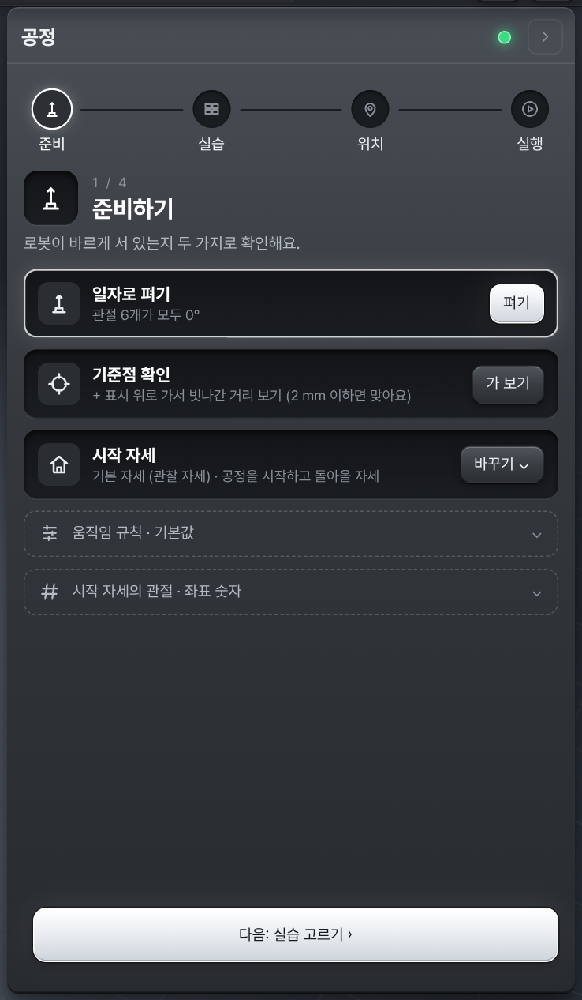
+++
- **일자로 펴기**: 로봇이 바르게 서 있는지 봐요.
- **기준점 확인**: 손끝이 + 표시 위로 가서 빗나간 거리를 보여 줘요(2 mm 이하면 맞아요).
- **시작 자세**: 공정을 시작하고 돌아올 자세. 보통 기본 자세.
- **움직임 규칙**: 옮길 때 높이, 내려가는 빠르기, 멀리 갈 때 빠르기.
:::

## ② 실습 고르기

::: cols
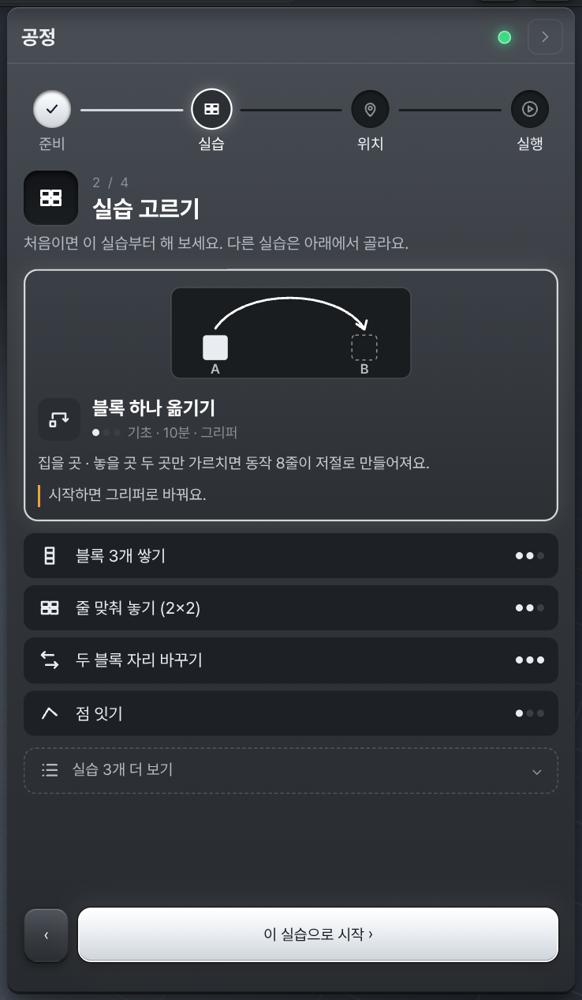
+++
- 블록 옮기기 · 쌓기 · 줄 맞춰 놓기 · 자리 바꾸기, 펜으로 점 잇기 · 도형 그리기 등이 있어요.
- 실습마다 난이도와 걸리는 시간, 필요한 도구가 적혀 있어요.
- **[이 실습으로 시작 ›]** 을 누르면 맞는 도구를 끼우고 책상에 블록을 놓아요.
:::

## ③ 위치 가르치기

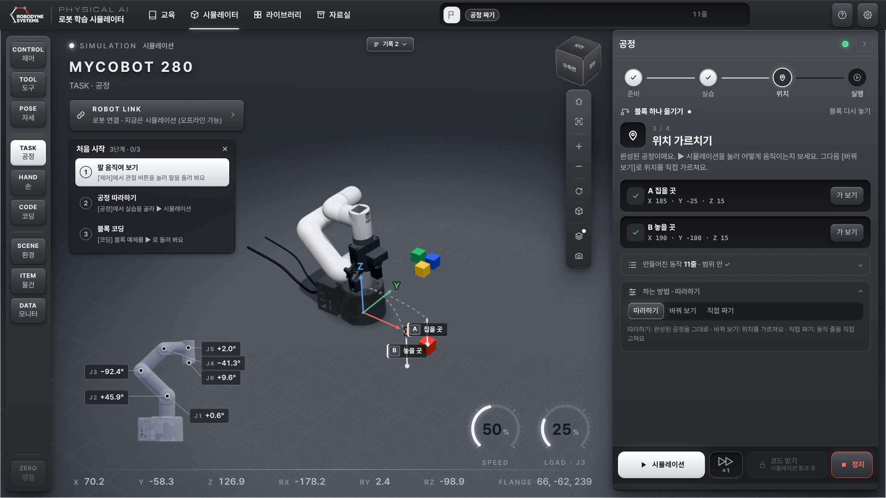{w=64}

**하는 방법** 은 세 가지예요. 접힌 [하는 방법] 을 펼쳐 골라요.

| 하는 방법 | 무엇을 하나요 |
| --- | --- |
| **따라하기** | 완성된 공정을 그대로 실행해 봐요. 처음에는 이걸로 |
| **바꿔 보기** | [제어] 로 손끝을 A · B 자리에 데려가 **[지금 위치 저장]**. 노란 값(높이 · 간격)도 바꿔요 |
| **직접 짜기** | 만들어진 이동 줄을 한 줄씩 고치거나 더해요 |

::: cols
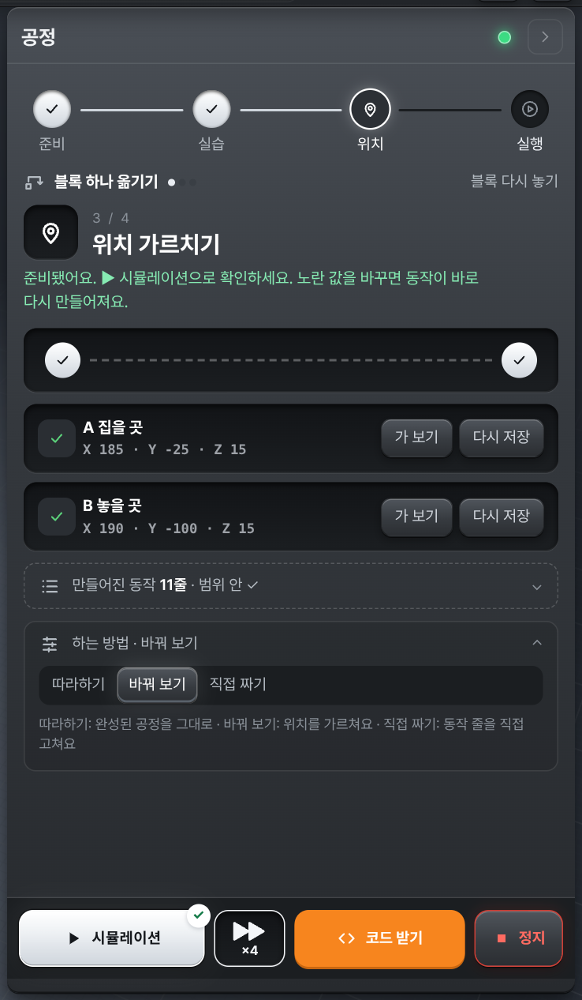
+++
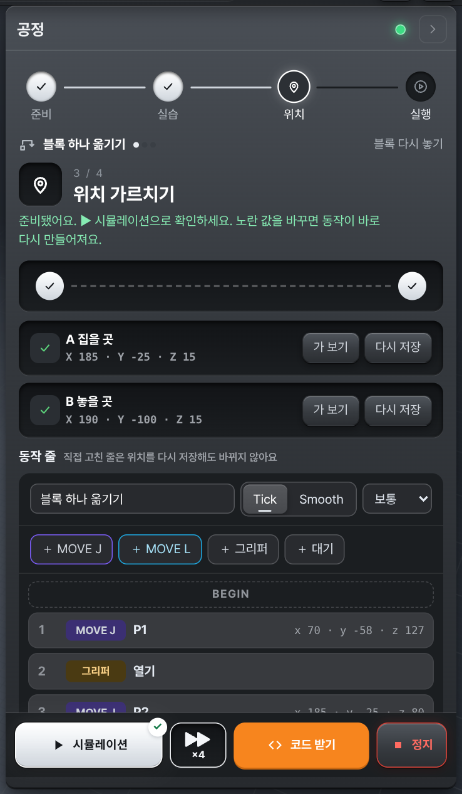
:::

### 이동 줄 읽기 — 관절로 · 곧게

| 줄 | 이름 | 손끝이 가는 길 |
| --- | --- | --- |
| **MOVE J** | 관절로 | 관절들이 함께 돌아요. 빠르지만 손끝은 **휘어진 길** 로 가요 (점선) |
| **MOVE L** | 곧게 | 손끝이 **곧은 선** 으로 가요. 블록 위에서 내려가고 올라올 때 써요 (실선) |

펜 실습에서는 **[관절로 그려 보기]** 로 같은 선을 MOVE J 로 그려, 선이 얼마나 휘는지 mm 로 비교할 수 있어요.

## ④ 실행 · 확인

::: cols
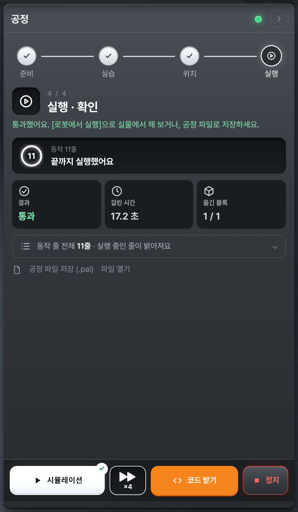
+++
- ▶ **시뮬레이션** 으로 실행해요. 지금 실행 중인 줄이 밝아져요.
- 결과: **통과 · 걸린 시간 · 옮긴 블록**.
- **Tick** 은 점마다 멈추고, **Smooth** 는 점을 이어서 지나가요.
- [공정 파일 저장 (.pal)] 로 저장하고, [파일 열기] 로 다시 불러와요.
:::

# 코딩하기 — [코딩]

같은 과제를 **블록(초급) → Python(중급) → ROS 2(고급)** 으로 풀 수 있어요. 처음에는 블록부터 해요.

![[코딩] → 블록](img/g-code.png){w=80}

::: marks
1. **언어 탭** — 블록 · Python · ROS 2.
2. **튜토리얼 카드** — 지금 과제와 단계(1/4 …). [과제 바꾸기] 로 [라이브러리] 에서 다른 과제를 골라요. [처음 예제로] 는 예제를 다시 불러와요.
3. **블록 꾸러미** — 한 번에 하는 동작 · 움직이기 · 카메라 · 옮기기 · 흐름. 끌어서 오른쪽에 놓거나, 누른 뒤 놓을 곳을 눌러요.
4. **프로그램 칸** — ▶ 시뮬레이션을 누르면 위에서 아래로 실행돼요. **노란 칸** 이 이번 단계에서 바꿀 곳이에요.
5. **↔ 넓게 보기** — 작업 칸을 넓혀 블록을 크게 봐요. 옆의 ↶ ↷ 는 되돌리기 · 다시 하기.
6. **미션 코드 조각** — 눌러서 프로그램에 바로 넣는 조각.
7. **실행 막대** — [시뮬레이션], 빠르기(×1 · ×2 · ×4), [코드 받기], [정지].
:::

## 튜토리얼 단계

과제마다 네 단계쯤 있어요. **그대로 실행 → 값 바꾸기 → 또 바꾸기 → 미션** 순서예요.
지금 단계의 노란 칸만 바꾸면 되고, 나머지 블록은 그대로 둬도 돼요. 3D 위 **지금 할 일** 에 이번 단계가 나오고, [다음 ▶] 으로 넘겨요.

## 실행하고 결과 보기

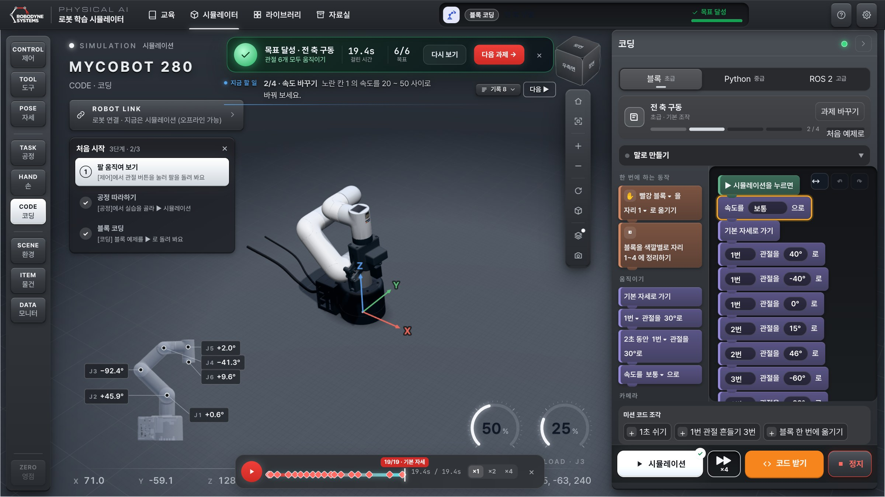

- 실행이 끝나면 위 가운데에 **목표 카드** 가 떠요: 목표 달성 여부, 걸린 시간, [다음 과제 →].
- 3D 아래 **재생 막대** 로 방금 실행을 다시 보거나, 마름모를 눌러 그 줄의 순간으로 가요.
- 통과하면 [시뮬레이션] 에 ✓ 가 붙고 **[코드 받기]** 가 열려요. 실제 로봇용 파이썬 코드를 보여 주고 파일로 받을 수 있어요.

## 넓게 보기

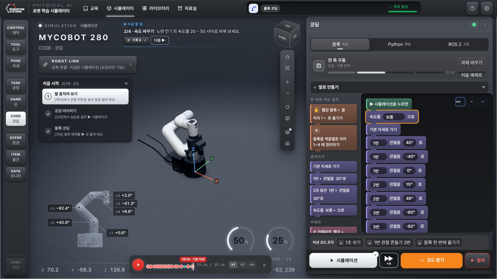{w=64}

블록이 많아지면 **↔** 를 눌러 작업 칸을 넓혀요. 3D 화면은 그만큼 좁아져요. 다시 누르면 원래 폭이에요.
Python · ROS 2 탭에서는 원래 폭으로 돌아오고, 블록 탭으로 오면 다시 넓어져요.

## Python · ROS 2

::: cols
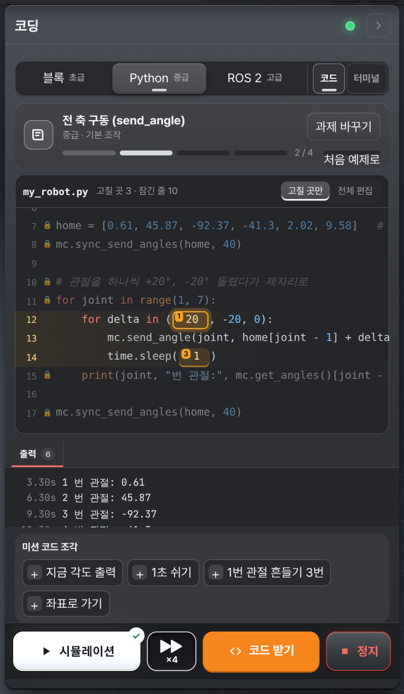
+++
- 블록과 같은 과제를 실제 로봇 라이브러리(pymycobot) 명령으로 풀어요.
- 노란 칸 · 튜토리얼 단계 · 미션 코드 조각은 블록과 같아요.
- 처음에는 **[고칠 곳만]** 이라 노란 칸만 고쳐져요. 모든 줄을 고치려면 **[전체 편집]**.
- `print()` 로 출력한 값은 아래 **출력** 창에 나와요. [코드] · [터미널] 중 [터미널] 은 명령으로 파일을 실행해요.
- 틀린 줄은 빨갛게 표시되고, 이유와 고칠 방법이 상황판에 나와요.
- ROS 2 탭은 노드 · 토픽으로 팔을 움직여요(고급).
:::

> 참고: **말로 만들기** 는 학급 서버에 로그인했을 때만 써요. 선생님이 켜 둔 반에서만 보여요.

# 손 따라하기 — [손]

PC 카메라에 손을 보이면 **로봇 손끝이 손을 따라** 움직여요. 손으로 보여 준 길을 녹화해 로봇이 그대로 따라 하게 할 수도 있어요.
사람이 시범을 보이고 로봇이 그것을 배워 따라 하는 것을 **모방학습** 이라고 해요. 그 가장 쉬운 형태예요.

![[손] 화면 — 카메라 위에 손 마디가 그려져요](img/g-hand.jpg)

## 따라 하기

::: step [카메라 켜기]
처음 한 번은 브라우저가 카메라를 써도 되는지 물어요. **허용** 을 눌러요. 손바닥을 카메라 쪽으로 펴면 손 마디가 그려지고 **손 찾음** 이 떠요.
:::

::: step [따라 하기]
손을 편하게 두고 누르면, 그때 손 위치가 **지금 손끝 위치** 가 돼요.
:::

::: step 손 움직이기
손을 옮기면 손끝이 따라와요. 다 하면 **[■ 멈추기]**.
:::

| 손 | 로봇 손끝 |
| --- | --- |
| 좌우로 옮기기 | 좌우(Y) |
| 위아래로 옮기기 | 위아래(Z) |
| 카메라에 가까이 · 멀리 | 앞(X+) · 뒤 |
| 엄지와 검지를 맞대기 · 떼기 | 그리퍼 닫기 · 열기 (그리퍼를 달았을 때) |

손끝은 처음 위치에서 15 cm 까지, 책상 위 15 mm 아래로는 가지 않아요.

## 녹화 · 재생 · 공정으로

::: cols
![녹화가 끝난 [손] 패널](img/g-hand-panel.png)
+++
- 따라 하는 중에 **[● 녹화]** → 손으로 옮길 길을 보여 주고 **[■ 녹화 끝]**.
- 녹화한 길은 몇 개의 **점** 으로 줄여져요(예: "점 3개로 줄였어요").
- **[▶ 재생]**: 책상을 녹화 전으로 되돌리고, 로봇이 같은 길을 따라 해요.
- **[공정으로]**: 그 점들이 공정의 이동 줄이 돼요.
:::

![[공정으로] — 손 시연 고치기](img/g-hand-demo.png){w=60}

[공정으로] 를 누르면 공정의 **손 시연 고치기** 가 열려요. 첫 점까지는 MOVE J, 그다음은 MOVE L 로 이어져요.
줄을 고치고 ▶ 시뮬레이션으로 확인하고 공정 파일로 저장해요. **[실습 고르기로]** 를 누르면 실습 공정으로 돌아가요.

> 참고: 카메라 영상은 이 PC 안에서만 써요. 저장하거나 보내지 않아요. 손 따라하기는 지금은 시뮬레이터에서만 돼요.

# 결과 확인 · 저장

| 무엇 | 어디서 |
| --- | --- |
| 목표를 이뤘나요 | 실행 뒤 위 가운데의 **목표 카드**, [시뮬레이션] 의 ✓ |
| 무슨 일이 있었나요 | 상황판의 **[기록]** |
| 어떻게 움직였나요 | 3D 아래 **재생 막대** (다시 보기 · ×1 · ×2 · ×4) |
| 블록 · 파이썬 프로그램 | 저절로 저장돼요. 다음에 켜도 그대로예요 |
| 공정 | 저절로 저장돼요. 다른 PC 로 옮길 때는 **공정 파일 (.pal)** |
| 실제 로봇용 코드 | 통과한 뒤 **[코드 받기]** → [파일로 받기] |

> 팁: 예제로 돌아가고 싶으면 튜토리얼 카드의 **[처음 예제로]** 를 눌러요.

# 이럴 땐 · 부록

## 자주 보는 알림

| 알림 | 왜 · 어떻게 |
| --- | --- |
| N번 관절이 책상에 닿아요 · 책상 아래예요 | 손끝이나 팔이 너무 낮아요. Z 를 높이거나 [위] 로 올려요 |
| 한계까지 N° · 움직일 수 있는 범위 밖이에요 | 그 관절이 더 못 돌아요. 다른 관절로 같은 곳에 가 봐요 |
| 닿을 수 없어요 | 너무 멀거나 가까워요. 로봇 쪽으로 당기거나 높이를 바꿔요 |
| 팔이 부딪혀서 실행 안 함 | 실행 전에 미리 검사한 결과예요. 알림이 말한 줄의 자세를 바꿔요 |
| 손이 안 보여요 | 손바닥을 카메라 쪽으로 펴고, 밝은 곳에서 해요 |
| 카메라 사용을 허락하지 않았어요 | 주소창의 카메라 표시를 눌러 허용해요 |

## 용어

| 말 | 뜻 |
| --- | --- |
| 관절 (J1~J6) | 로봇팔의 돌아가는 마디. 각도(°)로 말해요 |
| 좌표 (X · Y · Z) | 로봇 받침 가운데에서 잰 손끝 위치(mm). X 앞, Y 왼쪽, Z 위 |
| 손끝 (TCP) | 도구 끝의 일하는 점. 도구를 바꾸면 길이가 달라져요 |
| MOVE J · MOVE L | 관절로 · 곧게 가는 이동 |
| 공정 | 로봇이 할 일을 이동 줄로 적은 목록 |
| 시뮬레이션 | 화면 속 로봇으로 먼저 실행해 검사하는 것 |

# 기초 실습 안내

2부는 처음 배우는 사람이 **한 번씩 성공해 보는** 실습 다섯 개(11~15장)예요. 모든 과제를 다 풀 필요는 없어요.
실습마다 **목표 → 해 보기 → 확인 → 알아 두기** 순서예요. 확인표의 □ 에 표시하며 해요.

| 장 | 무엇을 | 화면 | 시간 (예시) |
| --- | --- | --- | --- |
| 11 | 움직임 제어 — 관절 · 좌표 · 자세 · 멈추기 | [제어] [자세] | 20분 |
| 12 | 블록 코딩 — 전 축 구동 · 반복 위치제어 · 블록 옮기기 | [코딩] 블록 | 40분 |
| 13 | 파이썬 튜토리얼 — 전 축 구동 · 반복 위치제어 | [코딩] Python | 40분 |
| 14 | 공정 첫걸음 — 블록 하나 옮기기 | [공정] | 20분 |
| 15 | 손 따라하기 첫걸음 — 따라 하기 · 녹화 · 재생 | [손] | 15분 |

# 기초 실습 · 움직임 제어

**목표**: 관절 여섯 개가 각각 어떻게 도는지 알고, 손끝을 원하는 곳으로 옮기고, 자세를 저장해 다시 가요.

::: step 관절 여섯 개
[제어] → [관절]. J1 부터 J6 까지 하나씩 [+5°] 를 누르고 있어요. 어디가 도는지 3D 에서 봐요. 끝나면 [기본 자세].
:::

::: step STEP 과 SPEED
STEP 을 1° 로 바꿔 한 번씩 눌러 보고, SPEED 를 20% 와 80% 로 바꿔 빠르기를 비교해요.
:::

::: step 손끝 옮기기
[좌표] 에서 [아래] 를 눌러 손끝을 내려요. 오른쪽 숫자 **Z** 가 줄어드는 것을 봐요. 앞 · 왼쪽으로도 옮겨요.
:::

::: step 자세 저장
[자세] → [지금 자세 저장하기] 로 「내 자세 1」 을 저장 → [기본 자세] → 목록의 [이 자세로].
:::

::: step 멈추기
[일자로 펴기] 를 누르고 팔이 움직이는 동안 **Esc** 를 눌러요.
:::

| | 확인 |
| --- | --- |
| □ | J1 · J2 · J3 · J5 가 각각 몸통 · 어깨 · 팔꿈치 · 손목 중 어디인지 말할 수 있어요 |
| □ | [아래] 를 누르면 Z 가 줄고, [앞] 을 누르면 X 가 늘어요 |
| □ | 저장한 자세로 다시 돌아왔어요 |
| □ | Esc 로 팔이 바로 멈췄어요 |

> 참고: **관절로 움직이기 · 좌표로 움직이기** — [관절] 은 각도를 정하면 손끝 위치가 따라 정해지고, [좌표] 는 손끝 위치를 정하면 프로그램이 관절 각도를 계산해요(역기구학). 같은 손끝 위치에도 팔 모양은 여러 가지일 수 있어요.

# 기초 실습 · 블록 코딩

**목표**: 예제를 실행해 보고, 노란 칸의 값을 바꿔 결과가 어떻게 달라지는지 확인하고, 미션 코드 조각을 넣어 봐요.

[코딩] → [블록] 을 열면 첫 과제 **전 축 구동** 이 나와요. 튜토리얼 카드의 단계를 따라가요. 실행은 ×2 · ×4 로 빨리 봐도 돼요.

## 과제 ① 전 축 구동 — 관절 6개 모두 움직이기

| 단계 | 할 일 |
| --- | --- |
| 1 그대로 실행 | ▶ 시뮬레이션을 눌러 관절 6개가 차례로 움직이는 것을 봐요 |
| 2 속도 바꾸기 | 노란 칸 1 의 속도를 20 ~ 50 사이로 바꿔요 |
| 3 각도 바꾸기 | 노란 칸 2 · 3 의 각도를 바꿔 1번 관절이 더 크게 돌게 해요 |
| 4 미션 | 코드 조각 [1초 쉬기] 를 넣어 마지막에 잠깐 멈추게 해요 |

## 과제 ② 반복 위치제어 — 같은 점에 5번 가기

[과제 바꾸기] → [라이브러리] 에서 **반복 위치제어** 를 골라요.

| 단계 | 할 일 |
| --- | --- |
| 1 그대로 실행 | 같은 점을 몇 번 오가는지 세어 봐요 |
| 2 횟수 바꾸기 | 노란 칸 1 의 반복 횟수를 바꿔요 |
| 3 높이 바꾸기 | 노란 칸 2 · 3 의 높이(mm)를 바꿔 오르내리는 폭을 바꿔요 |
| 4 미션 | 코드 조각 [1초 쉬기] 를 넣어 돌아오기 전에 쉬게 해요 |

## 과제 ③ 블록 옮기기 — 블록을 자리 1~4 로

| 단계 | 할 일 |
| --- | --- |
| 1 그대로 실행 | 로봇이 블록을 어떻게 옮기는지 먼저 봐요 |
| 2 블록 바꾸기 | 노란 칸 1 이 있는 블록마다 옮길 블록의 색을 같은 색으로 바꿔요 |
| 3 자리 바꾸기 | 노란 칸 2 를 눌러 내려놓을 자리를 바꿔요 |
| 4 미션 | 코드 조각 [블록 한 번에 옮기기] 로 블록을 하나 더 옮겨요 |

| | 확인 |
| --- | --- |
| □ | 세 과제 모두 목표 카드에 **목표 달성** 이 떴어요 |
| □ | 속도를 바꾸면 걸린 시간이 달라졌어요 |
| □ | 반복 횟수를 바꾸면 오가는 횟수가 그만큼 바뀌었어요 |
| □ | 미션 코드 조각을 넣고도 통과했어요 |

> 참고: **순서 · 반복** — 프로그램은 위에서 아래로 **차례대로** 실행돼요. [N번 반복하기] 블록 안에 넣은 블록은 N번 되풀이돼요. 같은 일을 여러 번 할 때 블록을 여러 번 쓰지 않고 반복을 써요.

# 기초 실습 · 파이썬 튜토리얼

**목표**: 블록으로 풀었던 과제를 파이썬(pymycobot)으로 풀며, 실제 로봇에서 그대로 돌아가는 코드를 읽고 고쳐요.

[코딩] → [Python] 탭을 열면 **전 축 구동 (send_angle)** 이 나와요.

## 과제 ① 전 축 구동 (send_angle)

```python
for joint in range(1, 7):
    for delta in (20, -20, 0):
        mc.send_angle(joint, home[joint - 1] + delta, 40)
        time.sleep(1)
    print(joint, "번 관절:", mc.get_angles()[joint - 1])
```

| 단계 | 할 일 |
| --- | --- |
| 1 그대로 실행 | 관절이 하나씩 움직이는 것과 **출력 창** 을 봐요 |
| 2 각도 바꾸기 | 노란 칸 1 의 돌릴 각도(20)를 바꿔요 |
| 3 시간 바꾸기 | 노란 칸 2 · 3 의 속도(40)와 쉬는 시간(1)을 바꿔 빠르기를 비교해요 |
| 4 미션 | 코드 조각 [지금 각도 출력] 을 넣어 마지막 각도를 출력해요 |

## 과제 ② 반복 위치제어 (send_coords)

```python
for i in range(5):
    mc.sync_send_coords(point, 40)
    x, y, z = mc.get_coords()[:3]
    print(f"{i + 1}번째 도착: x {x:.1f}, y {y:.1f}, z {z:.1f}")
    mc.sync_send_angles(home, 40)
```

| 단계 | 할 일 |
| --- | --- |
| 1 그대로 실행 | 같은 점에 5번 가고 출력된 좌표를 봐요 |
| 2 점 바꾸기 | 노란 칸 1 · 2 의 x, y 를 바꿔 다른 점으로 가게 해요 |
| 3 횟수 바꾸기 | 노란 칸 3 의 반복 횟수를 바꿔요 |
| 4 미션 | 코드 조각 [1초 쉬기] 를 넣어요 |

| | 확인 |
| --- | --- |
| □ | 출력 창에 관절 각도와 도착 좌표가 나왔어요 |
| □ | `range(5)` 를 바꾸면 도착 줄 수가 그만큼 바뀌었어요 |
| □ | 일부러 틀리게 고쳐 보고(예: 괄호 지우기) 빨간 줄과 이유를 읽었어요 |

> 참고: **명령 세 가지** — `send_angle(관절, 각도, 속도)` 는 관절 하나를, `sync_send_coords(좌표, 속도)` 는 손끝을 좌표로 보내고 도착할 때까지 기다려요. `get_angles()` · `get_coords()` 는 지금 값을 읽어요. 블록 하나가 이런 명령 한두 줄이에요.

# 기초 실습 · 공정 첫걸음

**목표**: 완성된 공정을 실행해 보고, MOVE J 와 MOVE L 이 어디에 쓰였는지 찾아요.

::: step 준비
[공정] → ① 준비하기에서 [펴기] 로 일자 자세를 보고, 단계 막대의 **실습** 을 눌러요.
:::

::: step 실습 고르기
**블록 하나 옮기기** 를 고르고 [이 실습으로 시작 ›]. 그리퍼가 끼워지고 책상에 블록이 놓여요.
:::

::: step 따라하기로 실행
③ 에서 [하는 방법] → **따라하기**. 실행 빠르기 ×4 로 ▶ 시뮬레이션.
:::

::: step 결과 보기
④ 에서 **통과 · 옮긴 블록 1 / 1** 을 확인해요. [동작 줄 전체] 를 펼쳐 이동 줄을 읽어요.
:::

| | 확인 |
| --- | --- |
| □ | 블록이 B 자리에 놓였어요 (옮긴 블록 1 / 1) |
| □ | 블록 위로 **가기 · 옮기기** 는 MOVE J, **내려가기 · 올라오기** 는 MOVE L 인 것을 찾았어요 |
| □ | (더 해 보기) [바꿔 보기] 에서 B 자리를 다시 저장하고 통과했어요 |

> 참고: **왜 내려갈 때는 곧게?** 블록 바로 위에서 관절로(MOVE J) 내려가면 손끝이 휘어진 길로 가서 옆 블록을 칠 수 있어요. 그래서 블록 가까이에서는 곧게(MOVE L), 멀리 옮길 때는 빠른 관절로(MOVE J) 가요.

# 기초 실습 · 손 따라하기 첫걸음

**목표**: 손으로 로봇 손끝을 움직여 보고, 시연을 녹화해 로봇이 따라 하게 해요.

::: step 따라 하기
[손] → [카메라 켜기] → 손바닥을 펴서 **손 찾음** 을 확인 → [따라 하기].
:::

::: step 세 방향
손을 왼쪽 · 오른쪽, 위 · 아래로 천천히 옮기고, 카메라에 가까이 대 봐요. 3D 의 손끝과 3D 아래 숫자 X · Y · Z 가 어떻게 바뀌는지 봐요.
:::

::: step 녹화와 재생
[● 녹화] → 손으로 「위 → 오른쪽 → 아래」 를 그리듯 움직이기 → [■ 녹화 끝] → [■ 멈추기] → [▶ 재생].
:::

| | 확인 |
| --- | --- |
| □ | 손을 위로 올리면 Z 가 늘었어요 |
| □ | 손을 카메라에 가까이 대면 X 가 늘었어요 |
| □ | 재생에서 로봇이 내가 보여 준 길을 따라 했어요 |
| □ | (더 해 보기) [공정으로] 로 옮겨 이동 줄 수를 세어 봤어요 |

> 참고: **시연으로 가르치기** — 손이 지나간 길 전부가 아니라, 곧은 선에서 5 mm 넘게 벗어나는 곳만 **점** 으로 남겨요. 그래서 짧은 시연도 몇 개의 이동 줄이 돼요. 사람이 보여 주고 로봇이 배워 따라 하는 것을 모방학습이라고 해요.
