# 시작하기 전에

## 이 프로그램으로 할 수 있는 것

Physical AI 시뮬레이터는 실제 로봇팔 **myCobot 280 RDK X5** 를 PC 화면 속 3D 로봇으로 그대로 옮겨 놓은 프로그램입니다.
로봇이 없어도, 인터넷이 없어도 PC 한 대로 모든 실습을 할 수 있고, 같은 Wi-Fi 에 로봇이 있으면 그 로봇을 바로 움직입니다.

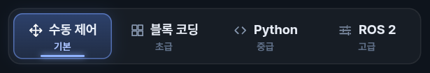{w=70}

| 탭 | 수준 | 하는 일 |
| --- | --- | --- |
| [수동 제어] | 기본 | 버튼과 막대로 관절 · 손끝을 직접 움직이고, 도구를 바꾸고, 자세를 저장합니다 |
| [블록 코딩] | 초급 | 블록을 쌓아 동작 순서를 만듭니다. 글자 코드를 몰라도 됩니다 |
| [Python] | 중급 | 실제 로봇에서 쓰는 공식 파이썬 라이브러리(pymycobot) 문법 그대로 코드를 씁니다 |
| [ROS 2] | 고급 | 로봇 소프트웨어 표준인 ROS 2 의 노드 · 토픽으로 팔을 움직입니다 |

윗줄의 [교육] 탭에서는 로봇공학 8개 단원 · 28차시 수업을 같은 프로그램 안에서 합니다(12장).
[라이브러리] 에서는 실습 과제 · 실습 환경 · 로봇 모델 · 도구를 골라 시뮬레이터에 열고, [자료실] 에서는 교재 · 문항지 · 매뉴얼을 내려받습니다(11장).
수업 운영은 따로 나눠 드리는 「교사용 교육 가이드라인」에 자세히 있습니다.

## 준비물

| 준비물 | 내용 |
| --- | --- |
| PC | Windows 10 또는 11. 설치 · 관리자 권한 · 인터넷이 필요 없습니다 |
| 브라우저 | 엣지(Windows 에 기본으로 있음) 또는 크롬. 시뮬레이터 창을 열 때 씁니다 |
| 프로그램 | `PhysicalAI-Simulator.zip` (받은 파일 하나) |
| 로봇 (선택) | myCobot 280 RDK X5. 로봇과 연결할 때만 필요합니다 — 10장 |

> 참고: 화면은 가로 1366 픽셀 이상에서 한 화면에 모두 보입니다. 노트북 화면이 좁으면 브라우저 확대를 90% 로 줄이면 편합니다.

## 이 매뉴얼 읽는 법

- 그림 위의 **빨간 번호**는 그림 아래 설명의 번호와 같습니다.
- `[시뮬레이션]` 처럼 네모 괄호로 쓴 말은 화면에 있는 **버튼 이름**입니다. 예: [로봇 연결] [정지]
- 파란 숫자 카드(1, 2, 3 …)는 **순서대로 따라 하는 단계**입니다.
- 초록 상자는 알아 두면 편한 **팁**, 주황 상자는 꼭 지켜야 하는 **주의**입니다.

# 설치하고 켜기

## 압축 풀고 실행하기

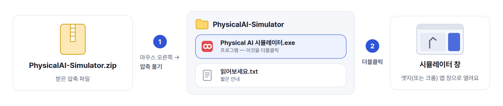

::: step 압축 풀기
받은 `PhysicalAI-Simulator.zip` 을 마우스 오른쪽 버튼으로 누르고 **[압축 풀기]** 를 고릅니다.
바탕화면이나 문서 폴더처럼 찾기 쉬운 곳에 풉니다. (압축 파일 안에서 바로 실행하지 마세요.)
:::

::: step 프로그램 실행
풀린 폴더의 **Physical AI 시뮬레이터.exe** 를 더블클릭합니다. 검은 창이 하나 뜨고, 잠시 뒤 엣지(또는 크롬) 앱 창으로 시뮬레이터가 열립니다.
:::

::: step 바탕화면에 바로 가기 (선택)
exe 파일을 마우스 오른쪽 버튼으로 끌어 바탕화면에 놓고 **[여기에 바로 가기 만들기]** 를 고르면 다음부터 바탕화면에서 바로 켭니다.
:::

## 처음 한 번 나오는 Windows 안내

처음 실행할 때 파란 창 **"Windows의 PC 보호"** 가 나오면 아래처럼 두 번 누릅니다.

![처음 한 번만: [추가 정보] → [실행]](img/d-smartscreen.png)

> 참고: 회사 코드 서명 인증서가 없는 프로그램이라 Windows 가 확인을 묻는 것입니다. 같은 PC 에서는 다시 묻지 않습니다.

## 시작 화면 — [연결하기] 또는 시뮬레이터로 시작

시뮬레이터가 열리면 회사 로고와 로봇들이 나오는 시작 화면이 재생되고, 아래 막대가 불러오기를 따라 찹니다.
화면을 한 번 누르면 건너뜁니다. 다 되면 마지막 화면에 두 가지가 나옵니다.

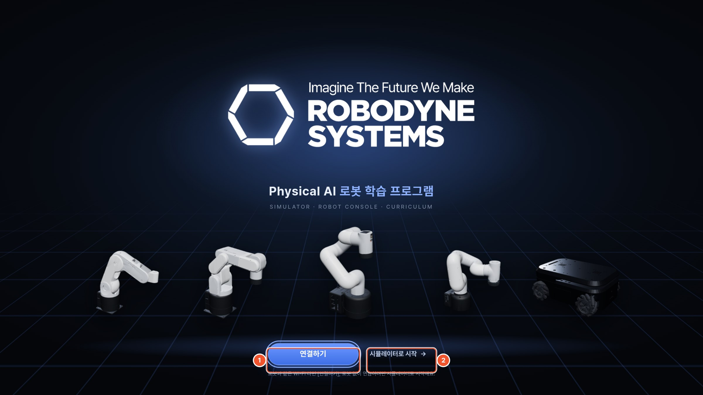{w=84}

::: marks
1. **[연결하기]** — 같은 Wi-Fi 의 로봇을 찾아 연결하는 **로봇 연결** 창을 엽니다.
2. **[시뮬레이터로 시작 →]** — 로봇 없이 PC 에서 바로 연습합니다.
:::

처음 켠 PC 라면 어느 쪽을 골라도 다음의 **로봇 모델 고르기** 창이 한 번 나옵니다([연결하기] 는 연결 창을 닫은 뒤).

## 로봇 모델 고르기

제품마다 같은 크기의 카드가 있습니다. 카드에서 **보드**를 고른 뒤(두세 개면 버튼, 더 많으면 목록) 그 카드의 **[시작 →]** 을 누릅니다.

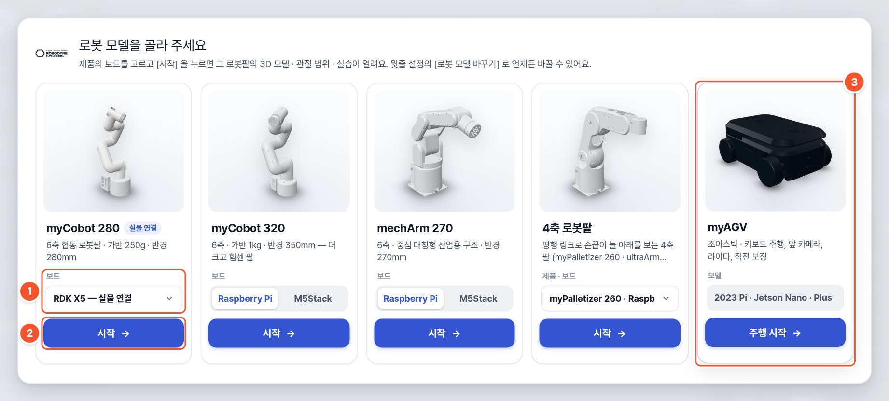{w=88}

::: marks
1. **보드** — myCobot 280 은 목록에서 **RDK X5 — 실물 연결** 을 그대로 둡니다. "준비 중" 인 보드는 고를 수 없습니다.
2. **[시작 →]** — 그 로봇팔의 3D 모델 · 관절 범위 · 실습이 열립니다. 이 매뉴얼은 myCobot 280 RDK X5 로 설명합니다.
3. **myAGV** — 이동 로봇 주행 실습(별도 안내서). [주행 시작 →] 을 누릅니다.
:::

한 번 고르면 기억하므로 다음부터는 이 창이 나오지 않습니다. 나중에 바꾸려면 윗줄 ⚙ 설정 → **로봇 모델 바꾸기**, 또는 작업 패널 위쪽의 **[바꾸기]** 를 누릅니다.

## 로봇 연결 창

시작 화면의 **[연결하기]** (또는 윗줄 [로봇 연결])를 누르면 **로봇 연결** 창이 열립니다. 로봇 없이 연습할 때는 오른쪽 아래 **[시뮬레이션만 (로봇 없이)]** 를 누르면 됩니다.

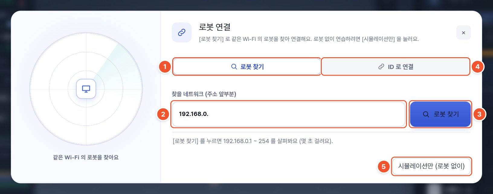{w=84}

::: marks
1. **[로봇 찾기]** — 같은 Wi-Fi 의 로봇을 자동으로 찾는 방법입니다.
2. **찾을 네트워크** — 교실 공유기 주소의 앞부분(예: 192.168.0.). 처음 한 번만 고치면 기억합니다.
3. **[로봇 찾기]** — 누르면 몇 초 안에 로봇 목록이 나옵니다.
4. **[ID 로 연결]** — 로봇 ID(예: 107)를 알면 숫자만 넣어 연결합니다.
5. **[시뮬레이션만 (로봇 없이)]** — 로봇 없이 PC 에서만 연습합니다.
:::

로봇과 연결하는 방법은 10장에 따로 정리했습니다. 처음에는 [시뮬레이션만] 으로 시작하세요.

> 참고: 이 PC 에서 시뮬레이터를 처음 열면 3D 화면 위에 **처음 쓰는 방법** 카드(3단계)가 한 번 나옵니다. [다음 →] 으로 읽거나 [건너뛰기] 를 누르면 다시 나오지 않습니다.

## 끄기

시뮬레이터 창을 닫고, 뒤에 떠 있는 **검은 창**도 닫습니다. 검은 창이 프로그램 본체이므로 쓰는 동안에는 닫지 마세요.
만든 블록 · 코드, 저장한 자세, 과제 진행 표시, 놓은 물건은 이 PC 에 남아 다음에 켜도 그대로입니다.

# 화면 둘러보기

## 한눈에 보기

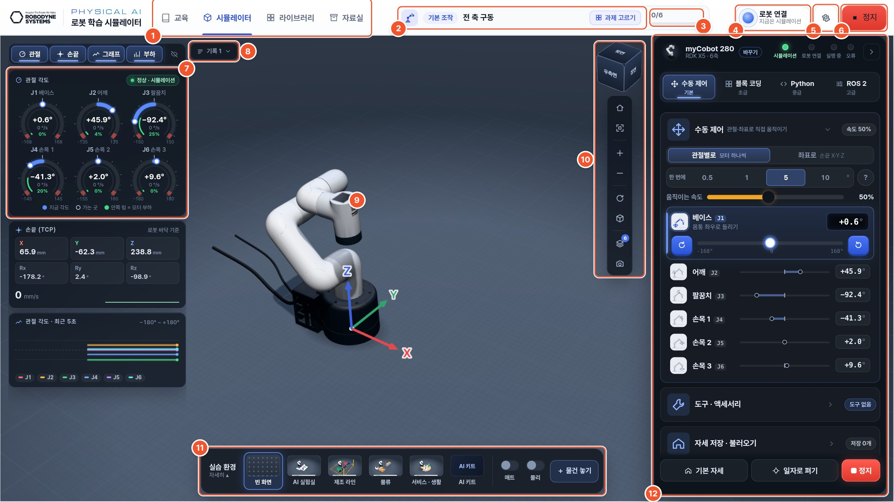

::: marks
1. **화면 탭** — [교육] [시뮬레이터] [라이브러리] [자료실] 네 화면을 오갑니다.
2. **지금 과제** — 주제와 과제 이름. 누르면 라이브러리의 과제 목록이 열립니다(9장).
3. **목표 진행** — 과제의 목표를 얼마나 했는지 막대로 보여 줍니다.
4. **[로봇 연결]** — 실제 로봇을 찾아 연결합니다(10장).
5. **⚙ 설정** — 로봇 모델 · 로봇 연결 · 패널 위치.
6. **[■ 정지]** — 언제든 모든 동작을 멈춥니다. 키보드 **Esc** 도 같습니다.
7. **모니터** — 관절 각도 · 손끝 위치 · 최근 5초 그래프(4장).
8. **알림 · [기록]** — 가장 최근 알림이 카드로 나오고, [기록] 에 모두 남습니다.
9. **3D 화면** — 로봇과 책상. 마우스로 돌리고 확대합니다.
10. **보기 큐브 · 도구 막대** — 보는 방향 · 맞춤 · 확대 · 표시 · 화면 저장(4장).
11. **실습 환경 막대** — 장면 · 매트 · 물리 · 물건 놓기(9장).
12. **작업 패널** — 로봇 모델, 상태 불, 탭 [수동 제어] [블록 코딩] [Python] [ROS 2].
:::

## 윗줄 — 늘 같은 자리

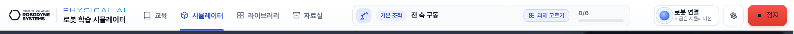

| 자리 | 하는 일 |
| --- | --- |
| [교육] [시뮬레이터] [라이브러리] [자료실] | 수업 · 실습 · 고르기 · 내려받기 화면을 오갑니다. 프로그램이 실행 중일 때는 다른 화면으로 가지 않습니다 |
| 지금 과제 | 주제(예: 기본 조작) · 과제 이름 · [과제 고르기]. 시뮬레이터와 라이브러리 화면에서 보입니다 |
| 진행 막대 | 0/6 → 6/6 처럼 목표를 채우면 초록 **✓ 목표 달성** 으로 바뀝니다. 실제 로봇에서도 하면 **로봇 ✓** 가 붙습니다 |
| [로봇 연결] | 로봇 찾기 · 연결. 연결되면 "로봇 107 연결됨" 처럼 바뀝니다 |
| ⚙ | 설정 메뉴 (아래) |
| [■ 정지] | 시뮬레이션과 실제 로봇을 바로 멈춥니다 |

## 설정 메뉴 ⚙

::: cols
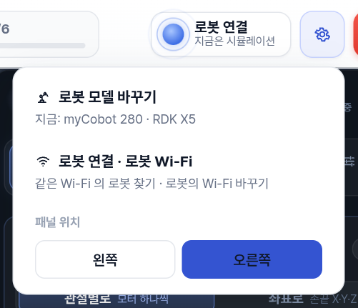
+++
| 항목 | 하는 일 |
| --- | --- |
| 로봇 모델 바꾸기 | 처음의 모델 고르기 창. 아래에 지금 모델이 보입니다 |
| 로봇 연결 · 로봇 Wi-Fi | 로봇 연결 창 — 로봇 찾기, 로봇의 Wi-Fi 바꾸기 |
| 패널 위치 | 작업 패널을 [왼쪽] / [오른쪽] 에 |

PC 프로그램은 [자료실] 의 **프로그램** 폴더, 검수 준비 점검 · 검수 결과표 저장은 [라이브러리] 의 **검수 시연** 에 있습니다.
:::

## 작업 패널 위쪽 — 모델 · 상태 불 · 탭

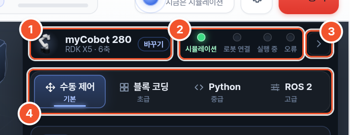{w=72}

::: marks
1. **로봇 모델** — 지금 쓰는 로봇의 그림 · 이름 · 보드 · 축 수. **[바꾸기]** 로 모델 고르기 창을 엽니다.
2. **상태 불** — 시뮬레이션 · 로봇 연결 · 실행 중 · 오류. 켜진 불이 지금 상태입니다. 누르면 로봇 상태가 펼쳐집니다(5장).
3. **[›]** — 작업 패널을 접어 3D 화면을 넓힙니다.
4. **탭** — [수동 제어] [블록 코딩] [Python] [ROS 2].
:::

## 알림 카드와 기록

3D 화면 왼쪽 위에 가장 최근 알림이 **카드** 하나로 나옵니다. 그동안 모니터는 카드 높이만큼 아래로 비켜납니다.

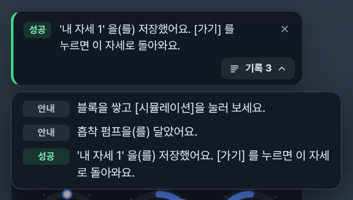{w=80}

- 카드 앞의 색 글자는 종류입니다: **안내** · **시뮬** · **성공** · **주의** · **오류**.
- 안내 · 성공은 몇 초 뒤 저절로 사라지고, 주의는 조금 더 오래 남습니다. **오류**는 [×] 로 닫을 때까지 남습니다.
- **[기록 N]** 을 누르면 지금까지의 알림(시뮬레이션 시작 · 목표 달성 · 오류 등)이 모두 펼쳐집니다. 다른 곳을 누르거나 Esc 로 접습니다.

문제가 생겼을 때 이 기록을 그대로 선생님께 보여 주면 원인을 빨리 찾을 수 있습니다.

## 패널을 접어 3D 를 크게

작업 패널 위쪽의 **[›]** 를 누르면 패널이 접히고 3D 화면이 창 전체로 넓어집니다.
오른쪽 가장자리에 남은 세로 막대의 **[‹]** 나 탭 아이콘을 누르면 다시 펼쳐집니다.

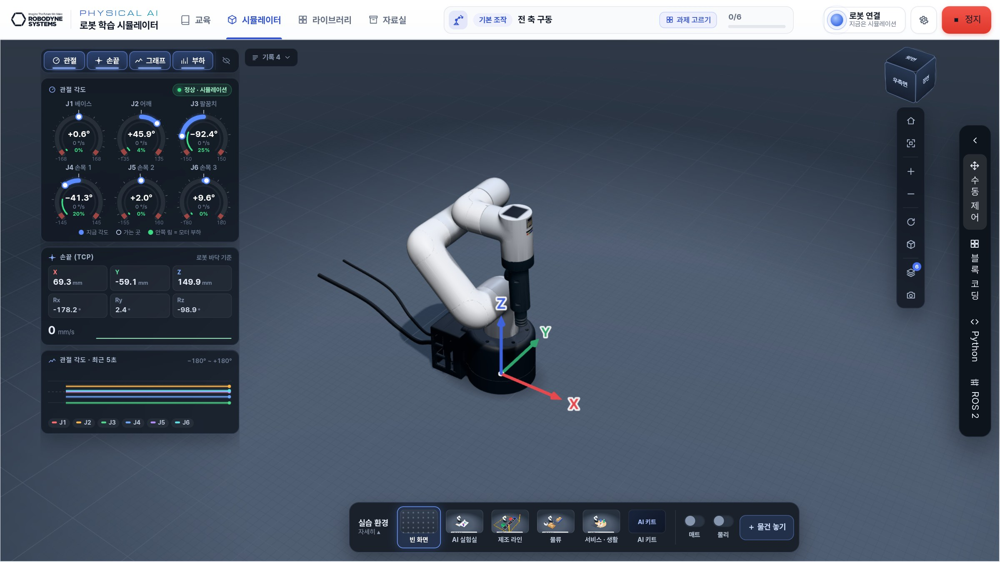

> 팁: 도구 막대의 표시 메뉴에서 **실행할 때 패널 접기** 가 켜져 있으면(처음 설정) 시뮬레이션하는 동안만 저절로 접히고, 끝나면 다시 펼쳐집니다.

# 3D 화면 다루기

## 마우스로 돌리고 확대하기

| 마우스 | 하는 일 |
| --- | --- |
| 왼쪽 버튼 끌기 | 돌려 보기 (도구 막대에서 이동으로 바꿀 수 있습니다) |
| 휠 굴리기 | 확대 · 축소 |
| 오른쪽 버튼 끌기 | 옮기기 (화면 이동) |

화면에서 로봇을 잃어버리면 도구 막대의 **전체 맞춤** 이나 **처음 시점** 을 누르세요.

## 보기 큐브와 도구 막대

3D 화면 오른쪽 위에 **보기 큐브**가 있고, 그 아래로 도구 버튼이 세로로 늘어서 있습니다. 버튼에 마우스를 올리면 이름이 나옵니다.

::: cols
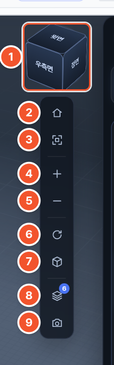{w=40}
+++
::: marks
1. **보기 큐브** — 3D 를 돌리면 함께 돕니다. 면(윗면 · 정면 · 우측면 …)을 누르면 그 방향에서 봅니다.
2. **처음 시점** — 처음 보던 방향과 크기로.
3. **전체 맞춤** — 지금 방향에서 로봇과 작업 공간이 꽉 차게.
4. **확대** (+ 키)
5. **축소** (− 키)
6. **회전 ↔ 이동** — 왼쪽 버튼으로 끌 때 돌릴지 옮길지.
7. **원근 ↔ 평면** — 눈으로 보듯 / 도면처럼 같은 크기로.
8. **표시** — 보조선 켜고 끄기(아래). 숫자는 켜진 개수.
9. **화면 저장** — 지금 3D 화면을 그림 파일(PNG)로 다운로드 폴더에.
:::
:::

카메라가 있을 때(AI 키트 환경이거나 카메라 플랜지를 달았을 때)는 맨 아래에 **카메라** 버튼이 하나 더 생깁니다.

## 표시 메뉴 — 보조선 켜고 끄기

::: cols
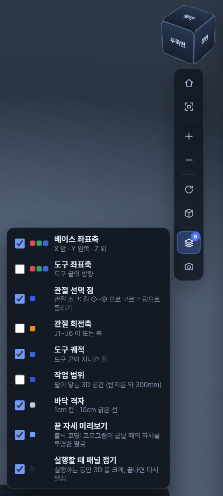
+++
| 항목 | 보이는 것 |
| --- | --- |
| 베이스 좌표축 | 로봇 바닥의 X(빨강, 앞) · Y(초록, 왼쪽) · Z(파랑, 위) |
| 도구 좌표축 | 손끝(도구 끝)의 방향 |
| 관절 선택 점 | 3D 위 관절 점 ①~⑥ — 눌러서 고르고 링으로 돌리기 |
| 관절 회전축 | J1~J6 이 도는 축 |
| 도구 궤적 | 손끝이 지나간 길(선) |
| 작업 범위 | 팔이 닿는 공간 |
| 바닥 격자 | 1 cm 칸, 10 cm 굵은 선 |
| 끝 자세 미리보기 | 블록 코딩: 프로그램이 끝날 때의 자세를 투명한 팔로 |
| 실행할 때 패널 접기 | 실행하는 동안 3D 를 크게 |

고른 것은 이 PC 에 기억됩니다.
:::

## 모니터 — 각도 · 손끝 · 그래프

3D 화면 왼쪽의 반투명 **모니터**는 로봇의 지금 상태를 숫자와 그림으로 보여 줍니다.

::: cols
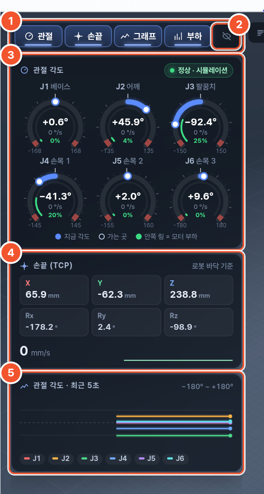
+++
::: marks
1. **보일 것** — [관절] [손끝] [그래프] [부하] 를 눌러 칸을 켜고 끕니다.
2. **감추기** — 모니터를 모두 감춥니다. 다시 볼 때는 **[모니터 보이기]**.
3. **관절 각도** — 관절마다 다이얼: 지금 각도(●), 가는 곳(○), 도는 빠르기(°/s), 안쪽 링은 모터 부하. 양 끝 빨간 칸은 한계 가까이. 오른쪽 위 글씨가 지금 상태(정상 · 경고).
4. **손끝 (TCP)** — 로봇 바닥 기준 X · Y · Z(mm), 방향 Rx · Ry · Rz(°), 움직이는 빠르기(mm/s).
5. **그래프** — 최근 5초 동안 J1~J6 의 각도.
:::
:::

## 카메라 화면

**AI 키트** 환경(9장)이나 **카메라 플랜지**(5장)를 쓰면 3D 화면에 작은 카메라 화면이 생깁니다.
작은 화면이나 도구 막대의 **카메라** 버튼을 누르면 큰 카메라 창이 열립니다.

![카메라 창 — 카메라를 고르고, [원본 | 영상 처리] 를 바꾸고, [사진 찍기] 로 저장합니다](img/13-camera.jpg){w=85}

- **키트 카메라**: 책상 위 거치대에 고정된 카메라. 블록의 색과 위치를 찾습니다(AI 키트 환경).
- **손 카메라**: 로봇 손끝의 카메라. [수동 제어] → 도구 · 액세서리 → **카메라 플랜지** 를 켜면 쓸 수 있습니다.
- **[원본 | 영상 처리]**: 카메라가 보는 그대로 / 색을 찾아 표시한 결과.
- 로봇에 연결되어 있으면 **실제 카메라** 화면도 고를 수 있습니다.

# 수동 제어 — 버튼으로 움직이기

[수동 제어] 탭은 **수동 제어(움직이기) → 도구 · 액세서리 → 자세 저장 · 불러오기** 세 칸입니다. 칸 이름을 누르면 그 칸이 펼쳐지고 나머지는 접힙니다.
맨 아래 **[기본 자세] [일자로 펴기] [■ 정지]** 는 어느 칸을 열어도 늘 보입니다.
프로그램을 만들기 전에 여기서 로봇이 어떻게 움직이는지 손으로 익혀 보세요.

## 관절 하나씩 움직이기 (관절별로)

::: cols
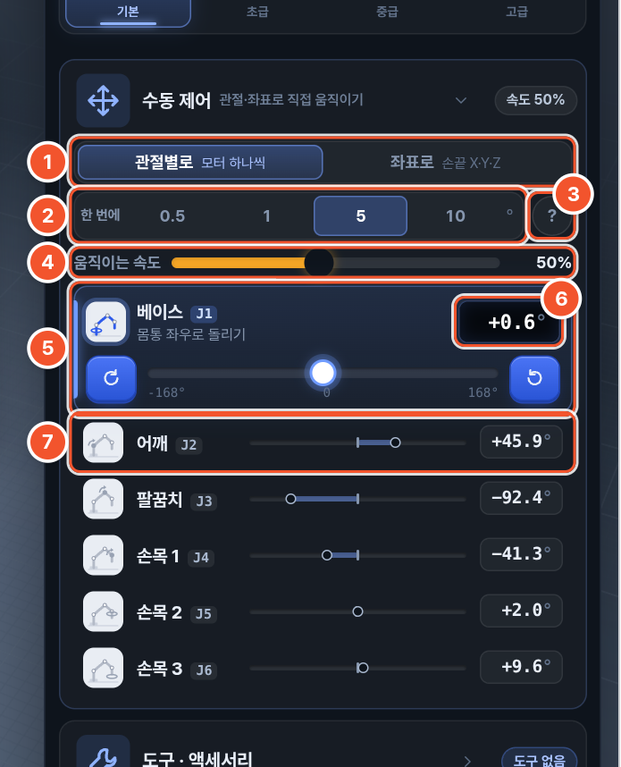
+++
::: marks
1. **[관절별로 | 좌표로]** — 관절(모터)을 하나씩 / 손끝을 X · Y · Z 로.
2. **한 번에** — 버튼을 짧게 한 번 누를 때 도는 각도(0.5 · 1 · 5 · 10°).
3. **[?]** — 쓰는 방법을 짧게 보여 줍니다.
4. **움직이는 속도** — 누르고 있을 때의 빠르기(10~100%).
5. **고른 관절** — 양옆 돌리기 버튼을 짧게 누르면 한 칸, **누르고 있으면 계속** 돕니다. 가운데 막대를 끌어도 됩니다.
6. **지금 각도** — 이 관절의 현재 각도. 한계에 가까우면 주황으로 바뀝니다.
7. **다른 관절** — 누르면 그 관절이 골라져 크게 펼쳐집니다.
:::
:::

- 관절 이름: 베이스(J1) · 어깨(J2) · 팔꿈치(J3) · 손목 1(J4) · 손목 2(J5) · 손목 3(J6).
- 3D 화면의 관절 점 ①~⑥ 을 누르면 그 관절이 골라지고, 나타나는 **링**을 끌어 돌릴 수도 있습니다.
- 키보드: **↑ ↓** 관절 고르기, **← →** 돌리기.

## 팔이 제 몸에 부딪히는 자세는 막습니다

관절을 돌려 팔이 **제 몸(다른 링크)이나 로봇 받침에 부딪히는** 자세가 되면, 팔은 그 자리에 멈추고 움직이지 않습니다.
그리고 어느 관절을 어느 쪽으로 바꾸면 되는지 알림으로 알려 줍니다.

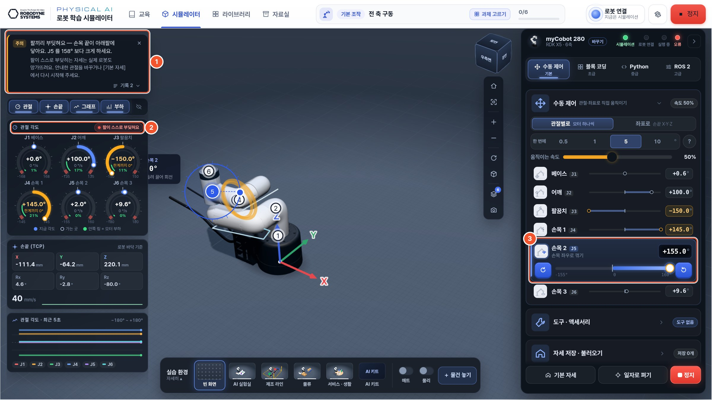

::: marks
1. **주의 알림** — 무엇이 어디에 닿는지와 바꿀 관절 · 방향. 예: "팔끼리 부딪혀요 — 손목 끝이 아래팔에 닿아요. J5 를 158° 보다 크게 하세요."
2. **모니터** — 상태가 빨간 **팔이 스스로 부딪혀요** 로 바뀝니다.
3. **막대** — 팔은 움직이기 전 자세 그대로이고, 막대를 놓으면 지금 각도로 돌아옵니다.
:::

- 알림대로 그 관절을 반대쪽으로 돌리거나, **[기본 자세]** 를 눌러 다시 시작하면 됩니다.
- 블록 · Python · ROS 2 프로그램도 실행하기 **전에** 같은 검사를 합니다. 부딪히는 줄이 있으면 아예 움직이지 않고, 줄 번호와 바꿀 관절을 빨간 **오류** 알림으로 보여 줍니다(6장).
- 팔이 **책상**에 닿으면 모니터에 빨간 글씨(예: "4번 관절이 책상에 닿아요.")로 알려 줍니다.

## 손끝을 X · Y · Z 로 움직이기 (좌표로)

[좌표로] 를 누르면 손끝을 앞뒤(X) · 좌우(Y) · 위아래(Z) 로 곧게 움직입니다.
로봇이 관절 여섯 개를 알아서 계산해 함께 돌립니다. 블록 바로 위로 손끝을 맞출 때 편합니다.

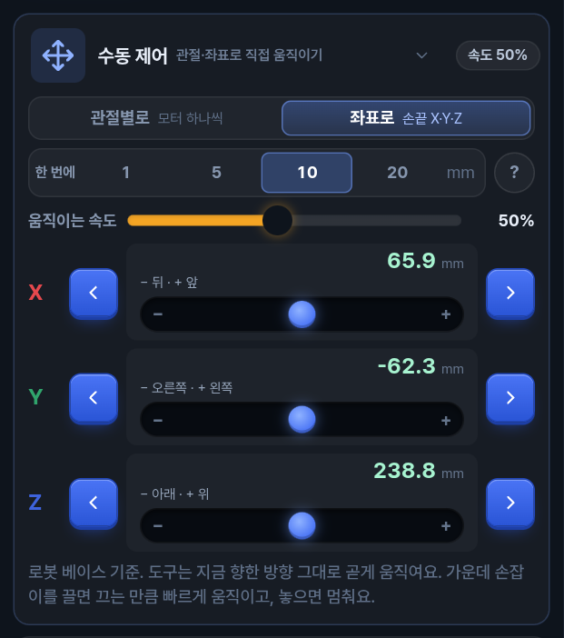{w=75}

- 줄마다 양옆 버튼은 한 번에 정한 길이(mm)만큼, 누르고 있으면 계속 움직입니다.
- 가운데 손잡이를 끌면 끄는 만큼 빠르게 움직이고, 놓으면 멈춥니다. 도구는 지금 향한 방향 그대로입니다.

> 팁: 팔이 닿지 않는 곳으로 보내면 움직이지 않고 이유를 알려 줍니다.

## 도구 · 액세서리 — 엔드이펙터 바꾸기

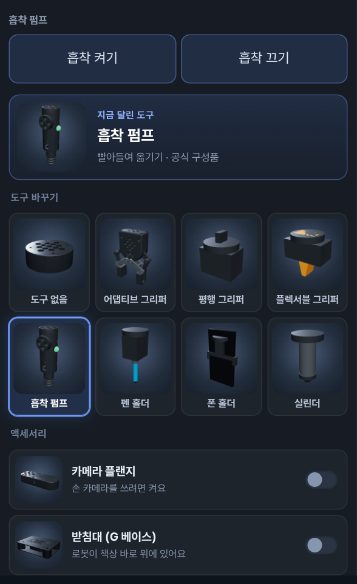{w=55}

- 맨 위는 지금 단 도구를 쓰는 버튼과 **지금 달린 도구** 카드입니다. 흡착 펌프면 [흡착 켜기] [흡착 끄기], 그리퍼면 [열기] [닫기], 펜 홀더면 [펜 내리기] [펜 올리기], 실린더면 [누르기].
- **도구 바꾸기**: 로봇 손끝에 다는 **엔드이펙터**를 고릅니다 — 도구 없음, 어댑티브 · 평행 · 플렉서블 그리퍼, 흡착 펌프, 펜 홀더, 폰 홀더, 실린더.
- **카메라 플랜지**: 손 카메라를 쓸 때 켭니다.
- **받침대 (G 베이스)**: 로봇 아래 받침대를 놓았으면 켜고 높이(mm)를 맞춥니다. 높이가 맞아야 블록을 정확히 집습니다.

## 자세 저장하고 다시 가기

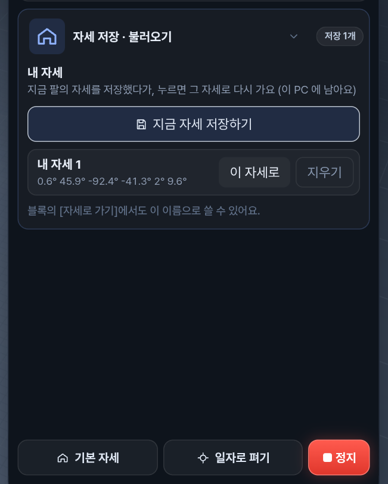{w=62}

- **[지금 자세 저장하기]**: 지금 자세를 "내 자세 1" 처럼 저장합니다. 목록의 **[이 자세로]** 를 누르면 그 자세로 다시 가고, [지우기] 로 지웁니다.
- 저장한 자세는 블록 코딩의 [자세로 가기] 블록에서 같은 이름으로 쓸 수 있습니다.
- **[기본 자세]**: 책상을 내려다보는 관찰 자세로 갑니다. 무엇을 하든 시작점으로 쓰기 좋습니다.
- **[일자로 펴기]**: 모든 관절을 0° 로 — 팔이 위로 곧게 섭니다.
- **[■ 정지]**: 움직임을 바로 멈춥니다.

## 로봇 상태 보기

작업 패널 위쪽의 **상태 불**을 누르면 로봇 상태가 펼쳐집니다: 모드(시뮬레이션 / 실제 로봇), 서보, 동작, 오류.
로봇에 연결되어 있으면 여기서 **[연결 확인]** · **[손으로 움직이기]** · **[영점 맞추기]** 를 합니다.

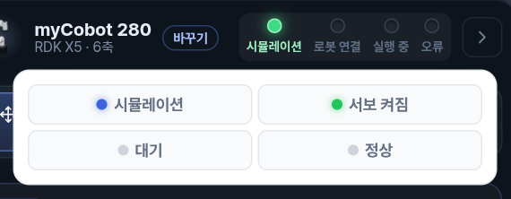{w=62}

## 따라 하기 — 첫 5분

::: step 기본 자세로
[수동 제어] 탭 맨 아래 **[기본 자세]** 를 누릅니다. 3D 로봇이 책상을 내려다보는 자세가 됩니다.
:::

::: step 베이스 돌려 보기
[관절별로] 에서 **베이스 J1** 의 오른쪽 돌리기 버튼을 누르고 있어 봅니다. 팔 전체가 수평으로 돕니다. 손을 떼면 멈춥니다.
:::

::: step 손끝 내리기
[좌표로] 로 바꾸고 **Z** 줄의 왼쪽(−) 버튼을 눌러 손끝을 내립니다. 모니터의 손끝 **Z** 숫자가 줄어드는 것을 봅니다.
:::

::: step 흡착해서 들어 올리기
도구 · 액세서리에서 **흡착 펌프** 를 고르고, 아래 실습 환경 막대의 **[매트]** 를 켜면 책상에 블록 4개가 놓입니다.
손끝을 블록 바로 위까지 내린 뒤 [흡착 켜기] → Z 의 오른쪽(+) 버튼으로 들어 올립니다. 블록이 손끝에 붙어 올라오면 성공입니다.
:::

# 블록 코딩 (초급)

## 화면 구성

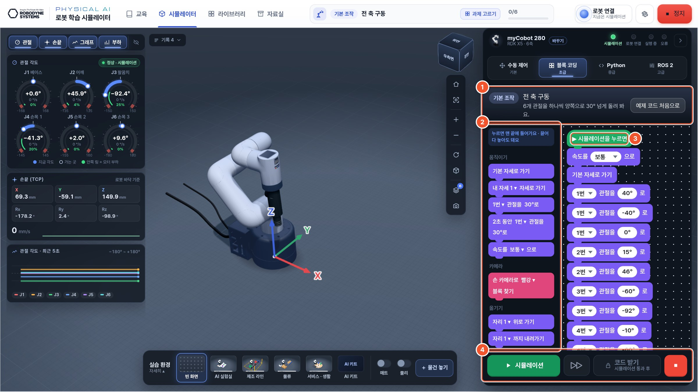

::: marks
1. **과제 카드** — 지금 과제의 주제 · 이름 · 할 일. [예제 코드 처음으로] 는 처음 예제로 되돌립니다.
2. **블록 꾸러미** — 움직이기 · 카메라 · 옮기기 · 흡착 펌프 · 반복 등 종류별 블록.
3. **내 프로그램** — "▶ 시뮬레이션을 누르면" 아래에 쌓인 순서대로 실행됩니다.
4. **실행 막대** — [▶ 시뮬레이션] · 빠르기 · [코드 받기] / [로봇 실행] · [■] 정지.
:::

## 블록 넣고 순서 바꾸기

- 꾸러미의 블록을 **누르면** 프로그램 맨 끝에 들어갑니다. 끌어다 원하는 자리에 놓아도 됩니다.
- 프로그램의 블록을 하나 눌러 고르면(파란 테두리) 새 블록은 **그 블록 바로 다음**에 들어갑니다.
- 블록을 고르면 위에 작은 버튼이 나옵니다: **↑ 위로 · ↓ 아래로 · 복사 · × 지우기**. 블록을 꾸러미 쪽으로 끌어다 놓아도 지워집니다.

::: cols
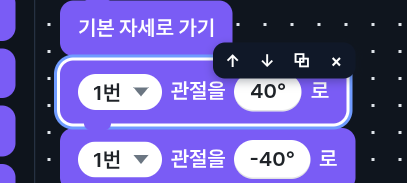
+++
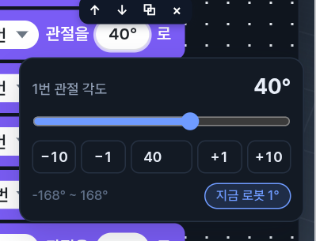
:::

## 숫자 바꾸기

블록의 흰 숫자(각도 · 초 · 횟수)를 누르면 작은 창이 열립니다.
막대를 끌거나 **−10 · −1 · +1 · +10** 을 누르거나, 숫자를 직접 씁니다.
**[지금 로봇 ○°]** 를 누르면 수동 제어로 맞춰 둔 로봇의 지금 각도가 그대로 들어갑니다. 로봇이 갈 수 없는 값은 들어가지 않습니다.

## 시뮬레이션하고 결과 보기

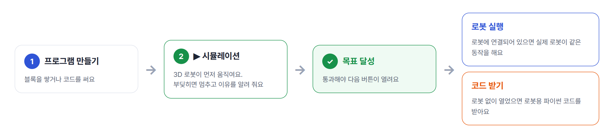

[▶ 시뮬레이션] (또는 **Ctrl + Enter**)을 누르면 3D 로봇이 프로그램대로 움직입니다.
실행 중에는 편집기가 잠기고, 알림 카드에 지금 하는 일이 나옵니다. 부딪히거나 닿지 않는 곳이 있으면 그 자리에서 멈추고 이유를 알려 줍니다.
팔이 **제 몸이나 받침에 부딪히는** 길은 실행하기 전에 미리 찾아, 아예 움직이지 않고 그 줄과 바꿀 관절을 알려 줍니다(5장).

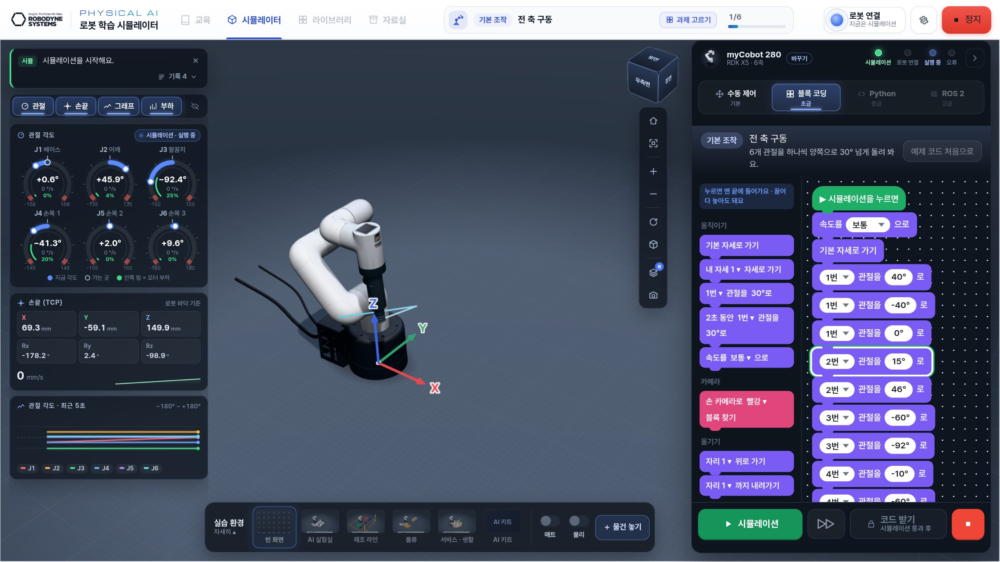

목표를 이루면 결과 카드와 **다시 보기 막대**가 나옵니다.

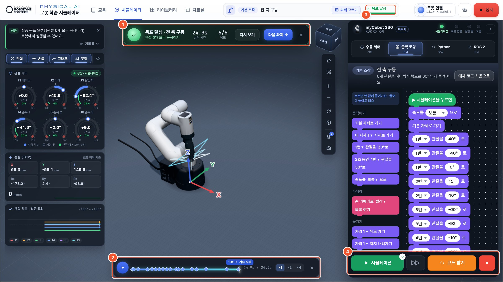

::: marks
1. **결과 카드** — 걸린 시간 · 목표. [다시 보기] 는 방금 실행을 처음부터 다시 보여 주고, [다음 과제 →] 는 다음 과제를 엽니다. 잠시 뒤 저절로 닫힙니다.
2. **다시 보기 막대** — 실행한 줄(블록)마다 눈금이 있습니다. 끌거나 ▶ 로 아무 순간이나 다시 봅니다. ×1 · ×2 · ×4 로 빠르기, [×] 로 닫으면 실습 환경 막대로 돌아갑니다.
3. **윗줄 진행 막대** — **✓ 목표 달성** 으로 바뀝니다.
4. **실행 막대** — [▶ 시뮬레이션] 에 ✓ 가 붙고 **[코드 받기]** (로봇에 연결되어 있으면 **[로봇 실행]**) 가 열립니다.
:::

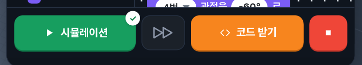{w=60}

| 버튼 | 하는 일 |
| --- | --- |
| [▶ 시뮬레이션] | 3D 로봇으로 먼저 실행 (Ctrl + Enter) |
| [▷▷] | 시뮬레이션 빠르기. 한 번 = 2배, 두 번 = 4배, 세 번 = 보통 (실제 로봇은 늘 제 속도) |
| [코드 받기] | 로봇에서 그대로 돌아가는 파이썬 코드 보기 · 복사 · 파일로 받기 |
| [로봇 실행] | 로봇에 연결되어 있을 때 — 같은 동작을 실제 로봇이 합니다 |
| [■] | 멈추기 (Esc, 실행 중이면 스페이스도) |

![[코드 받기] — 블록 프로그램이 로봇용 파이썬 코드로 바뀝니다](img/26-export.jpg){w=80}

## 따라 하기 — 전 축 구동

::: step 과제 열기
윗줄 [과제 고르기] 를 누르면 라이브러리의 **실습 과제** 가 열립니다. 「전 축 구동」 카드를 누르고, 작업 패널의 **[블록 코딩]** 탭을 엽니다.
:::

::: step 예제 읽기
프로그램에 이미 예제 블록이 있습니다. "1번 관절을 40° 로 → −40° 로 → 0° 로" 처럼 관절마다 양쪽으로 돌렸다 돌아옵니다.
:::

::: step 시뮬레이션
[▶ 시뮬레이션] 을 누르고, 여섯 관절이 차례로 도는 것을 봅니다. 윗줄 진행이 0/6 → 6/6 으로 채워집니다.
:::

::: step 바꿔 보기
숫자 하나를 바꿔(예: 40° → 60°) 다시 시뮬레이션해 봅니다. 너무 크게 바꾸면 어떻게 되는지도 확인해 봅니다.
:::

# Python (중급)

[Python] 탭에서는 실제 로봇에서 쓰는 공식 라이브러리 **pymycobot** 문법 그대로 코드를 씁니다.
코드는 PC 안에서 실행되고, 통과한 코드는 고치지 않고 실제 로봇에서도 그대로 돌아갑니다.

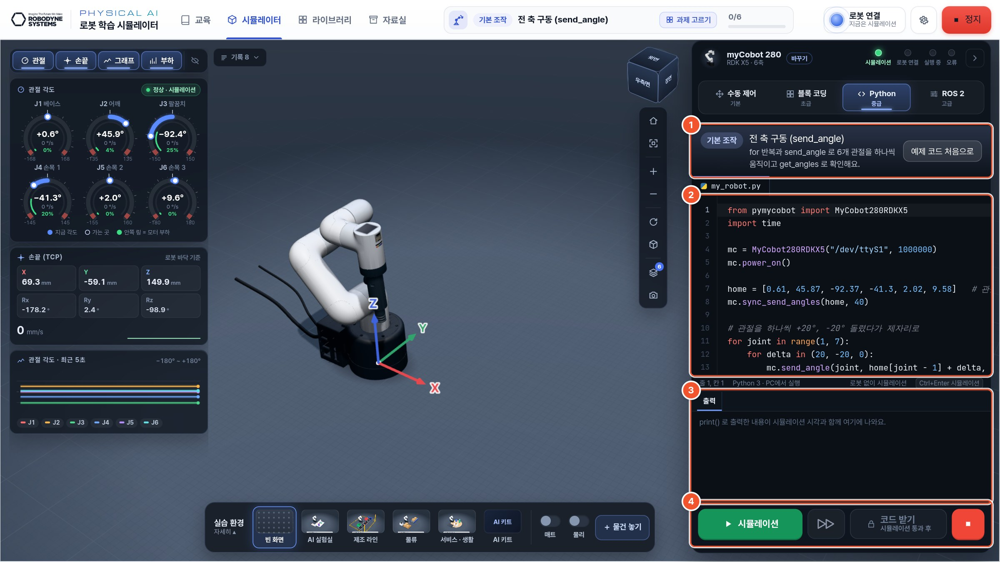

::: marks
1. **과제 카드** — 이 과제의 할 일. [예제 코드 처음으로] 로 되돌립니다.
2. **코드 편집기** — 줄 번호 · 색 입힌 코드. 실행 중인 줄은 초록, 오류 줄은 빨강으로 표시됩니다.
3. **출력** — `print()` 로 찍은 내용이 시각과 함께 나옵니다.
4. **실행 막대** — 블록 코딩과 같습니다. **Ctrl + Enter** 로 바로 시뮬레이션.
:::

![실행 결과 — 출력에 각 관절의 각도가 찍히고, 목표를 이루면 [코드 받기] 가 열립니다](img/28-python-run.jpg)

| 자주 쓰는 명령 | 뜻 |
| --- | --- |
| `mc = MyCobot280RDKX5("/dev/ttyS1", 1000000)` | 로봇과 연결 (맨 위에 한 번) |
| `mc.send_angles([0, 0, 0, 0, 0, 0], 40)` | 여섯 관절 각도로, 속도 40 |
| `mc.send_angle(1, 30, 40)` | 1번 관절만 30° 로 |
| `mc.send_coords([x, y, z, rx, ry, rz], 40, 0)` | 손끝을 좌표(mm, °)로 |
| `mc.get_angles()` · `mc.get_coords()` | 지금 각도 · 손끝 좌표 읽기 |
| `time.sleep(1)` | 1초 기다리기 (시뮬레이션에서는 바로 지나가고 3D 가 실제 속도로 보여 줌) |

> 팁: 오류가 나면 출력에 **몇 번째 줄**인지와 쉬운 설명이 나옵니다. 로봇 범위를 벗어난 각도는 실제 pymycobot 과 같은 오류 문장으로 알려 줍니다.

# ROS 2 (고급)

[ROS 2] 탭에서는 로봇 소프트웨어 표준인 **ROS 2** 의 파이썬 라이브러리(rclpy)로 노드를 만듭니다.
노드가 `/joint_states` 토픽으로 관절 각도를 보내면, 시뮬레이터 안의 로봇 드라이버 노드 `control_slider` 가 받아 팔을 움직입니다.

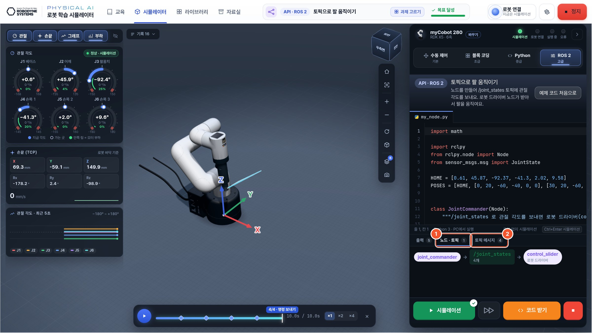

::: marks
1. **[노드 · 토픽]** — 내 노드 → 토픽 → 로봇 드라이버로 이어지는 그림 (`ros2 node list` 와 같은 정보).
2. **[토픽 메시지]** — 토픽으로 오간 메시지 목록 (`ros2 topic echo` 와 같은 정보).
:::

- 실제 로봇에서 ROS 2 로 돌릴 때는 [코드 받기] 창의 안내대로 터미널 두 개에서 드라이버와 내 노드를 실행합니다.
- 실습 과제: 토픽으로 팔 움직이기, 타이머로 반복 동작, ROS 2 노드 로봇에서 실행, 자유 실습.

# 과제와 실습 환경

## 과제 고르기 — 라이브러리의 실습 과제

윗줄의 지금 과제(**[과제 고르기]**)를 누르면 [라이브러리] 화면의 **실습 과제** 가 열립니다.

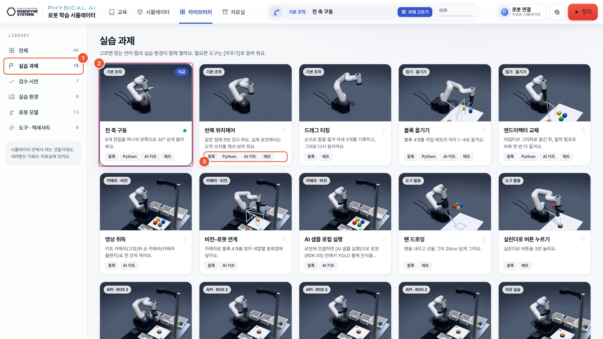

::: marks
1. **실습 과제** — 라이브러리 왼쪽의 칸. 옆 숫자는 과제 수입니다.
2. **지금 과제** — "지금" 표시가 붙은 카드. 위 왼쪽 글자는 주제입니다.
3. **할 수 있는 곳** — 블록 · Python · ROS 2 (언어), AI 키트 · 매트 (실습 환경).
:::

- 카드를 누르면 시뮬레이터로 돌아가 그 과제가 **맞는 언어 탭과 실습 환경**으로 열립니다. 필요한 도구가 없으면 과제 카드에 [끼우기] 가 나옵니다.
- 같은 과제를 다른 언어로 하려면 작업 패널의 탭을 바꿉니다. 그 언어에 같은 과제가 있으면 그대로 이어집니다.
- 카드 오른쪽 위 동그라미가 연한 초록이면 시뮬레이션 완료, 진한 초록이면 실제 로봇 완료입니다.

실습은 **기본 조작 · 집기 · 옮기기 · 카메라 · 비전 · 도구 활용 · API · ROS 2 · 자유 실습** 으로 나뉩니다.

## 검수 시연 — 납품 검수 7종

라이브러리의 **검수 시연** 은 납품 검수 항목 7가지를 하나씩 열어 보여 주는 칸입니다.
카드를 누르면 검수 시연 모드가 되고, 윗줄에 번호 1~7 이 생겨 한 번에 다른 검수로 갑니다.

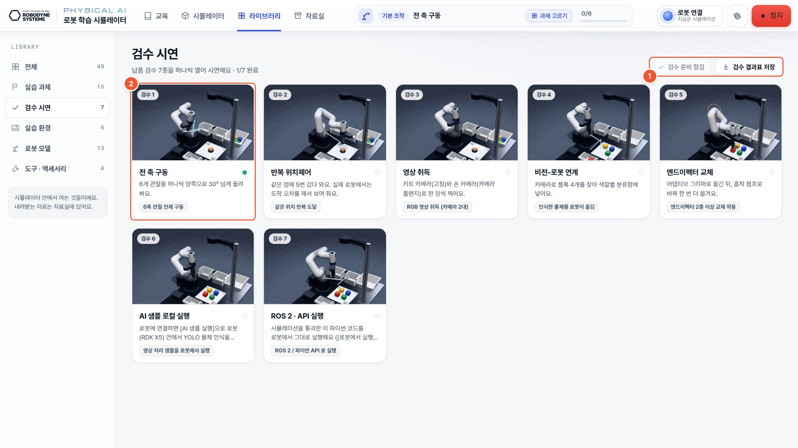

::: marks
1. **[검수 준비 점검]** (로봇에 연결했을 때) · **[검수 결과표 저장]** — 검수별 시각 · 실측값을 한 장으로 (열어서 인쇄 → PDF).
2. **검수 카드** — 번호 · 이름 · 할 일 · 기준.
:::

| 번호 | 검수 | 하는 일 |
| --- | --- | --- |
| 1 | 전 축 구동 | 여섯 관절을 하나씩 양쪽으로 |
| 2 | 반복 위치제어 | 같은 점에 5번 — 실제 로봇이면 도착점 퍼짐(mm)을 잽니다 |
| 3 | 영상 취득 | 키트 카메라와 손 카메라로 한 장씩 |
| 4 | 비전-로봇 연계 | 카메라로 블록 4개를 찾아 색깔별 분류함에 |
| 5 | 엔드이펙터 교체 | 그리퍼로 옮긴 뒤 흡착 펌프로 한 번 더 |
| 6 | AI 샘플 로컬 실행 | 로봇(RDK X5) 안에서 물체 인식을 돌려 처리 시간을 봅니다 |
| 7 | ROS 2 · API 실행 | 파이썬 API 코드와 ROS 2 실행 명령 |

## 실습 환경 막대 쓰기

3D 화면 아래의 **실습 환경 막대**에서 로봇이 놓인 장면과 책상 위를 바꿉니다.

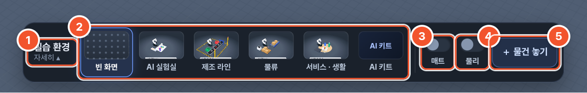

::: marks
1. **실습 환경 자세히** — 누르면 위로 실습 환경 창(환경 · 물건 · 물리)이 열립니다.
2. **장면** — 빈 화면 · AI 실험실 · 제조 라인 · 물류 · 서비스 · 생활 · AI 키트. 누르면 바로 그 장면으로 바뀝니다.
3. **[매트]** — 책상에 실습 매트와 블록 4개를 놓습니다. 매트를 쓰는 과제에서는 켜진 채 고정됩니다.
4. **[물리]** — 물리 엔진 켜기 · 끄기 (아래).
5. **[+ 물건 놓기]** — 실습 환경 창의 물건 칸을 엽니다.
:::

## 실습 환경 창 — 장면 고르기

::: cols
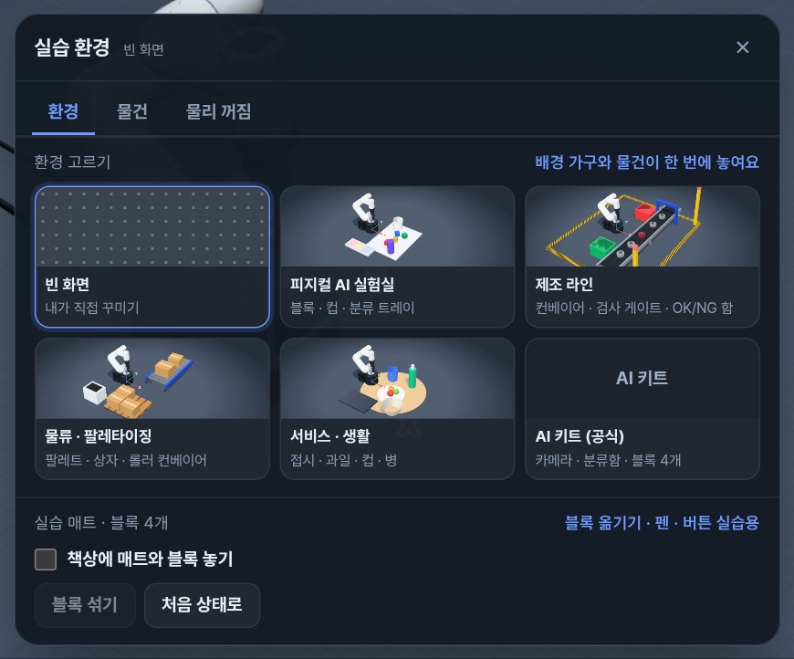
+++
| 장면 | 놓이는 것 |
| --- | --- |
| 빈 화면 | 내가 직접 꾸미기 |
| 피지컬 AI 실험실 | 블록 · 컵 · 분류 트레이 |
| 제조 라인 | 컨베이어 · 검사 게이트 · OK/NG 함 |
| 물류 · 팔레타이징 | 팔레트 · 상자 · 롤러 컨베이어 |
| 서비스 · 생활 | 접시 · 과일 · 컵 · 병 |
| AI 키트 (공식) | 카메라 · 분류함 · 블록 4개 |

장면을 바꾸면 그 장면의 물건으로 바뀝니다. 아래 **[블록 섞기]** 는 블록 자리를 무작위로 바꾸고(카메라로 찾는 연습), **[처음 상태로]** 는 블록과 로봇을 처음 자리로 되돌립니다.
:::

## 물건 놓고 옮기고 지우기

[+ 물건 놓기] (또는 실습 환경 창의 **물건** 칸)에서 블록 · 원기둥 · 택배 상자 · 컵 · 공 · 과일 · 부품 · 분류함 · 트레이 · 장애물을 골라 책상에 놓습니다.

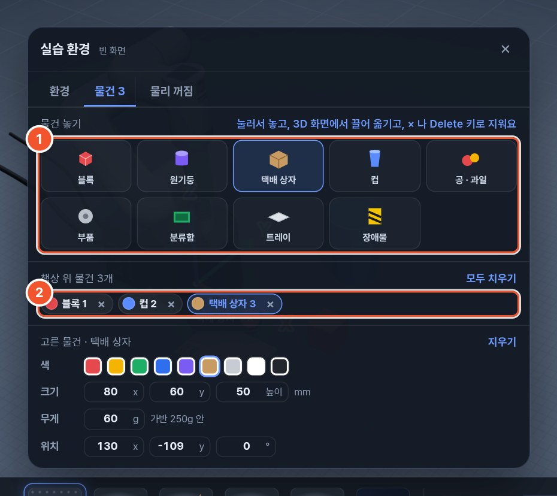{w=80}

::: marks
1. **물건 고르기** — 누르면 책상의 빈 자리에 하나 놓이고, 그 물건이 골라집니다.
2. **책상 위 물건 목록** — 눌러서 고르고, 옆의 × 로 지웁니다. [모두 치우기] 는 전부 지웁니다.
:::

고른 물건은 목록 아래에서 색 · 크기 · 무게 · 위치를 바꿀 수 있습니다. 3D 화면에서는 이렇게 다룹니다.

::: cols
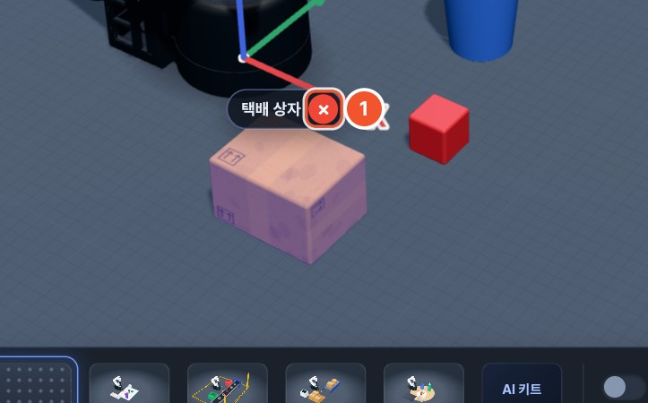
+++
- 물건을 **끌면** 책상 위에서 옮겨집니다. 물건을 누르면 그 물건이 골라집니다.
- 고른 물건 바로 위의 **×** (그림의 1)를 누르면 지워집니다.
- 물건을 고른 채 키보드 **Delete** 를 눌러도 지워집니다.
- 프로그램이 실행 중일 때는 물건을 옮기거나 지울 수 없습니다.
:::

## 물리 엔진 켜고 끄기

| 물리 | 이렇게 됩니다 |
| --- | --- |
| 끄기 | 팔이 물건에 닿으면 멈추고 알려 줍니다 (실제 로봇을 지키는 연습). 코딩 연습에 알맞습니다 |
| 켜기 | 물건에 무게 · 마찰이 생겨 떨어지고, 미끄러지고, 쓰러지고, 팔에 밀립니다. 흡착 펌프를 켜거나 그리퍼를 닫으면 손끝의 물건을 집습니다. 쌓기 · 분류 과제에 알맞습니다 |

실습 블록 4개는 물리와 상관없이 늘 정확하게 움직입니다. 장면의 가구(컨베이어 · 팔레트 등)에는 언제나 닿으면 멈춥니다.

## AI 키트 — 카메라 · 분류함 배치

막대의 **AI 키트** 를 고르면 공식 AI 키트 배치(카메라 거치대 · 분류함 · 블록 4개)가 됩니다. 카메라 · 비전 과제와 검수 시연에 씁니다.

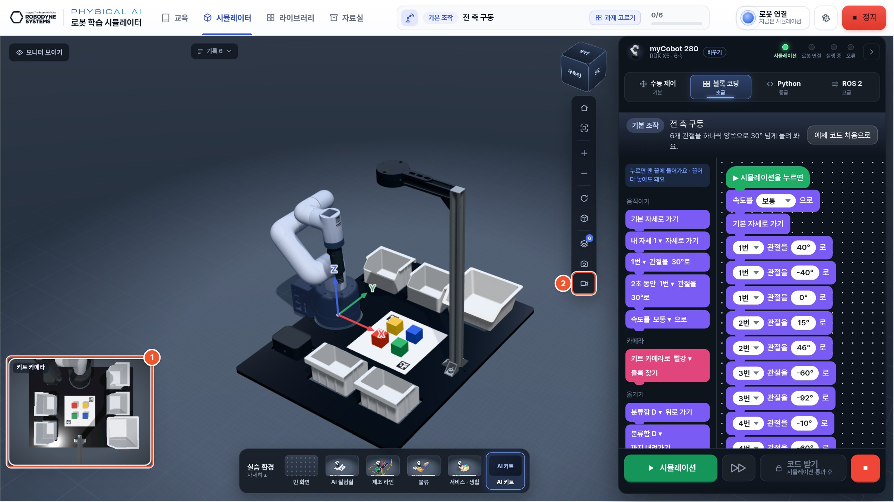

::: marks
1. **작은 카메라 화면** — 키트 카메라가 보는 모습. 누르면 큰 카메라 창(4장)이 열립니다.
2. **카메라** — 도구 막대에 생긴 카메라 버튼. 큰 카메라 창을 열고 닫습니다.
:::

# 실제 로봇과 연결하기

## 준비 — 같은 Wi-Fi

PC 와 로봇이 **같은 Wi-Fi(공유기)** 에 연결되어 있어야 합니다. 교실 전용 공유기 한 대를 권장합니다.

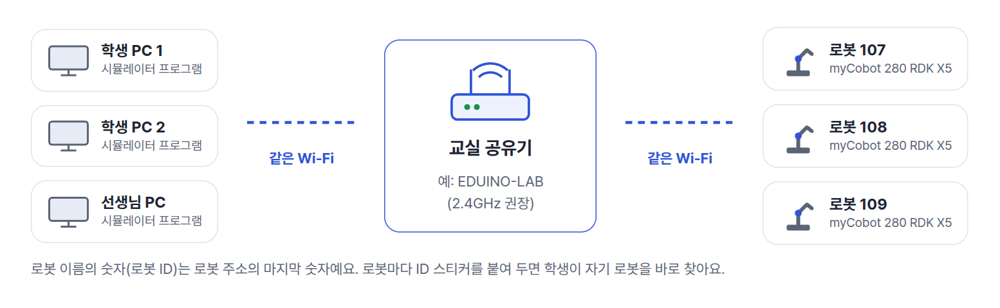

> 주의: 학교망 Wi-Fi 는 기기끼리 통신을 막아 둔 경우가 많습니다. 로봇이 목록에 안 나오면 교실 전용 공유기를 쓰세요. 접속할 때 웹 로그인 화면이 뜨는 Wi-Fi 는 쓸 수 없습니다.

## 로봇을 교실 Wi-Fi 에 붙이기 — USB

로봇은 USB 메모리의 `wifi.txt` 에 적힌 Wi-Fi 에 저절로 연결됩니다. 터미널 명령이 필요 없습니다.

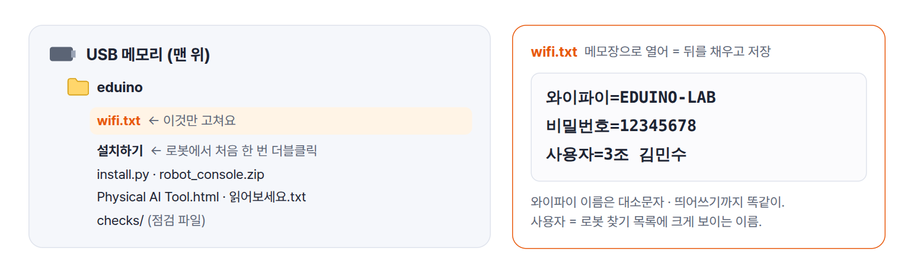

::: step USB 준비 (PC, 한 번)
받은 `eduino_usb.zip` 을 풀어 나온 **eduino 폴더**를 USB 메모리 맨 위에 복사합니다.
:::

::: step wifi.txt 고치기
`eduino/wifi.txt` 를 메모장으로 열어 와이파이 이름 · 비밀번호 · 사용자 이름을 적고 저장합니다.
:::

::: step 로봇마다 처음 한 번 — 설치
로봇에 모니터 · 마우스를 연결하고 USB 를 꽂은 뒤 eduino 폴더의 **설치하기** 를 더블클릭합니다.
"신뢰할 수 없는 실행 파일" 이 나오면 [그래도 실행], 비밀번호를 물으면 로봇 계정 비밀번호를 넣습니다. 약 5분 걸립니다.
:::

::: step 그다음부터 — 꽂기만
Wi-Fi 가 다른 교실로 갈 때는 PC 에서 `wifi.txt` 만 고쳐 저장하고, 로봇을 켠 지 1분 뒤 USB 를 꽂습니다.
20~60초 안에 로봇이 살짝 움직이면 연결된 것입니다. USB 의 `result-로봇이름.txt` 에 결과와 로봇 ID 가 적힙니다.
:::

## 로봇 찾아 연결하기

::: step 로봇 연결 창 열기
윗줄 **[로봇 연결]** 을 누릅니다(시작 화면에서는 [연결하기]).
:::

::: step 로봇 찾기
[로봇 찾기] 를 누르면 같은 Wi-Fi 의 로봇이 **사용자 이름 · IP · 로봇 ID** 로 나옵니다. 사람이 많으면 위 칸에 이름 · ID · IP 를 넣어 거릅니다.
:::

::: step 내 로봇 확인 · 연결
내 로봇인지 모르겠으면 **[움직여 확인]** — 그 로봇의 몸통이 살짝 돌았다가 돌아옵니다. 맞으면 **[연결]**.
윗줄에 "로봇 107 연결됨" 이 나오고, 3D 팔이 실제 팔의 자세를 따라갑니다.
:::

로봇 ID 를 알면 [ID 로 연결] 에 숫자만 넣어도 됩니다. 로봇은 전원을 켜고 1~2분 뒤에 목록에 나옵니다.

![[ID 로 연결] — 주소 앞부분과 로봇 ID](img/36-connect-id.jpg){w=80}

> 팁: [자료실] → **프로그램** 폴더의 **Physical AI Tool.html** (PC 프로그램)을 받아 바탕화면에 두면, 다음부터 더블클릭만으로 같은 Wi-Fi 의 로봇을 찾아 바로 엽니다.

## 시뮬레이션 → 실제 로봇

로봇에 연결되면 실행 막대의 [코드 받기] 가 **[로봇 실행]** 으로 바뀝니다.
순서는 같습니다: **[▶ 시뮬레이션] 통과 → [로봇 실행]**. 시뮬레이션을 통과하지 않은 프로그램은 로봇으로 보내지 않습니다.

> 안전: 실행하기 전에 로봇 주변(팔이 닿는 반경 약 30 cm)을 비우세요. 이상하면 바로 **Esc** 또는 윗줄 **[■ 정지]** 를 누릅니다.
> 처음 쓰는 로봇이거나 화면과 실제 팔의 자세가 다르면 작업 패널 위쪽 상태 불 → **[영점 맞추기]** 를 먼저 합니다.

- 속도는 최대 50 으로 제한되고, 모든 관절 각도는 로봇 한계 안에서만 보냅니다.
- 팔이 제 몸에 부딪히는 자세는 실제 로봇으로도 보내지 않습니다(5장).
- 목표 자세에 제시간에 도착하지 못하면(무언가에 막힘) 멈추고 알려 줍니다.
- 서보를 풀어 팔이 떨어지게 하는 명령은 로봇으로 보내지 않습니다.

# 라이브러리와 자료실

## 라이브러리 — 시뮬레이터에 여는 것

윗줄 **[라이브러리]** 는 시뮬레이터에서 열 수 있는 모든 것을 카드로 모은 화면입니다.
카드마다 시뮬레이터에서 녹화한 짧은 움직이는 그림이 있고, 누르면 시뮬레이터로 돌아가 그것이 바로 열립니다.

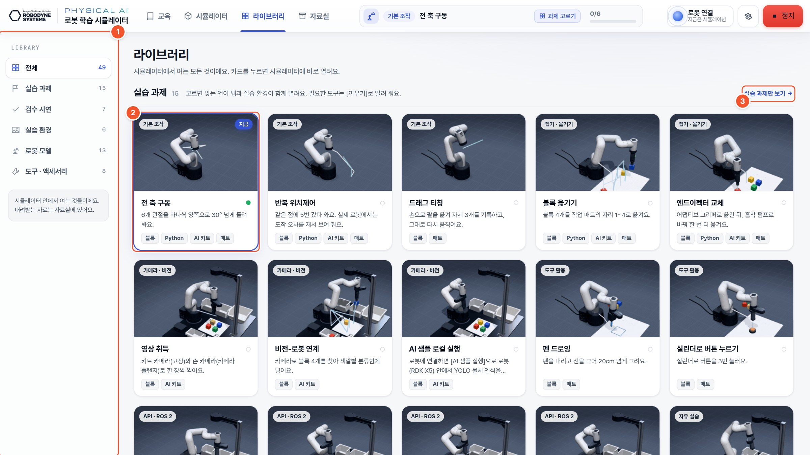

::: marks
1. **칸** — 전체 · 실습 과제 · 검수 시연 · 실습 환경 · 로봇 모델 · 도구 · 액세서리. 옆 숫자는 카드 수입니다.
2. **카드** — 움직이는 그림, 이름, 한 줄 설명, 할 수 있는 언어 · 환경. 지금 열린 것에는 "지금" 이 붙습니다.
3. **[… 만 보기 →]** — 그 칸만 크게 봅니다.
:::

| 칸 | 카드를 누르면 |
| --- | --- |
| 실습 과제 | 그 과제가 맞는 언어 탭과 실습 환경으로 열립니다(9장) |
| 검수 시연 | 검수 시연 모드로 그 검수가 열립니다 |
| 실습 환경 | 그 장면이 시뮬레이터에 바로 놓입니다 |
| 로봇 모델 | 그 로봇의 3D 모델 · 관절 범위 · 실습이 열립니다 |
| 도구 · 액세서리 | 로봇 손끝의 도구가 바로 바뀝니다 |

## 자료실 — 내려받기

윗줄 **[자료실]** 은 수업에 쓰는 파일을 폴더별로 모은 화면입니다. Windows 의 파일 탐색기처럼 씁니다.
모두 프로그램 안에 들어 있어 인터넷이 없어도 받을 수 있습니다.

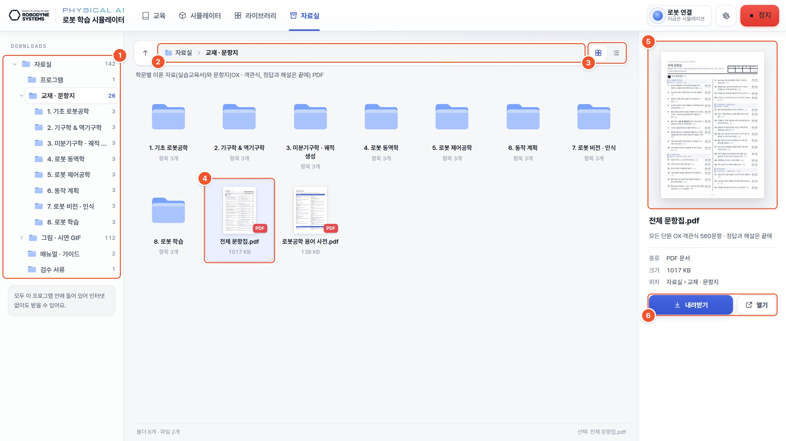

::: marks
1. **폴더 목록** — 프로그램, 교재 · 문항지, 그림 · 시연 GIF, 매뉴얼 · 가이드, 검수 서류. 옆 숫자는 파일 수이고, [›] 로 안의 폴더를 펼칩니다.
2. **경로** — 지금 폴더의 위치. 앞 폴더 이름을 누르거나 [↑] (Backspace) 로 올라갑니다.
3. **[큰 아이콘 | 목록]** — 보는 방식. 목록은 이름 · 종류 · 크기로 보여 줍니다.
4. **파일** — 한 번 누르면 고르고, 두 번 누르면 엽니다. 폴더는 두 번 눌러 들어갑니다. 화살표 키로도 고릅니다.
5. **미리 보기** — 고른 파일의 첫 쪽 그림 · 설명 · 종류 · 크기 · 위치.
6. **[내려받기] [열기]** — 파일을 다운로드 폴더에 받거나 새 창에서 엽니다.
:::

| 폴더 | 들어 있는 것 |
| --- | --- |
| 프로그램 | PC 프로그램 **Physical AI Tool.html** — 바탕화면에 두고 더블클릭하면 같은 Wi-Fi 의 로봇을 찾아 엽니다 |
| 교재 · 문항지 | 단원별 이론 교재 · OX 문항지 · 객관식 문항지 PDF, 전체 문항집 · 용어 사전 |
| 그림 · 시연 GIF | 단원 · 차시별 원리 그림 애니메이션과 실습 시연 GIF |
| 매뉴얼 · 가이드 | 이 매뉴얼과 「교사용 교육 가이드라인」 PDF |
| 검수 서류 | 검수 결과표 — 검수별 시각 · 실측값 한 장 (열어서 인쇄 → PDF) |

# 교육 탭 — 커리큘럼 지도

윗줄 **[교육]** 에서는 로봇공학 **8개 단원 · 28차시** 수업을 합니다. 처음 열면 **수업 대상**(고등학교 50분 · 대학교 75분)과 **우리 학교 장비**를 고른 뒤 **커리큘럼 지도**가 나옵니다.

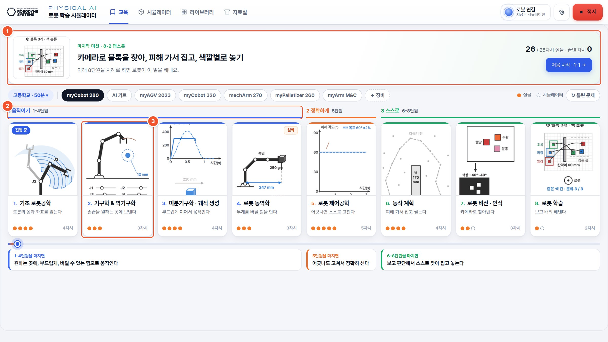{w=84}

::: marks
1. **마지막 미션** — 과정 끝에 로봇이 해낼 일. 오른쪽 버튼(**[처음 시작]** 또는 **[이어서]**)으로 수업을 엽니다.
2. **세 단계** — 1 움직이기 → 2 정확하게 → 3 스스로. 8개 단원이 이 순서로 쌓입니다.
3. **단원 타일** — 누르면 오른쪽에 **단원 미리보기**가 열립니다. 차시를 고르고 [수업 시작 →] 을 누릅니다.
:::

- 수업 화면은 위쪽 **단계 막대**(도입 · 개념 · 활동 1 · 2 · 3 · 정리 · 평가), 3D 화면 위의 **활동 패널**, 오른쪽 **수업 카드**로 되어 있습니다.
- 수업 대상과 장비는 지도 위쪽에서 언제든 바꿀 수 있습니다.
- 자세한 수업 운영은 「교사용 교육 가이드라인」을 보세요([자료실] → 매뉴얼 · 가이드).

# 문제가 생기면

| 증상 | 해결 |
| --- | --- |
| exe 를 눌러도 아무것도 안 열림 | 압축을 푼 폴더에서 실행했는지 확인. 엣지 또는 크롬이 있어야 합니다 |
| "Windows의 PC 보호" 창 | [추가 정보] → [실행] (2장) |
| 3D 로봇이 안 보이거나 화면이 느림 | 새로고침(F5). 다른 프로그램을 닫습니다. 모니터를 감추거나 표시 메뉴의 보조선을 줄이면 가벼워집니다 |
| 화면에서 로봇을 잃어버림 | 도구 막대의 **전체 맞춤** 또는 **처음 시점** |
| 팔이 움직이지 않고 "부딪혀요" 알림 | 알림이 말한 관절을 반대쪽으로 돌리거나 [기본 자세] (5장) |
| 블록이 엉망이 됨 | 과제 카드의 [예제 코드 처음으로] |
| 블록 · 로봇이 처음 자리가 아님 | 실습 환경 창의 [처음 상태로] (9장) |
| 놓은 물건을 치우고 싶음 | 실습 환경 창 → 물건 → [모두 치우기] |
| [코드 받기] 가 잠겨 있음 | [▶ 시뮬레이션] 을 먼저 통과해야 열립니다 |
| 로봇이 목록에 안 나옴 | PC 와 로봇이 같은 Wi-Fi 인지, 로봇을 켜고 1~2분 기다렸는지, 주소 앞부분이 맞는지 확인 |
| "로봇 서버와 연결이 끊겼어요" | 로봇 전원 · Wi-Fi 확인. 화면이 스스로 다시 시도하며, [다시 연결] 로 바로 확인 |
| "로봇 팔이 대답하지 않아요" | 팔 전원 · 케이블 확인 후 [다시 연결] |
| 화면과 실제 팔의 자세가 다름 | 상태 불 → [영점 맞추기] |
| 끄고 싶음 | 시뮬레이터 창과 뒤의 검은 창을 함께 닫습니다 |

## 단축키

| 키 | 하는 일 |
| --- | --- |
| Esc | 모든 동작 멈추기 (어느 화면이든) |
| 스페이스 | 실행 중일 때 멈추기 |
| Ctrl + Enter | 시뮬레이션 (블록 · Python · ROS 2) |
| ↑ ↓ | [수동 제어] 에서 관절 고르기 |
| ← → | 고른 관절 돌리기 |
| + − | 3D 화면 확대 · 축소 |
| Delete | 3D 화면에서 고른 물건 지우기 |
